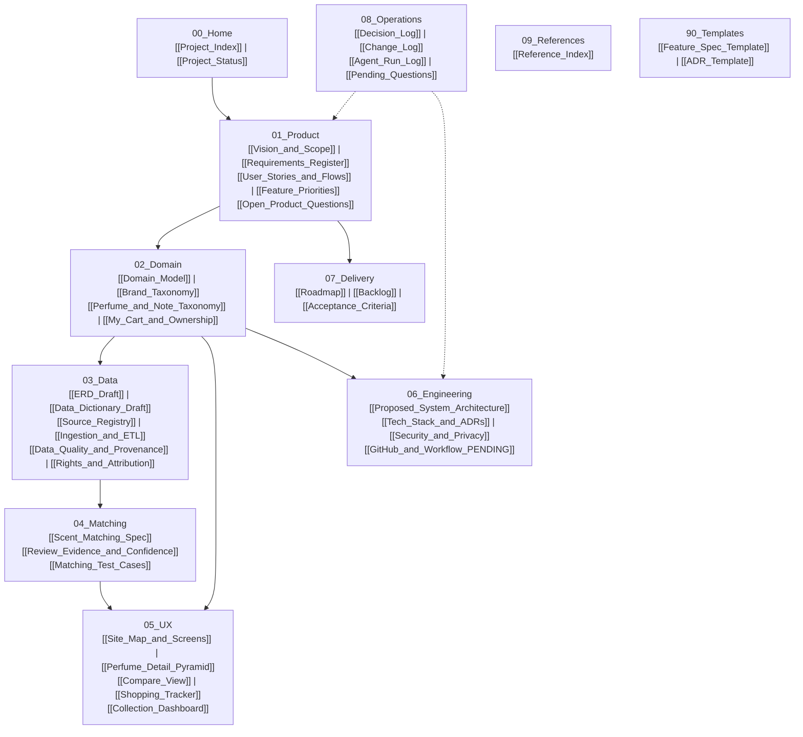

# Project Index — DoomParfum By TK

## Post-PR13–17 verified integration — 2026-11-13

Current integration: [[DPT-DOC-002_Post_PR13_17_Integration]], [[DPT-DOC-002_Post_PR13_17_Preflight]],
[[Next_Wave_Owner_Decision_Form]], [[Normalization_Closure_and_Materialization_Transition]].
Separate new task PRs are registered after actual publication; no broken cross-branch links.

## Post-merge Waves 0–2 — 2026-11-13

Current merged-state and review entry point: [[Project_Status]], [[Post_Merge_Owner_Review_Matrix]],
[[DPT-DOC-001_Post_Merge_Waves]], [[Post_Merge_Verification_Evidence]],
[[DPT-DOC-001_Post_Merge_Tool_Observation]]. Separate-lane PR links and exact source heads belong in
the review matrix so this branch does not introduce broken cross-branch Wikilinks.

> **Map of Content (MOC) & Documentation Hub**
> ยินดีต้อนรับสู่ Obsidian Vault ของระบบ **DoomParfum By TK** เอกสารชุดนี้รวบรวมพิมพ์เขียว (Blueprint), ข้อกำหนดระบบ (Requirements), แบบจำลองข้อมูล (Domain & Data), กลไกการจับคู่กลิ่น (Scent Matching), การออกแบบประสบการณ์ผู้ใช้ (UX), สถาปัตยกรรมวิศวกรรม (Engineering), แผนงาน (Delivery), และบันทึกการตัดสินใจ (Operations)

---

## 1. Quick Navigation (สารบัญแผนผังความรู้)

---

## 2. Directory Structure & Key Documents

### `00_Home` — ศูนยกลางและสถานะโครงการ
- [[Project_Index]]: แผนผังนำทางภาพรวม (หน้านี้)
- [[Project_Status]]: สถานะความคืบหน้าปัจจุบัน อุปสรรค (Blockers) และลำดับงานถัดไป

### `01_Product` — วิสัยทัศน์และข้อกำหนดเชิงผลิตภัณฑ์
- [[Vision_and_Scope]]: วิสัยทัศน์ ปัญหาที่แก้ไข (Pain Points) ผู้ใช้งานเป้าหมาย งบประมาณ และสิ่งที่ไม่ทำ (Non-goals)
- [[Requirements_Register]]: ทะเบียนข้อกำหนด R01 ถึง R31 พร้อมสถานะและ Priority
- [[User_Stories_and_Flows]]: เรื่องราวผู้ใช้และโฟลว์หลัก (ค้นพบจาก TikTok -> หาตัวเลือกกลิ่นคล้าย -> เพิ่มตะกร้าในแอป -> ซื้อจริง -> จัดการคอลเลกชัน)
- [[Feature_Priorities]]: การจัดลำดับความสำคัญตามระยะโครงการ (P0–P6)
- [[Open_Product_Questions]]: รวมประเด็นคำถามทางผลิตภัณฑ์ที่ยังรอการตัดสินใจจากผู้ใช้

### `02_Domain` — แบบจำลองเชิงธุรกิจและอนุกรมวิธาน
- [[Domain_Model]]: Bounded Contexts (Catalogue, Scent, Matching, Research, Shopping Tracker, Ownership, User)
- [[Brand_Taxonomy]]: การจัดหมวดหมู่แบรนด์ ประเทศต้นกำเนิด และตำแหน่งทางการตลาด พร้อมรายชื่อแบรนด์ไทยโฟกัส
- [[Perfume_and_Note_Taxonomy]]: ความสัมพันธ์ Perfume vs Variant vs Listing, Top/Heart/Base, Accords/Families
- [[My_Cart_and_Ownership]]: คำจำกัดความสำคัญของ In-App Cart (ไม่มี Checkout), Buying Sources, Ordered, Received, Owned และ Previously Owned

### `03_Data` — โครงสร้างข้อมูลและธรรมาภิบาล
- [[ERD_Draft]]: แผนผังความสัมพันธ์เอนทิตี (Mermaid ERD)
- [[Data_Dictionary_Draft]]: พจนานุกรมข้อมูลร่างระบุฟิลด์ ชนิดข้อมูล Nullable และ Foreign Keys
- [[Source_Registry]]: ทะเบียนแหล่งข้อมูลภายนอกและสถานะสิทธิ์การใช้งาน
- [[Ingestion_and_ETL]]: ไปป์ไลน์การนำเข้า ทำความสะอาด จัดกลุ่ม และตรวจสอบข้อมูล
- [[Data_Quality_and_Provenance]]: แหล่งที่มาของข้อมูลระดับฟิลด์ การจัดการข้อมูลขัดแย้ง และการป้องกันข้อมูลปลอม
- [[Rights_and_Attribution]]: นโยบายลิขสิทธิ์ สิทธิ์การเข้าถึง และการอ้างอิงแหล่งที่มา

### `04_Matching` — กลไกเปรียบเทียบกลิ่นและหลักฐาน
- [[Scent_Matching_Spec]]: สูตรคำนวณความคล้ายเชิงโครงสร้าง (Pyramid 40%, Accords 25%, Family 15%, Evidence 20% - Proposed)
- [[Review_Evidence_and_Confidence]]: การจัดเก็บหลักฐานความเห็นจากชุมชน/รีวิว และค่าความเชื่อมั่น
- [[Matching_Test_Cases]]: กรณีทดสอบการจับคู่กลิ่นจำลอง

### `05_UX` — ข้อมูลจำเพาะหน้าจอและการใช้งาน
- [[Site_Map_and_Screens]]: แผนผังเว็บไซต์และรายการหน้าจอหลัก
- [[Perfume_Detail_Pyramid]]: รายละเอียดหน้า Perfume Detail และการแสดงผลพีระมิดโน้ตพร้อมรูปภาพ
- [[Compare_View]]: หน้าระบบเปรียบเทียบสองรุ่นเคียงข้าง (Side-by-Side)
- [[Shopping_Tracker]]: หน้าจัดการตะกร้าในแอป บันทึกลิงก์ร้านค้า และบันทึกการสั่งซื้อ
- [[Collection_Dashboard]]: หน้าแดชบอร์ดสรุปสถิติน้ำหอมที่เคยซื้อและที่มีอยู่ในครอบครอง

### `06_Engineering` — สถาปัตยกรรมและเทคโนโลยี
- [[Proposed_System_Architecture]]: แผนผังระบบที่นำเสนอ (Next.js, PostgreSQL, Drizzle, Docker)
- [[Tech_Stack_and_ADRs]]: สแต็กเทคโนโลยีและแนวทางการจัดทำ Architectural Decision Records
- [[Security_and_Privacy]]: นโยบายความปลอดภัย การเก็บข้อมูลส่วนบุคคล และความปลอดภัยของลิงก์ภายนอก
- [[GitHub_and_Workflow_PENDING]]: เวิร์กโฟลว์การพัฒนา Two-Gate Development Workflow (อ้างอิง `../DEVELOPMENT_WORKFLOW.md` และ `../AGENTS.md`)

### `07_Delivery` — แผนงานและการส่งมอบ
- [[Roadmap]]: แผนการส่งมอบระยะ P0 ถึง P6
- [[Backlog]]: รายการงานที่ต้องทำตามลำดับความสำคัญและขึ้นต่อกัน
- [[Acceptance_Criteria]]: เกณฑ์การตรวจรับงานในแต่ละฟังก์ชัน
- โฟลเดอร์ `Tasks/`: บันทึกงานรายข้อสำหรับ Agent
- โฟลเดอร์ `Planning_PRs/`: ข้อกำหนดสำหรับ Planning PRs แต่ละรอบ

### `08_Operations` — บันทึกการดำเนินงานและการตัดสินใจ
- [[Decision_Log]]: บันทึกการตัดสินใจทางสถาปัตยกรรมและผลิตภัณฑ์ (DEC-001 ถึง DEC-009)
- [[Change_Log]]: บันทึกการเปลี่ยนแปลงข้อกำหนดและแบบจำลองข้อมูล
- [[Agent_Run_Log]]: บันทึกประวัติการทำงานของ Agent แต่ละรอบ
- [[Pending_Questions]]: บันทึกคำถามที่ยังรอคำตอบเพื่อความชัดเจน
- โฟลเดอร์ `Receipts/`: ใบเสร็จสรุปงานและผลทดสอบ (Immutable Receipts)
- โฟลเดอร์ `Handoffs/`: ชุดส่งต่องานระหว่าง Agent (Continuity Packs)

### `09_References` & `90_Templates`
- [[Reference_Index]]: ดัชนีแหล่งข้อมูลอ้างอิง เว็บไซต์ และเอกสารเทคนิค
- [[Feature_Spec_Template]]: แม่แบบสำหรับร่างสเปกฟีเจอร์ใหม่
- [[ADR_Template]]: แม่แบบสำหรับบันทึกการตัดสินใจทางสถาปัตยกรรม

---

## 3. Core Principles & Non-Negotiables

1. **Private-first Research App:** ไม่ใช่ E-commerce ไม่มีระบบจ่ายเงินจริง ตะกร้าเป็นสมุดจดส่วนตัว
2. **Clear Decision Status:** แยกสถานะ `[CONFIRMED]`, `[PROPOSED]`, `[RESEARCH]`, `[DEFERRED]` อย่างเข้มงวด
3. **Data Provenance & Rights:** ไม่กวาดข้อมูล (Scrape) ละเมิดสิทธิ์ ไม่เก็บข้อมูลที่ไม่มีที่มา และไม่ประดิษฐ์คะแนนขึ้นมาเอง
4. **Distinction between Cart and Ownership:** สถานะ Cart, Ordered, Purchased, Owned และ Previously Owned แยกออกจากกันเด็ดขาด
