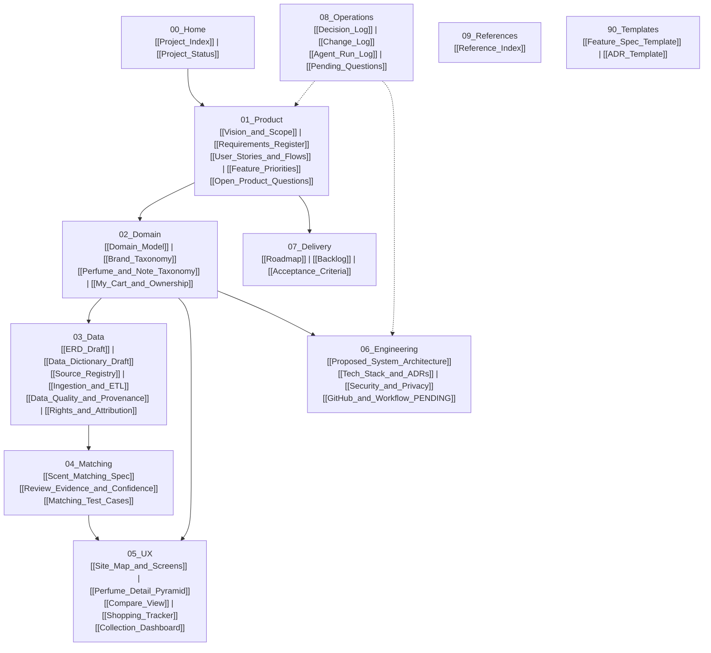

# Project Index — DoomParfum By TK

## Post-PR13–17 verified integration — 2026-11-13

Current integration: [[DPT-DOC-002_Post_PR13_17_Integration]], [[DPT-DOC-002_Post_PR13_17_Preflight]],
[[Next_Wave_Owner_Decision_Form]], [[Normalization_Closure_and_Materialization_Transition]].
Separate new task PRs are registered after actual publication; no broken cross-branch links.

## Post-merge Waves 0–2 — 2026-11-13

Current merged-state and review entry point: [[Project_Status]], [[Post_Merge_Owner_Review_Matrix]],
[[DPT-DOC-001_Post_Merge_Waves]], [[Post_Merge_Verification_Evidence]],
[[DPT-DOC-001_Post_Merge_Tool_Observation]]. Separate-lane PR links and exact source heads belong in
the review matrix so this branch does not introduce broken cross-branch Wikilinks.

> **Map of Content (MOC) & Documentation Hub**
> ยินดีต้อนรับสู่ Obsidian Vault ของระบบ **DoomParfum By TK** เอกสารชุดนี้รวบรวมพิมพ์เขียว (Blueprint), ข้อกำหนดระบบ (Requirements), แบบจำลองข้อมูล (Domain & Data), กลไกการจับคู่กลิ่น (Scent Matching), การออกแบบประสบการณ์ผู้ใช้ (UX), สถาปัตยกรรมวิศวกรรม (Engineering), แผนงาน (Delivery), และบันทึกการตัดสินใจ (Operations)

---

## 1. Quick Navigation (สารบัญแผนผังความรู้)

---

## 2. Directory Structure & Key Documents

### `00_Home` — ศูนยกลางและสถานะโครงการ
- [[Project_Index]]: แผนผังนำทางภาพรวม (หน้านี้)
- [[Project_Status]]: สถานะความคืบหน้าปัจจุบัน อุปสรรค (Blockers) และลำดับงานถัดไป

### `01_Product` — วิสัยทัศน์และข้อกำหนดเชิงผลิตภัณฑ์
- [[Vision_and_Scope]]: วิสัยทัศน์ ปัญหาที่แก้ไข (Pain Points) ผู้ใช้งานเป้าหมาย งบประมาณ และสิ่งที่ไม่ทำ (Non-goals)
- [[Requirements_Register]]: ทะเบียนข้อกำหนด R01 ถึง R31 พร้อมสถานะและ Priority
- [[User_Stories_and_Flows]]: เรื่องราวผู้ใช้และโฟลว์หลัก (ค้นพบจาก TikTok -> หาตัวเลือกกลิ่นคล้าย -> เพิ่มตะกร้าในแอป -> ซื้อจริง -> จัดการคอลเลกชัน)
- [[Feature_Priorities]]: การจัดลำดับความสำคัญตามระยะโครงการ (P0–P6)
- [[Open_Product_Questions]]: รวมประเด็นคำถามทางผลิตภัณฑ์ที่ยังรอการตัดสินใจจากผู้ใช้

### `02_Domain` — แบบจำลองเชิงธุรกิจและอนุกรมวิธาน
- [[Domain_Model]]: Bounded Contexts (Catalogue, Scent, Matching, Research, Shopping Tracker, Ownership, User)
- [[Brand_Taxonomy]]: การจัดหมวดหมู่แบรนด์ ประเทศต้นกำเนิด และตำแหน่งทางการตลาด พร้อมรายชื่อแบรนด์ไทยโฟกัส
- [[Perfume_and_Note_Taxonomy]]: ความสัมพันธ์ Perfume vs Variant vs Listing, Top/Heart/Base, Accords/Families
- [[My_Cart_and_Ownership]]: คำจำกัดความสำคัญของ In-App Cart (ไม่มี Checkout), Buying Sources, Ordered, Received, Owned และ Previously Owned

### `03_Data` — โครงสร้างข้อมูลและธรรมาภิบาล
- [[ERD_Draft]]: แผนผังความสัมพันธ์เอนทิตี (Mermaid ERD)
- [[Data_Dictionary_Draft]]: พจนานุกรมข้อมูลร่างระบุฟิลด์ ชนิดข้อมูล Nullable และ Foreign Keys
- [[Source_Registry]]: ทะเบียนแหล่งข้อมูลภายนอกและสถานะสิทธิ์การใช้งาน
- [[Ingestion_and_ETL]]: ไปป์ไลน์การนำเข้า ทำความสะอาด จัดกลุ่ม และตรวจสอบข้อมูล
- [[Data_Quality_and_Provenance]]: แหล่งที่มาของข้อมูลระดับฟิลด์ การจัดการข้อมูลขัดแย้ง และการป้องกันข้อมูลปลอม
- [[Rights_and_Attribution]]: นโยบายลิขสิทธิ์ สิทธิ์การเข้าถึง และการอ้างอิงแหล่งที่มา

### `04_Matching` — กลไกเปรียบเทียบกลิ่นและหลักฐาน
- [[Scent_Matching_Spec]]: สูตรคำนวณความคล้ายเชิงโครงสร้าง (Pyramid 40%, Accords 25%, Family 15%, Evidence 20% - Proposed)
- [[Review_Evidence_and_Confidence]]: การจัดเก็บหลักฐานความเห็นจากชุมชน/รีวิว และค่าความเชื่อมั่น
- [[Matching_Test_Cases]]: กรณีทดสอบการจับคู่กลิ่นจำลอง

### `05_UX` — ข้อมูลจำเพาะหน้าจอและการใช้งาน
- [[Site_Map_and_Screens]]: แผนผังเว็บไซต์และรายการหน้าจอหลัก
- [[Perfume_Detail_Pyramid]]: รายละเอียดหน้า Perfume Detail และการแสดงผลพีระมิดโน้ตพร้อมรูปภาพ
- [[Compare_View]]: หน้าระบบเปรียบเทียบสองรุ่นเคียงข้าง (Side-by-Side)
- [[Shopping_Tracker]]: หน้าจัดการตะกร้าในแอป บันทึกลิงก์ร้านค้า และบันทึกการสั่งซื้อ
- [[Collection_Dashboard]]: หน้าแดชบอร์ดสรุปสถิติน้ำหอมที่เคยซื้อและที่มีอยู่ในครอบครอง

### `06_Engineering` — สถาปัตยกรรมและเทคโนโลยี
- [[Proposed_System_Architecture]]: แผนผังระบบที่นำเสนอ (Next.js, PostgreSQL, Drizzle, Docker)
- [[Tech_Stack_and_ADRs]]: สแต็กเทคโนโลยีและแนวทางการจัดทำ Architectural Decision Records
- [[Security_and_Privacy]]: นโยบายความปลอดภัย การเก็บข้อมูลส่วนบุคคล และความปลอดภัยของลิงก์ภายนอก
- [[GitHub_and_Workflow_PENDING]]: เวิร์กโฟลว์การพัฒนา Two-Gate Development Workflow (อ้างอิง `../DEVELOPMENT_WORKFLOW.md` และ `../AGENTS.md`)

### `07_Delivery` — แผนงานและการส่งมอบ
- [[Roadmap]]: แผนการส่งมอบระยะ P0 ถึง P6
- [[Backlog]]: รายการงานที่ต้องทำตามลำดับความสำคัญและขึ้นต่อกัน
- [[Acceptance_Criteria]]: เกณฑ์การตรวจรับงานในแต่ละฟังก์ชัน
- โฟลเดอร์ `Tasks/`: บันทึกงานรายข้อสำหรับ Agent
- โฟลเดอร์ `Planning_PRs/`: ข้อกำหนดสำหรับ Planning PRs แต่ละรอบ

### `08_Operations` — บันทึกการดำเนินงานและการตัดสินใจ
- [[Decision_Log]]: บันทึกการตัดสินใจทางสถาปัตยกรรมและผลิตภัณฑ์ (DEC-001 ถึง DEC-009)
- [[Change_Log]]: บันทึกการเปลี่ยนแปลงข้อกำหนดและแบบจำลองข้อมูล
- [[Agent_Run_Log]]: บันทึกประวัติการทำงานของ Agent แต่ละรอบ
- [[Pending_Questions]]: บันทึกคำถามที่ยังรอคำตอบเพื่อความชัดเจน
- โฟลเดอร์ `Receipts/`: ใบเสร็จสรุปงานและผลทดสอบ (Immutable Receipts)
- โฟลเดอร์ `Handoffs/`: ชุดส่งต่องานระหว่าง Agent (Continuity Packs)

### `09_References` & `90_Templates`
- [[Reference_Index]]: ดัชนีแหล่งข้อมูลอ้างอิง เว็บไซต์ และเอกสารเทคนิค
- [[Feature_Spec_Template]]: แม่แบบสำหรับร่างสเปกฟีเจอร์ใหม่
- [[ADR_Template]]: แม่แบบสำหรับบันทึกการตัดสินใจทางสถาปัตยกรรม

---

## 3. Core Principles & Non-Negotiables

1. **Private-first Research App:** ไม่ใช่ E-commerce ไม่มีระบบจ่ายเงินจริง ตะกร้าเป็นสมุดจดส่วนตัว
2. **Clear Decision Status:** แยกสถานะ `[CONFIRMED]`, `[PROPOSED]`, `[RESEARCH]`, `[DEFERRED]` อย่างเข้มงวด
3. **Data Provenance & Rights:** ไม่กวาดข้อมูล (Scrape) ละเมิดสิทธิ์ ไม่เก็บข้อมูลที่ไม่มีที่มา และไม่ประดิษฐ์คะแนนขึ้นมาเอง
4. **Distinction between Cart and Ownership:** สถานะ Cart, Ordered, Purchased, Owned และ Previously Owned แยกออกจากกันเด็ดขาด

## Post-PR18–21 current audit and gates

- [[DPT-DOC-003_Post_PR18_21_Catalogue_Wave]]
- [[Post_PR18_21_Implementation_Gate_Audit]]
- [[DPT-DOC-003_Wave0_Evidence]]
- [[Next_Wave_Owner_Decision_Form]]

## Current observed-audit closeout

- [[DPT-DOC-003_Wave_Closeout]]
- Exact filename/branch/worker-head manifest: `08_Operations/Test_Evidence/DPT-DOC-003_Exact_File_Manifest.json`.

## Post-PR22–25 current review checkpoint

- [[Post_PR22_25_Owner_Review_and_Unlock]]

## Synthetic M1 implementation — 2026-11-14

- [[M1_Exact_Owner_Acceptance]] — exact dated version/hash and synthetic-only scope.
- [[M1_Notes_Layered_Typed_Contract]] — unchanged accepted artifact; historical proposal wording retained.
- [[IMP-MATCH-08_Synthetic_M1]] — isolated implementation task and actual current status.
- [[IMP-MATCH-08_Synthetic_M1_Evidence]] — actual RED/GREEN, properties, regressions and independent review.
- [[M1_Contract_Preparation]], [[M1_Next_B1_Owner_Packet]], [[M1_Parallel_Data_Readiness_Checkpoint]]
  and [[M1_Preparation_Preflight_and_Gate]] — preserved dated preparation annexes, not new B1/data approvals.

## Post-M1 exact B1 Owner gate — 2026-11-15

PR26 is Owner-merged at604d447e599aa8359d3427dfbfbceaac85373e48. [[B1_Contract_Preparation]]
contains current execution facts. [[B1_Positive_Domain_Typed_Contract]] / [[B1_Exact_Owner_Decision_Batch]]
and [[B1_Final_Owner_Review_Summary]] bind the reviewed77bfca59... proposal. Owner explicitly has
not approved implementation; current principle agreement is not exact version/hash acceptance.
Target IMP-MATCH-03 remains synthetic-only pure typed Python after exact approval;80/20 PROPOSED.
No branch/code/PR/receipt or broader DM/OP/source/real-data/app approval is inferred.
[[B1_Data_Enrichment_and_Acquisition_Backlog]] and [[B1_Media_Rights_Inventory_and_Sample_Proposal]]
are separate current-wave bounded research outputs; import/binary intake and rights remain gated.

## Exact synthetic B1 scope accepted — 2026-11-15

[[B1_Exact_Owner_Acceptance]] records explicit Human Owner approval of B1-PD-TYPED-1 revision2,
SHA-25677bfca59dab449313eb02def8c30ff355e341a2b88397dbc412a09af970a5977,
mc-b1-pyramid-positive-domain-p1/configb1-pd-typed-config-1/schemab1-pd-typed-schema-1.
This accepts the complete4/5Coverage+1/5Focus typed synthetic IMP-MATCH-03 contract and its
exact gates, schemas, bounds, errors and ordering. Earlier NOT APPROVED and principle-only entries
remain dated history. Other broader DM/OP, real-source closure, rights, alias, app/session,
publication and acquisition choices are not accepted by this scoped decision.
[[IMP-MATCH-03_Synthetic_B1]] owns current implementation/TDD/evidence/review status. Only one
task branch/Draft PR is authorized; no agent merge or real-data activation. Existing M1 unchanged.
[[IMP_MATCH_03_Data_Research_Continuation]] and [[IMP_MATCH_03_Media_Research_Continuation]] record
separate bounded research done in parallel: no entity/API/sample acquisition or image bytes.

## Post-PR27 consolidated planning checkpoint — 2026-11-15

- [[Post_PR27_Consolidated_Next_Wave_Plan]] and [[Post_PR27_Owner_Decision_Packet]].
- [[Post_PR27_Data_Readiness_and_Pilot]]; [[Post_PR27_Media_Rights_and_Storage]].
- [[Post_PR27_Application_Integration_and_Security]]; [[ADR_Post_PR27_Local_Private_Integration_Proposed]].
- [[DPT-PLAN-009_Post_PR27_Next_Wave]]; [[DPT-PLAN-009_Post_PR27_Verification]]; [[Post_PR27_Local_Diagnostics]].

Main `8eef8f13265adc14db0cae82ff77cfc4863853ce` contains Owner-merged PR26/27; wider data/media/app gates remain proposed. PR8 blocked; no Production mutation.

## Post-PR28 architecture refinement checkpoint — 2026-11-16

- [[System_Architecture_Refinement]]; [[C4_Context_and_Container_Design]]; [[Component_and_Dependency_Registry]].
- [[Unified_Information_Architecture]]; [[UI_Element_Function_Matrix]]; [[State_and_Error_Contracts]].
- [[Function_Interface_and_DTO_Contracts]]; [[Authorization_and_Trust_Boundaries]]; [[Data_and_Media_Lifecycle_Architecture]]; [[Cache_Offline_and_Privacy_Policy]].
- [[Architecture_Technical_Research_Python]]; [[Architecture_Technical_Research_Security]]; [[Architecture_Technical_Research_UX]].
- [[Architecture_Alternatives_and_ADR]]; [[Dependency_Based_Implementation_Roadmap]]; [[Architecture_Owner_Review_Packet]].
- [[DPT-PLAN-010_System_Architecture_Refinement]]; [[DPT-PLAN-010_Architecture_Verification]].

Main `168715bc9bc5fff968524074257dc106a8a63638` includes Owner-merged PR28; all new design/implementation choices remain proposed. Existing exact contracts/receipts preserved; PR8 blocked.

## IMP-ENR-01 implementation and evidence index — 2026-11-17

- [[IMP-ENR-01_Pinned_Scento_Offline_Preview]] — approved scope and session/evidence ledger.
- [[IMP_ENR_01_Preflight.json]] — exact authority/pins/protection.
- [[IMP_ENR_01_Architecture_Compatibility]] — fresh preimplementation gate/matrix.
- [[IMP_ENR_01_Independent_Data_Review]] — independent46-slot review; completion status is explicit.

- [[IMP_ENR_01_Field_Review_Mapping]] —46sanitized locator/state/outcome rows.
- [[IMP_ENR_01_Implementation_Boundary]] —actualfunctions, scope and limits.
- [[IMP_ENR_01_Implementation_Review.json]], [[IMP_ENR_01_Offline_Regression.json]], [[IMP_ENR_01_Private_Publication.json]] —exact independent/regression/publication evidence.

## DPT-PLAN-011 post-PR30 planning navigation

Owner-merged PR30/main `4f23cbc858dd818b149674342bfa504e78930088`; [[DPT-PLAN-011_Post_PR30_Data_App_Media_Readiness]] coordinates the next docs-only planning task. Earlier dated PR30 Draft/planning statements remain history.

- [[Post_PR30_Data_App_Media_Readiness_Plan]] — integrated scope, requirements and acceptance.
- [[Post_PR30_Canonical_Field_Review_Packet]] — all46slots/20columns, human dispositions remain pending.
- [[Post_PR30_First_Readonly_Web_Slice_ADR]] and [[Post_PR30_Principal_and_Authorization_Plan]] — stack alternatives, genuine principal, least privilege and proposed transport.
- [[Post_PR30_Element_Function_Slice_Matrix]] — catalogue/detail and safe private interactions.
- [[Post_PR30_Media_Rights_Readiness]] —23retainedleads, conditional rights and proposed original-only path.
- [[Post_PR30_Dependency_and_Gate_Map]] and [[Post_PR30_Dependency_Model.json]] —13packet-local units/22prerequisite edges; no global implementation IDs allocated.
- [[Post_PR30_Owner_Decision_Packet]] — POST30-ODP-1,15PROPOSED/UNANSWERED decisions; no implementation authority.

Historical runtime tests remain historical; current planning static/review/publication evidence follows actual checkpoints. No source/asset/DB/Production change or agent merge.

## Governance — task intake and PR routing

- [[DPT-GOV-WORKFLOW-001_Task_PR_Routing_and_Obsidian_Reporting]]: proposed task-intake classification, PR routing, mandatory session recording, read-only review exception and publication rules. ACCEPTANCE PENDING; not merged.
  - 2026-11-22: merged by the Owner in [PR33](https://github.com/kraveerachat/DoomParfum-By-TK/pull/33) at `0daafbb`; the governance is in effect on `main` (see [[Project_Status]]).

## DPT-GATE-012 / U01 security gate navigation

- [[DPT-GATE-012_U01_Security_Gate]] — canonical status, r1–r12 history and registers for the proposed P30-U01 field-review security contract; nothing approved or implemented.
- [[DPT-GATE-012_U01_Security_History_and_Recovery_Index]] — artifact inventory, evidence classes, publication omissions and continuation rules.
- [[DPT-GATE-012_U01_r12_Authoring_Handoff]]: sanitized r12 authoring brief (inputs, R11-IR-01/02 remediation, LOW dispositions, invariants, review conditions). r12 was authored from it on 2026-11-20 (S4); its independent review is PENDING.
- [[DPT-GATE-012_U01_Security_Resumption_Handoff]]: freeze of 2026-11-22 (S9): frozen r12–r14 artifact hashes, open findings, gates, Owner decisions and the next authorized step (independent r14 review). SECURITY_DOCUMENTATION_SNAPSHOT / PROPOSED DESIGN / NOT APPROVED.

## Overall project handoff navigation

- [[2026-11-23_DPT-DOC-004_Overall_Project_Handoff]]: overall handoff after closeout Stages 1–4 (2026-11-23): verified baseline, implementation status by area, PR8 / IMP-P1-04 deferred-work record, web dependency assessment, proposed mock-only shell task and Owner actions. Task: [[DPT-DOC-004_Overall_Project_Handoff]].
- [[2026-11-23_IMP-P1-04_S6_Report]]: Stage 3 PR8 disposition assessment (its closing recommendation is superseded by the Owner's keep-open decision).

## Luxury frontend planning — 2026-11-23

- [[DPT-PLAN-012_Luxury_Frontend_Editorial]] — canonical task and S1 records
- [[Luxury_Reference_Research_Matrix]] — twenty reference sites, observed versus proposed
- [[Luxury_Routes_and_Wireframes]] — five-route mock shell and centered navigation
- [[Luxury_Design_Tokens_and_Components]] — proposed tokens and motion
- [[Luxury_Mock_Fixture_Contract]] — synthetic fixtures and isolation
- [[Luxury_Docker_Runtime_Proposal]] — local preview/development specification
- [[Luxury_Frontend_Acceptance_and_Task_Map]] — future tests and work units
- [[Luxury_Design_Critique_and_Audit]] — requested planning passes
- [[Luxury_Frontend_Draft_PR_Description]] — local proposed PR body, not published

### IMP-WEB-01 — luxury mock frontend implementation (2026-11-24)

- [[IMP-WEB-01_Luxury_Frontend_Docker]] — canonical implementation task
- [[2026-11-24_IMP-WEB-01_S1_Report]], [[2026-11-24_IMP-WEB-01_S1_Summary]]
- [[2026-11-24_IMP-WEB-01_S2_Report]], [[2026-11-24_IMP-WEB-01_S2_Summary]]
- [[2026-11-25_IMP-WEB-01_S3_Report]], [[2026-11-25_IMP-WEB-01_S3_Summary]]

## 2026-11-25 — IMP-WEB-01 S4 recovery/publication reconciliation

[PR36](https://github.com/kraveerachat/DoomParfum-By-TK/pull/36) OPEN/DRAFT, feat/imp-web-01-luxury-frontend; published starting cda91ff7ba00a44d5b8be53a2dbff68553c6736c, reviewed code449178093ed7616570cf651f8b5e4f3cc2d3001e, fetched main61932bef147816272a06cbe6eba9363940fa4baf. Owner decisions1–10 accepted only for current local mock;11 explicitly defers unavailable A05manual checks. A05 remains PARTIAL; A10second-machineLAN NOT RUN. Final Human visual/local-mock acceptance and receipt still pending.

[[IMP-WEB-01_Luxury_Frontend_Docker]], [[2026-11-25_IMP-WEB-01_S4_Report]], [[2026-11-25_IMP-WEB-01_S4_Summary]].

New S4 records supersede historical publication/decision status without changing old reports/evidence. No new task or final receipt.

## 2026-11-26 — IMP-WEB-01 S5 Frontend V1 closeout

[[IMP-WEB-01_Luxury_Frontend_Docker]], [[2026-11-26_IMP-WEB-01_S5_Report]], [[2026-11-26_010500_IMP-WEB-01_Luxury_Frontend_Docker]], [[2026-11-26_IMP-WEB-01_S5_Summary]].

## 2026-11-26 — DPT-PLAN-013 Frontend V1.1 planning amendment

[[DPT-PLAN-013_Frontend_V1_1_Design_Upgrade]], [[DPT-PLAN-013_Frontend_V1_1_Amendment]], [[DPT-PLAN-013_Draft_PR_Description]], [[2026-11-26_DPT-PLAN-013_S1_Report]], [[2026-11-26_DPT-PLAN-013_S1_Summary]], [[2026-11-26_020413_DPT-PLAN-013_Frontend_V1_1_Planning]]. V1 baseline: [[IMP-WEB-01_Luxury_Frontend_Docker]].

## 2026-11-26 — IMP-WEB-02 Frontend V1.1

[[IMP-WEB-02_Frontend_V1_1]], [[IMP-WEB-02_CP4_Owner_Review]], [[IMP-WEB-02_Translation_Review]], [[2026-11-26_IMP-WEB-02_S1_Report]], [[2026-11-26_IMP-WEB-02_S1_Summary]].

## 2026-11-26 — IMP-WEB-02 S2

[[2026-11-26_IMP-WEB-02_S2_Report]], [[2026-11-26_IMP-WEB-02_S2_Summary]], [[IMP-WEB-02_CP5_Translation_Review]]. [[IMP-WEB-02_Frontend_V1_1]]
