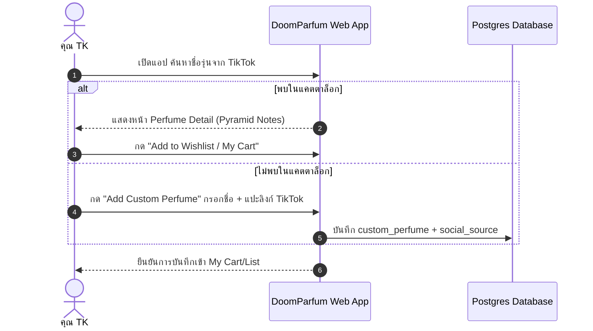
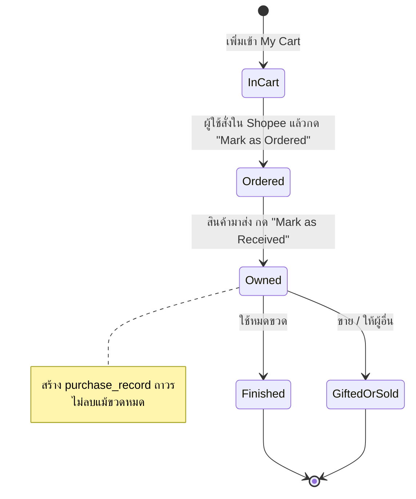

# User Stories and Flows — DoomParfum By TK

> **Document Type:** User Journey & Interaction Workflows
> **Source Baseline:** `../README.md` (Section 2.2)
> **Status:** Draft / Partially Confirmed

---

## 1. Overview & Core Personas

**Persona หลัก: คุณ TK (Perfume Enthusiast & Smart Value Shopper)**
- ชื่นชอบการค้นพบน้ำหอมใหม่ ๆ จากโซเชียลมีเดีย (TikTok, YouTube, กลุ่มน้ำหอม)
- ชอบทดลองน้ำหอมแบรนด์ Designer / Niche แต่ต้องการหาตัวเลือกราคาย่อมเยา (คุ้มค่าในช่วง ฿1,000–฿2,000) ที่มีแนวกลิ่นใกล้เคียง
- ซื้อน้ำหอมจากร้านค้าออนไลน์ (เช่น Shopee) หลายร้าน ต้องการเก็บลิงก์ บันทึกสถานะ และดูสถิติย้อนหลังว่าเคยมีหรือเคยซื้อรุ่นใดบ้าง

---

## 2. Core User Scenarios & End-to-End Flows

### Scenario A: เจอรีวิวใน TikTok แล้วบันทึกเข้าสู่ระบบ (Social Discovery -> In-App Wishlist)
1. **Trigger:** ผู้ใช้เลื่อน TikTok เจอน้ำหอมแบรนด์ไทย เช่น `BE CHERIE White Instinct` หรือ `SÚNDALO Rhapsody Sky`
2. **Action:** เปิดเว็บแอป DoomParfum ค้นหาชื่อรุ่น
   - *Case 1 (มีในระบบแล้ว):* กดเข้าหน้า Perfume Detail ตรวจสอบ Notes/Accords แล้วกด `Add to Wishlist` หรือ `Add to My Cart`
   - *Case 2 (ยังไม่มีในระบบ):* กดปุ่ม `+ Add Custom Perfume` กรอกชื่อรุ่น แบรนด์ แปะลิงก์คลิป TikTok (Social Source) และระบุโน้ตเบื้องต้น
3. **Outcome:** รายการถูกบันทึกไว้ในระบบ ไม่สูญหาย พร้อมสืบค้นต่อ

---

### Scenario B: เลือก Designer เป็นตัวอ้างอิง แล้วค้นหาทางเลือกที่คุ้มค่า (Reference -> Alternative)
1. **Trigger:** สนใจน้ำหอม Designer เช่น `Dior Sauvage` หรือ `Bleu de Chanel` แต่อยากรู้ว่ามีแบรนด์อาหรับหรือแบรนด์ไทยตัวไหนที่กลิ่นคล้ายในงบ <= ฿2,000
2. **Action:**
   - ค้นหา `Dior Sauvage` แล้วกดปุ่ม `Find Alternatives / Dupe Comparison`
   - ระบบประมวลผล Scent DNA Matching กรองตามงบประมาณ (<= ฿2,000) และแบรนด์ (เช่น Lattafa, Armaf, แบรนด์ไทย)
3. **Review:** ผู้ใช้กดเปรียบเทียบ Side-by-Side ดูโน้ตที่ตรงกัน โน้ตที่ต่าง และหลักฐานรีวิวที่ได้รับรอง
4. **Outcome:** ผู้ใช้เลือกรุ่นทางเลือกที่น่าสนใจ (เช่น `Afnan Modest Une` หรือแบรนด์ทางเลือกอื่น) แล้วส่งเข้า `My Cart`

---

### Scenario C: จัดการตะกร้าในแอป และเพิ่มร้านค้า Shopee หลายแห่ง (In-App Cart & Multi-Source)
1. **Trigger:** มีน้ำหอมอยู่ใน `My Cart` แล้ว ต้องการเลือกร้านที่จะสั่งซื้อ
2. **Action:**
   - ในหน้า `My Cart` ผู้ใช้กด `+ Add Buying Source`
   - แปะลิงก์ร้าน Shopee ร้านที่ 1: ราคา ฿1,250 ขนาด 100ml พร้อมโน้ต "ร้าน mall ส่งไว"
   - แปะลิงก์ร้าน Shopee ร้านที่ 2: ราคา ฿1,100 ขนาด 100ml พร้อมโน้ต "ร้านหิ้วมีโค้ดลดวัน Payday"
3. **Protection:** หากผู้ใช้พยายามกด Add น้ำหอมรุ่นเดิมเข้า Cart ซ้ำ ระบบจะแจ้งเตือนว่า "มีรุ่นนี้ในตะกร้าแล้ว ต้องการเพิ่มลิงก์ร้านค้าใหม่หรือไม่?" (R30)
4. **Outcome:** ข้อมูลร้านค้าถูกบันทึกไว้เทียบราคา ผู้ใช้สามารถคลิกเปิดลิงก์ภายนอกไปยัง Shopee ได้ทันที

---

### Scenario D: สั่งซื้อภายนอกแล้ว และรับสินค้าเข้าคอลเลกชัน (Manual Transition: Cart -> Ordered -> Owned)
1. **Step 1 (Order Placed):** ผู้ใช้ไปสั่งซื้อที่ Shopee สำเร็จ กลับมาที่แอป กดปุ่ม `Mark as Ordered`
   - ระบบเปิด Modal ให้กรอก (ไม่บังคับ): ราคาที่จ่ายจริง (เช่น ฿1,050 หลังใส่โค้ด), ร้านที่เลือก, วันที่สั่งซื้อ
   - สถานะรายการเปลี่ยนเป็น `ORDERED` (แยกจาก Cart ทั่วไป)
2. **Step 2 (Item Received):** เมื่อพัสดุมาส่งถึงบ้าน ผู้ใช้กด `Mark as Received / Owned`
   - ระบบสร้างรายการใน `inventory_items` สถานะ `OWNED`
   - ระบบสร้างบันทึกประวัติถาวรใน `purchase_records`
3. **Step 3 (Lifecycle Management):** หากในอนาคตใช้น้ำหอมจนหมดขวด หรือส่งต่อให้เพื่อน ผู้ใช้เข้าไปที่คอลเลกชันและเปลี่ยนสถานะขวดเป็น `FINISHED` หรือ `GIFTED`
   - ขวดใน Inventory เปลี่ยนสถานะ
   - **ประวัติการซื้อใน `purchase_records` ยังคงอยู่ครบถ้วน ไม่ถูกลบ** (R26)

---

### Scenario E: เปิดดู Dashboard สรุปประวัติและการสะสม (Analytics & Collection Insights)
1. **Trigger:** ผู้ใช้ต้องการดูภาพรวมว่าตนเองเคยซื้อน้ำหอมอะไรไปบ้าง และปัจจุบันมีอะไรอยู่ในตู้
2. **Action:** เข้าสู่เมนู `Collection Dashboard`
3. **Insights Displayed:**
   - **Metrics แยก 2 ส่วนชัดเจน:**
     - `Ever Purchased` (เคยซื้อทั้งหมดกี่ขวด กี่รุ่น ยอดรวมเท่าไร)
     - `Currently Owned` (ปัจจุบันมีที่ใช้ได้จริงกี่ขวด ปริมาณรวมกี่ mL)
   - **สถิติเชิงลึก:** แบรนด์ที่ซื้อบ่อยที่สุด, ตระกูลกลิ่นที่ครอบครองมากที่สุด (เช่น Woody 45%, Citrus 30%), โน้ตยอดนิยม (เช่น Bergamot, Amberwood, Vanilla)
4. **Outcome:** ช่วยให้เห็นพฤติกรรมการใช้น้ำหอม และตัดสินใจเลือกซื้อขวดถัดไปได้ง่ายขึ้น

---

## 3. Requirements Covered

- [[Requirements_Register#R09|R09]], [[Requirements_Register#R10|R10]], [[Requirements_Register#R11|R11]]
- [[Requirements_Register#R23|R23]], [[Requirements_Register#R24|R24]], [[Requirements_Register#R25|R25]], [[Requirements_Register#R26|R26]]
- [[Requirements_Register#R27|R27]], [[Requirements_Register#R28|R28]], [[Requirements_Register#R29|R29]], [[Requirements_Register#R30|R30]]

---

## 4. Dependencies & Links

- ข้อกำหนดตะกร้าและสถานะ: [[My_Cart_and_Ownership]]
- สเปกหน้าจอที่เกี่ยวข้อง: [[Shopping_Tracker]], [[Collection_Dashboard]], [[Compare_View]]
- พจนานุกรมข้อมูล: [[Data_Dictionary_Draft]]

---

## 5. Change Notes

- `2026-11-10`: ร่างโฟลว์ทั้ง 5 สถานการณ์ (A ถึง E) ครบถ้วนตามข้อกำหนด v0.2.0-planning
