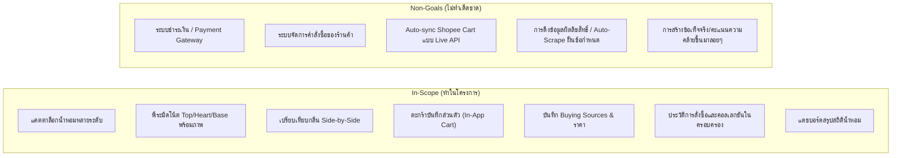

# Vision and Scope — DoomParfum By TK

> **Document Type:** Product Strategy & Scope Definition
> **Source Baseline:** `../README.md` (Section 1)
> **Status:** Draft / Partially Confirmed

---

## 1. Purpose / Scope

เอกสารนี้ระบุวิสัยทัศน์ของผลิตภัณฑ์ ปัญหาที่ต้องการแก้ไข (Pain Points) กลุ่มเป้าหมาย ขอบเขตงานที่ทำ (In-Scope) และสิ่งที่ไม่ทำ (Non-Goals) เพื่อให้การตัดสินใจด้านการออกแบบและเทคโนโลยีสอดคล้องกับเจตจำนงของผู้ใช้อย่างแท้จริง

---

## 2. Current Decisions

### 2.1 Confirmed Decisions `[CONFIRMED]`
- **DEC-001:** DoomParfum By TK คือ **เว็บแอปส่วนตัวสำหรับการศึกษาวิจัยและเปรียบเทียบน้ำหอม** (Research, Comparison & Personal Collection Tracker) ไม่ใช่ Marketplace หรือระบบ E-Commerce
- **No Checkout / No Payment:** ไม่มีระบบตะกร้าสินค้าที่ตัดเงินจริง ไม่มีระบบขนส่ง ไม่มีเกตเวย์การชำระเงิน และไม่มีการสั่งซื้อสินค้าแทนผู้ใช้
- **Target User:** เริ่มต้นออกแบบเพื่อผู้ใช้งานคนเดียว (Single-user private-first) แต่เตรียมโครงสร้างเพื่อรองรับ Multi-user ในอนาคต
- **Reference Model:** ใช้น้ำหอมแบรนด์ Designer / Niche เป็นตัวอ้างอิง (Reference Scent) เพื่อค้นหาตัวเลือกที่มีกลิ่นใกล้เคียงจากแบรนด์ราคาย่อมเยา
- **Target Budget Filter:** ช่วงราคาเริ่มต้นในการค้นหาน้ำหอมทางเลือกตั้งไว้ที่ **฿1,000 – ฿2,000** ต่อรายการ (สามารถปรับตัวกรองได้)

### 2.2 Proposed Decisions `[PROPOSED]`
- **Per-SKU Pricing:** ระบบคำนวณและประเมินราคาตามขนาด/SKU/ร้านค้าจริง ไม่เหมารวมว่าทั้งแบรนด์อยู่ในเกณฑ์ราคาประหยัด
- **Progressive Disclosure:** การค้นหาและแสดงผลเริ่มต้นด้วยข้อมูลพื้นฐานและแสดงหลักฐานเชิงลึกเมื่อผู้ใช้ต้องการเจาะรายละเอียด

---

## 3. Pain Points to Solve (ปัญหาที่แก้ไข)

1. **Information Fragmentation across Platforms:**
   - ผู้ใช้พบคำแนะนำหรือรีวิวน้ำหอมจาก TikTok, YouTube, Instagram หรือชุมชนน้ำหอม แล้วลืมว่าเคยดูรุ่นไหน หรือเก็บลิงก์ไว้ที่ใด
2. **Tab Overload for Note Checking:**
   - ต้องเปิดหลายหน้าต่างพร้อมกันเพื่อดู Top / Heart / Base Notes, Accords, ความติดทน (Longevity) และการกระจายตัว (Sillage)
3. **Manual Scent Alternative Hunting:**
   - การค้นหาว่าแบรนด์ราคาย่อมเยา (อาหรับ, ไทย, อินโดนีเซีย) รุ่นใดมีโครงสร้างกลิ่นใกล้เคียงกับ Designer / Niche รุ่นโปรด เป็นไปอย่างยากลำบากและต้องพึ่งพาการสืบค้นหลายแหล่ง
4. **Scattered Shopping Links & Duplicate Purchases:**
   - มีรายการและลิงก์ร้านค้าใน Shopee/Lazada กระจัดกระจาย จำไม่ได้ว่าสั่งซื้อไปแล้วหรือยัง มีในตู้แล้วหรือไม่
5. **Lack of Personal Scent Analytics:**
   - ขาดระบบสรุปภาพรวมคอลเลกชันส่วนตัวว่าชอบโทนกลิ่นใดเป็นพิเศษ (Woody, Citrus, Amber) และเคยสะสมรุ่นใดมาบ้างในอดีต

---

## 4. In-Scope vs. Non-Goals

---

## 5. Requirements Covered

- [[Requirements_Register#R01|R01]] — Global Multi-brand Catalogue
- [[Requirements_Register#R05|R05]] — Designer/Niche Reference Scent Lookup
- [[Requirements_Register#R06|R06]] — Value Brands (Middle Eastern, Thai, Indonesian)
- [[Requirements_Register#R08|R08]] — Budget Filtering (<= ฿2,000)
- [[Requirements_Register#R10|R10]] — Multiple Marketplace Buying Sources
- [[Requirements_Register#R23|R23]] — In-App My Cart

---

## 6. Dependencies & Links

- ความเชื่อมโยงของข้อกำหนด: [[Requirements_Register]]
- ภาพรวมโฟลว์ผู้ใช้: [[User_Stories_and_Flows]]
- นิยามโดเมนตะกร้าและความเป็นเจ้าของ: [[My_Cart_and_Ownership]]
- บันทึกการตัดสินใจ: [[Decision_Log#DEC-001|DEC-001]], [[Decision_Log#DEC-004|DEC-004]]

---

## 7. Risks & Assumptions

- **ความเสี่ยงเรื่องสิทธิ์ข้อมูล:** การรวบรวมข้อมูลแคตตาล็อกและภาพโน้ตต้องคำนึงถึงเงื่อนไขของแต่ละแหล่งข้อมูล (ดู [[Rights_and_Attribution]])
- **สมมติฐานการใช้งาน:** ผู้ใช้เป็นผู้บันทึกลิงก์และเปลี่ยนสถานะ Ordered / Owned ด้วยตนเองเป็นหลัก

---

## 8. Open Questions

- ดูรายการคำถามผลิตภัณฑ์ที่รอคำตอบ: [[Open_Product_Questions]]

---

## 9. Change Notes

- `2026-11-10`: เริ่มต้นร่างเอกสารจาก `../README.md` (v0.2.0-planning)
