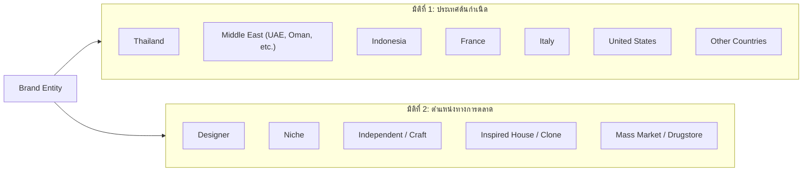

# Brand Taxonomy — DoomParfum By TK

> **Document Type:** Brand Classification & Registry
> **Source Baseline:** `../README.md` (Section 3)
> **Status:** Draft / Partially Confirmed

---

## 1. Purpose / Scope

เอกสารนี้กำหนดหลักเกณฑ์การจำแนกแบรนด์น้ำหอมตามมิติต่าง ๆ เช่น ประเทศต้นกำเนิด (Origin Country) และตำแหน่งทางการตลาด (Market Position) ตลอดจนรวบรวมรายชื่อแบรนด์เป้าหมายสำคัญ โดยเฉพาะแบรนด์ไทยที่ต้องบรรจุในแคตตาล็อกระบบ

---

## 2. Taxonomy Dimensions (มิติการจำแนก)

> [!IMPORTANT]
> ระบบกำหนดให้ **ประเทศต้นกำเนิด (Country of Origin)** และ **ตำแหน่งทางการตลาด (Market Position)** เป็นคนละมิติที่ไม่ผูกติดกัน และตำแหน่งทางการตลาดสามารถมีได้หลายป้ายกำกับ (Tag Relation) โดยไม่ตัดสินเหมารวมทั้งแบรนด์

### 2.1 Origin Country (ประเทศต้นกำเนิด)
- หมายถึง **ประเทศที่ก่อตั้งแบรนด์** ไม่ใช่ประเทศที่ผลิตทุกล็อตสินค้า (Batch Production)
- ตัวอย่าง:
  - **Thailand:** La Palette, SCENTERY, BE CHERIE PARFUM, SÚNDALO, Mith, Proad
  - **Middle East:** Lattafa (UAE), Armaf (UAE), Afnan (UAE), Rasasi (UAE), Paris Corner (UAE), Fragrance World (UAE)
  - **Indonesia:** HMNS, SAFF & Co., Mykonos
  - **Europe/Global:** Dior (FR), Chanel (FR), Tom Ford (US), Creed (FR/UK), Maison Francis Kurkdjian (FR)

### 2.2 Market Position (ตำแหน่งทางการตลาด)
- **Designer:** แบรนด์แฟชั่นระดับสากลที่มีไลน์น้ำหอมเป็นส่วนหนึ่งของธุรกิจ (เช่น Dior, Chanel, YSL, Versace)
- **Niche:** แบรนด์ที่มุ่งเน้นการปรุงน้ำหอมโดยเฉพาะ มีการเล่าเรื่องเฉพาะกลุ่มและมักมีราคาสูง (เช่น Creed, MFK, Diptyque, Kilian)
- **Independent / Craft (Indie):** ผู้ผลิตอิสระขนาดเล็กถึงขนาดกลาง มักเน้นวัตถุดิบท้องถิ่นหรืออัตลักษณ์เฉพาะตัว (แบรนด์ไทยและอินโดนีเซียหลายแบรนด์)
- **Inspired House:** แบรนด์ที่มุ่งเน้นการสร้างสรรค์น้ำหอมที่มีแรงบันดาลใจหรือโปรไฟล์กลิ่นใกล้เคียงกับ Designer/Niche ยอดนิยม ในราคาเข้าถึงง่าย
- **Mass Market:** แบรนด์ที่วางจำหน่ายในซูเปอร์มาร์เก็ตหรือร้านสะดวกซื้อทั่วไป

### 2.3 Product Relationship Types (ความสัมพันธ์ระดับผลิตภัณฑ์)
ความสัมพันธ์ถูกกำหนด **ระหว่างน้ำหอม 2 รุ่น ไม่ใช่การตัดสินทั้งแบรนด์**:
1. `Inspired By`: รุ่นที่ระบุชัดเจนหรือเป็นที่ยอมรับว่าปรุงโดยมีน้ำหอมต้นแบบ
2. `Reported Dupe`: ชุมชนผู้ใช้รายงานว่ากลิ่นเหมือนหรือแทนกันได้
3. `Similar Profile`: มีโครงสร้างโน้ตและตระกูลกลิ่นใกล้เคียงกันโดยธรรมชาติ
4. `Community Comparison`: มีการพูดถึงเปรียบเทียบในโซเชียลมีเดีย
5. `Original Creation`: ผลงานสร้างสรรค์กลิ่นเอกลักษณ์ของแบรนด์เอง

---

## 3. Brand Registry ที่ผู้ใช้ให้ความสำคัญ

### 3.1 Thai Brand Registry `[CONFIRMED]` (R22)
รายชื่อแบรนด์ไทยลำดับความสำคัญสูงที่ต้องมีในระบบ:

| Brand Name | Slug / Search Alias | Country | Market Position | ตัวอย่างรุ่นโฟกัส (จากบันทึกผู้ใช้) | หมายเหตุ |
|---|---|---|---|---|---|
| **BE CHERIE PARFUM** | `be-cherie` | Thailand | Indie / Value | `White Instinct`, `Love White` *(รอตรวจชื่อรุ่น)* | ผู้ใช้มีรูปตัวอย่างในตะกร้า |
| **SÚNDALO** | `sundalo` | Thailand | Indie / Craft | `Rhapsody Sky`, `Unspoken Rose` | ผู้ใช้มีรูปตัวอย่างในตะกร้า |
| **La Palette** | `lapalette` | Thailand | Indie / Craft | รุ่นที่เปิดตัวในปัจจุบัน | ระบุชัดเจนในคำสั่งผู้ใช้ |
| **SCENTERY** | `scentery` | Thailand | Indie / Lifestyle | รุ่นยอดนิยมของแบรนด์ | ระบุชัดเจนในคำสั่งผู้ใช้ |

*แบรนด์ไทยที่สำรวจเพิ่มเติม:* Mith, Proad, Journal, Butterfly Thai Perfume

### 3.2 Middle Eastern Brand Registry (แบรนด์ทางเลือกยอดนิยม)
| Brand Name | Country | Position | จุดเด่น |
|---|---|---|---|
| **Lattafa** | UAE | Inspired House / Value | มีไลน์น้ำหอมทางเลือกหลากหลาย คุณภาพคุ้มราคา |
| **Armaf** | UAE | Inspired House / Value | ซีรีส์ Club de Nuit ยอดนิยม |
| **Afnan** | UAE | Inspired House / Value | งานผลิตและขวดระดับพรีเมียม |
| **Rasasi** | UAE | Middle East House | มีทั้งน้ำหอมดั้งเดิมและกลิ่นร่วมสมัย |
| **Paris Corner** | UAE | Inspired House / Value | ทางเลือกกลิ่น Designer/Niche |
| **Fragrance World** | UAE | Inspired House / Value | ไลน์โคลนและแรงบันดาลใจหลากหลาย |

### 3.3 Indonesian Brand Registry (แบรนด์สำรวจ)
- **HMNS (Humans):** แบรนด์อินโดนีเซียยอดนิยม กลิ่นทันสมัย
- **SAFF & Co.:** เด่นด้านความเข้มข้นและความติดทน
- **Mykonos:** แบรนด์ไวรัล ดีไซน์ขวดสวยงาม ราคาย่อมเยา

---

## 4. Requirements Covered

- [[Requirements_Register#R02|R02]] — Independent Country & Position Dimensions
- [[Requirements_Register#R06|R06]] — Value Brands (Middle East, Thai, Indo)
- [[Requirements_Register#R20|R20]] — Add Non-open DB Perfumes
- [[Requirements_Register#R22|R22]] — Thai Brand Registry Inclusion

---

## 5. Dependencies & Links

- ข้อกำหนดโดเมน: [[Domain_Model]]
- ผังตารางฐานข้อมูล: [[ERD_Draft#brands|ERD_Draft]]
- รายละเอียดโน้ตและรุ่น: [[Perfume_and_Note_Taxonomy]]

---

## 6. Change Notes

- `2026-11-10`: จัดทำเอกสารอนุกรมวิธานแบรนด์ บันทึก 4 แบรนด์ไทยหลักตาม R22
