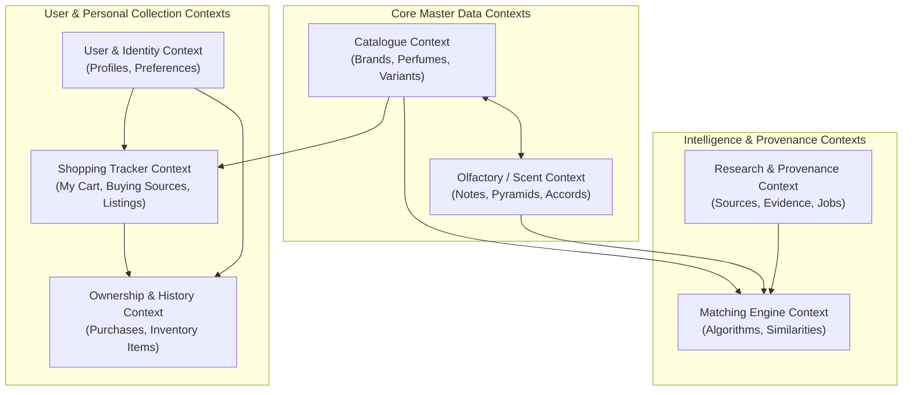

# Domain Model — DoomParfum By TK

> **Document Type:** Domain-Driven Design (DDD) Bounded Contexts
> **Source Baseline:** `../README.md` (Section 4)
> **Status:** Draft / Proposed Domain Architecture

---

## 1. Purpose / Scope

เอกสารนี้กำหนดขอบเขตแบบจำลองเชิงโดเมน (Bounded Contexts) และเอนทิตีหลักของระบบ เพื่อให้เกิดการแบ่งความรับผิดชอบอย่างชัดเจนระหว่างข้อมูลมาสเตอร์ (Catalogue & Olfactory), ระบบการจับคู่กลิ่น (Matching & Research), และระบบติดตามส่วนตัวของผู้ใช้ (Shopping Tracker & Ownership)

---

## 2. Bounded Contexts Architecture

ระบบแบ่งออกเป็น 7 Bounded Contexts ที่มีหน้าที่และขอบเขตข้อมูลอิสระต่อกัน:

---

## 3. Bounded Context Breakdown

### 3.1 Catalogue Context
- **หน้าที่:** จัดการข้อมูลแบรนด์ (Brands), รุ่นน้ำหอมมาตรฐาน (Canonical Perfumes), และรุ่นย่อย/ขนาด/ความเข้มข้น (Product Variants)
- **Entities & Value Objects:**
  - `Brand`: รหัสแบรนด์, ชื่อทางการ, ชื่อพ้อง (Aliases), ประเทศต้นกำเนิด, ตำแหน่งตลาด
  - `Perfume`: น้ำหอมรุ่นหลัก, ชื่อรุ่น, ปีที่เปิดตัว, เพศเป้าหมาย, สถานะการผลิต
  - `ProductVariant`: ขนาดบรรจุ (Volume mL), ชนิดความเข้มข้น (EDP, EDT, Extrait), บรรจุภัณฑ์พิเศษ
- **กฎสำคัญ:** 1 แบรนด์มีได้หลายน้ำหอม และ 1 น้ำหอมมีได้หลาย Variant

### 3.2 Olfactory / Scent Context
- **หน้าที่:** จัดการคลังโครงสร้างกลิ่น พีระมิดโน้ต และตระกูลกลิ่น
- **Entities & Value Objects:**
  - `Note`: โน้ตกลิ่นมาตรฐาน (เช่น Bergamot, Sandalwood, Ambroxan), คำแปลภาษาไทย, ภาพประกอบวัตถุดิบ
  - `NoteAlias`: ชื่อพ้องหรือคำสะกดอื่น (เช่น Heart/Middle Note, Cedrat/Citron)
  - `PerfumeNote`: การจับคู่ระหว่างน้ำหอมกับโน้ต พร้อมระบุชั้น (Top, Heart, Base)
  - `Accord`: ตระกูลหรือลักษณะกลิ่น (Woody, Amber, Aromatic, Fresh Spicy)
  - `PerfumeAccord`: ความเด่นหรือน้ำหนักของ Accord ในแต่ละรุ่น

### 3.3 Matching Engine Context
- **หน้าที่:** คำนวณความคล้ายคลึงระหว่างน้ำหอมคู่ต้นแบบและคู่ทางเลือก
- **Entities & Value Objects:**
  - `PerfumeRelation`: ความสัมพันธ์ระหว่าง 2 รุ่น (Inspired By, Community Dupe, Alternative Vibe)
  - `MatchingResult`: ผลคะแนนคำนวณแยกตามมิติ (Pyramid, Accords, Family, Evidence) พร้อมเวอร์ชันของอัลกอริทึม
  - `SimilarityScore`: ตัวเลขสะท้อนความคล้ายเชิงโครงสร้าง (Structural Similarity)
  - `ConfidenceScore`: ตัวเลขสะท้อนความน่าเชื่อถือและความสมบูรณ์ของข้อมูล

### 3.4 Research & Provenance Context
- **หน้าที่:** ติดตามแหล่งที่มาของข้อมูล ตรวจสอบสิทธิ์การใช้งาน และบันทึกหลักฐานรีวิว
- **Entities & Value Objects:**
  - `SourceRecord`: แหล่งที่มาของข้อมูล (URL, ประเภท, สิทธิ์, วันที่ตรวจสอบ)
  - `ComparisonEvidence`: ข้อความหรือข้อสรุปจากรีวิวที่ระบุความเหมือน/ต่างของกลิ่น
  - `IngestionJob`: ประวัติการนำเข้าและตรวจสอบคุณภาพข้อมูล

### 3.5 Shopping Tracker Context (My Cart)
- **หน้าที่:** จัดการรายการที่ผู้ใช้บันทึกไว้เพื่อเตรียมซื้อ และคลังร้านค้าออนไลน์
- **Entities & Value Objects:**
  - `UserList` / `UserListItem`: รายการที่ผู้ใช้สร้าง (เช่น My Cart, Wishlist, Next Payday)
  - `RetailListing`: ข้อมูลสินค้าในมาร์เก็ตเพลส (Shopee, Lazada) ราคา ขนาด ลิงก์ร้าน
  - `SavedBuyingSource`: ลิงก์ร้านค้าที่ผู้ใช้เลือกผูกไว้กับน้ำหอมในตะกร้า พร้อมโน้ตร้านค้า
- **กฎสำคัญ:** **ไม่มี Checkout** ไม่มีการตัดเงิน รายการในตะกร้าคือสมุดจดส่วนตัว

### 3.6 Ownership & History Context
- **หน้าที่:** บันทึกประวัติการสั่งซื้อและสถานะขวดน้ำหอมที่ครอบครองจริง
- **Entities & Value Objects:**
  - `PurchaseRecord`: ประวัติการซื้อถาวร (ซื้อวันที่เท่าไร จากร้านใด ราคาเท่าไร ซื้อซ้ำได้หลายครั้ง)
  - `InventoryItem`: ขวดน้ำหอมที่ครอบครองจริง พร้อมสถานะวงจรชีวิต (Owned, Finished, Sold, Gifted)
- **กฎสำคัญ:** ประวัติใน `PurchaseRecord` จะไม่ถูกลบแม้ว่าขวดใน `InventoryItem` จะถูกใช้หมดหรือให้คนอื่นไปแล้ว

### 3.7 User & Identity Context
- **หน้าที่:** จัดการตัวตนผู้ใช้และการตั้งค่าส่วนบุคคล
- **Entities & Value Objects:**
  - `User`: บัญชีผู้ใช้งาน (เริ่มต้นด้วยบัญชีคุณ TK)
  - `UserPreference`: งบประมาณเริ่มต้น, โน้ตที่ชอบ/แพ้, ธีมการแสดงผล

---

## 4. Fundamental Invariants & Business Rules

1. **Separation of Concepts:**
   $$\text{Perfume} \neq \text{RetailListing} \neq \text{PurchaseRecord} \neq \text{InventoryItem}$$
2. **Multiple Sources Allowed:** น้ำหอม 1 รุ่นสามารถผูกแหล่งซื้อ Shopee ได้หลายร้านค้า
3. **Repeat Purchases Supported:** ผู้ใช้สามารถซื้อน้ำหอมรุ่นเดิมซ้ำได้หลายครั้ง โดยแต่ละครั้งสร้าง `PurchaseRecord` แยกกัน
4. **Historical Persistence:** การเปลี่ยนแปลงสถานะใน Inventory จะไม่ทำให้ข้อมูลใน Purchase History สูญหาย
5. **No Blind Web Scraping:** ระบบไม่นำเข้าข้อมูลจากแหล่งภายนอกโดยไม่มีการตรวจสอบสิทธิ์ใน Research Context

---

## 5. Requirements Covered

- [[Requirements_Register#R01|R01]], [[Requirements_Register#R02|R02]], [[Requirements_Register#R03|R03]]
- [[Requirements_Register#R10|R10]], [[Requirements_Register#R11|R11]], [[Requirements_Register#R23|R23]]
- [[Requirements_Register#R26|R26]], [[Requirements_Register#R28|R28]]

---

## 6. Dependencies & Links

- ผังข้อมูล ERD: [[ERD_Draft]]
- พจนานุกรมข้อมูล: [[Data_Dictionary_Draft]]
- รายละเอียดตะกร้าและความเป็นเจ้าของ: [[My_Cart_and_Ownership]]

---

## 7. Change Notes

- `2026-11-10`: กำหนด 7 Bounded Contexts และกฎความสัมพันธ์พื้นฐาน
