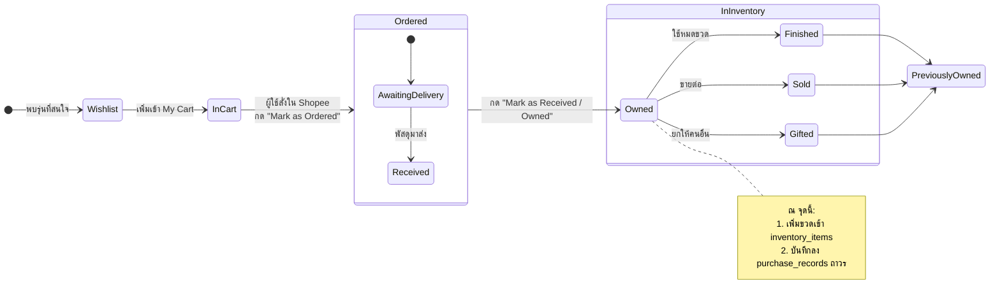

# My Cart and Ownership Model — DoomParfum By TK

> **Document Type:** Core Domain Logic & State Machine Specification
> **Source Baseline:** `../README.md` (Section 2.2 & 4.3)
> **Status:** Draft / Confirmed Core Logic

---

## 1. Purpose / Scope

เอกสารนี้ระบุหลักการทำงานของ **`My Cart` (ตะกร้าภายในแอป)**, **`Buying Sources` (แหล่งซื้อภายนอก)**, และ **`Ownership & Purchase History` (ประวัติการซื้อและการครอบครอง)**

> [!IMPORTANT]
> **หลักการสำคัญที่สุดของระบบ [CONFIRMED]:**
> `My Cart` ใน DoomParfum By TK คือ **สมุดจดรายการเตรียมซื้อส่วนตัว** ไม่ใช่ระบบ E-commerce ไม่มีกระบวนการ Checkout จริง ไม่มีการตัดเงิน และไม่เชื่อมต่อ API ตะกร้าของ Shopee แบบเรียลไทม์

---

## 2. Core Concepts & State Definitions (นิยามสถานะที่ไม่ทับซ้อนกัน)

เพื่อไม่ให้เกิดความสับสนระหว่างการใช้งาน ข้อมูลถูกแบ่งสถานะเป็นเอกเทศตามตารางนี้:

| สถานะ / แนวคิด | ความหมายเชิงธุรกิจ | อยู่ในตารางใด | ตัวอย่างการใช้งาน |
|---|---|---|---|
| **Saved Buying Source** | ลิงก์ร้านค้าภายนอก ราคา และขนาดที่บันทึกไว้สำหรับน้ำหอมรุ่นนั้น | `saved_buying_sources` / `retail_listings` | บันทึกลิงก์ Shopee ร้าน Mall ราคา ฿1,250 |
| **In App Cart** | รายการน้ำหอมที่ผู้ใช้จัดกลุ่มไว้ในตะกร้าเตรียมซื้อ | `user_list_items` (list_type = `cart`) | เลือก 3 ขวดนี้ไว้รอซื้อวันโปรเลขเบิ้ล |
| **Ordered** | ผู้ใช้แจ้งกับแอปด้วยตนเองว่า **ได้สั่งซื้อภายนอกแล้ว** อยู่ระหว่างรอของ | `user_list_items` (status = `ordered`) | กด "Mark as Ordered" หลังจ่ายเงินใน Shopee |
| **Owned (In Inventory)** | มีขวดน้ำหอมจริงอยู่ในครอบครองและยังใช้งานได้ | `inventory_items` (status = `owned`) | พัสดุมาส่ง แกะกล่อง ตรวจรับเข้าตู้ |
| **Previously Owned** | เคยมีในครอบครอง แต่อดีตปัจจุบันหมดขวด ขายต่อ หรือยกให้ผู้อื่น | `inventory_items` (status = `finished` / `sold` / `gifted`) | น้ำหอมหมดขวด เปลี่ยนสถานะเป็น Finished |
| **Purchase Record** | บันทึกประวัติศาสตร์การซื้อที่เกิดขึ้นจริงในอดีต (ไม่ถูกลบ) | `purchase_records` | เคยซื้อรุ่นนี้เมื่อ 10 ม.ค. 2026 ราคา ฿1,150 |

---

## 3. The Lifecycle State Machine

---

## 4. Business Rules & Detailed Specifications

### 4.1 In-App Cart (ตะกร้าที่ไม่มี Checkout)
1. **เพิ่มได้ทุกแบรนด์ (R23):** สามารถเพิ่มน้ำหอมทุกกลุ่มเข้า `My Cart` ได้ ไม่ว่าจะเป็นแบรนด์ Designer, แบรนด์ไทย, แบรนด์อาหรับ หรือ Niche
2. **ผูกหลายแหล่งซื้อต่อ 1 รายการ (R24):** ในแต่ละรายการตะกร้า ผู้ใช้สามารถแปะลิงก์ร้านค้า Shopee ได้มากกว่า 1 ร้าน พร้อมโน้ตความน่าเชื่อถือ เช่น:
   - ร้านที่ 1: ราคา ฿1,290 (ส่งฟรี จากกทม.)
   - ร้านที่ 2: ราคา ฿1,180 (รอของ 7 วัน ของแท้แน่นอน)
3. **ป้องกันรายการซ้ำ (R30):** หากผู้ใช้กดเพิ่มน้ำหอมรุ่นที่มีใน `My Cart` อยู่แล้ว ระบบจะไม่สร้างแถวใหม่ แต่จะแสดงข้อความแจ้งเตือน:
   > *"น้ำหอมรุ่นนี้มีอยู่ใน My Cart แล้ว คุณต้องการเพิ่มลิงก์ร้านค้าทางเลือกใหม่ หรือไปที่หน้าตะกร้า?"*

### 4.2 Manual Status Transitions (การเปลี่ยนสถานะด้วยมือ)
1. **Mark as Ordered (R25):**
   - เมื่อผู้ใช้ทำการสั่งซื้อใน Shopee เสร็จสิ้น ผู้ใช้เข้าแอปมากดปุ่ม `Mark as Ordered`
   - ระบบจะเปิดฟอร์มย่อให้เลือกร้านค้าที่สั่ง และกรอกราคาจริงที่จ่าย (Optional)
   - รายการจะถูกย้ายจากแท็บ "To Buy (ในตะกร้า)" ไปยังแท็บ "Ordered (สั่งแล้ว รอส่ง)"
2. **Mark as Received / Owned:**
   - เมื่อได้รับพัสดุ ผู้ใช้กด `Mark as Received`
   - ระบบจะย้ายรายการเข้าสู่คอลเลกชันส่วนตัว (`inventory_items`)

### 4.3 Separation: Purchase History vs. Current Inventory (R26, R28)
- **การซื้อซ้ำ (Repeat Purchases):** หากผู้ใช้ชอบน้ำหอมรุ่นหนึ่งมาก และซื้อซ้ำ 3 ครั้งในช่วง 2 ปี:
  - จะมีแถวในตาราง `purchase_records` ทั้งหมด **3 แถว** (บันทึกวันที่ ราคา และร้านค้าของแต่ละรอบ)
  - จะมีแถวในตาราง `inventory_items` ตามจำนวนขวดจริงที่มีอยู่
- **ความคงอยู่ของประวัติ (History Persistence):**
  - แม้ผู้ใช้จะใช้ขวดจนหมดและกดเปลี่ยนสถานะขวดเป็น `FINISHED` หรือลบขวดออกจากคอลเลกชัน
  - **ประวัติการซื้อใน `purchase_records` จะยังคงอยู่ตลอดไป** ไม่ถูกลบหรือสูญหาย
  - ทำให้ Dashboard ใน [[Collection_Dashboard]] สามารถคำนวณยอด "เคยซื้อทั้งหมด (Ever Purchased)" ได้ถูกต้องแม่นยำ

---

## 5. Requirements Covered

- [[Requirements_Register#R09|R09]] — Manual Data Import
- [[Requirements_Register#R10|R10]] — Multiple Marketplace Sources
- [[Requirements_Register#R11|R11]] — Status Lifecycle Tracking
- [[Requirements_Register#R23|R23]] — Universal Brand In-App Cart
- [[Requirements_Register#R24|R24]] — Multiple Buying Links & Notes
- [[Requirements_Register#R25|R25]] — Manual Mark as Ordered
- [[Requirements_Register#R26|R26]] — Purchase History Persistence
- [[Requirements_Register#R28|R28]] — Separate Purchase Record from Inventory
- [[Requirements_Register#R29|R29]] — Optional Purchase Fields
- [[Requirements_Register#R30|R30]] — Duplicate Cart Item Warning

---

## 6. Dependencies & Links

- ผังข้อมูล ERD: [[ERD_Draft]]
- พจนานุกรมข้อมูล: [[Data_Dictionary_Draft]]
- สเปกหน้าจอ Shopping Tracker: [[Shopping_Tracker]]
- สเปกหน้าจอแดชบอร์ด: [[Collection_Dashboard]]

---

## 7. Change Notes

- `2026-11-10`: จัดทำเอกสาร My Cart and Ownership Model อย่างละเอียด แยกสถานะ Cart, Ordered, Owned, History ชัดเจน
