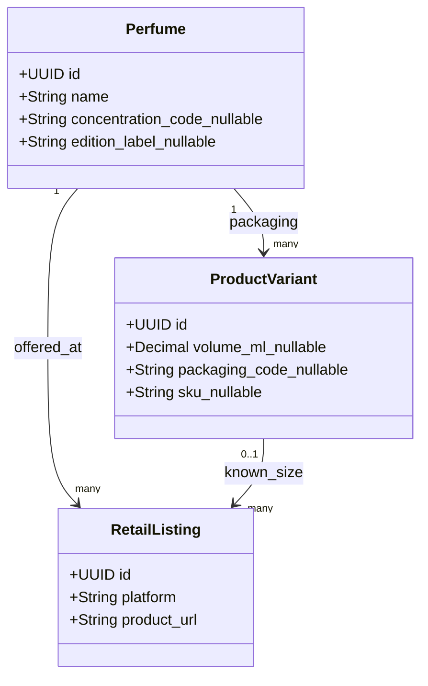
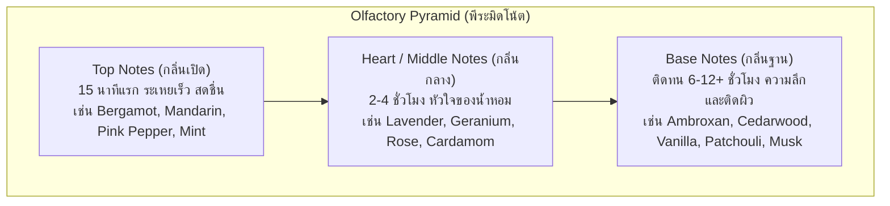

# Perfume and Note Taxonomy — DoomParfum By TK

> **Document Type:** Olfactory Structure & Classification
> **Source Baseline:** `../README.md` (Sections 3 and 4)
> **Status:** Draft / Partially Confirmed

---

## 1. Purpose / Scope

เอกสารนี้ให้คำจำกัดความโครงสร้างข้อมูลทางสุคนธศาสตร์ (Olfactory Taxonomy) รวมถึงการแยกชั้นโน้ต (Pyramid Notes), การจัดกลุ่มความรู้สึกของกลิ่น (Accords), ตระกูลกลิ่น (Fragrance Families), และการแยกแนวคิดระหว่าง **Perfume vs. Variant vs. Listing**

---

## 2. Perfume vs Variant vs Listing — P1 PROPOSED revision

P1 evidence refines the bootstrap proposal; owner approval remains required. A perfume is a
concentration/edition-specific **scent profile**, not a disclosed chemical formula. EDT/EDP and
flankers may have different notes and separate profile IDs. Unknown concentration/edition remains
unknown and blocks automatic identity merging. A product variant is packaging/volume/refill/SKU of
that profile. A retail listing is a seller/URL observation with optional known packaging.

Evidence: Scento has two Balmain Bleu Infini records with different EDP/EDT concentration, and 251
profiles with unknown concentration. Name-only uniqueness would merge different source identities.
See [[P1_Data_Profiling_Findings]], [[ERD_Draft]], [[Data_Dictionary_Draft]].

---

## 3. The Olfactory Pyramid (พีระมิดโน้ต)

> [!NOTE]
> คำว่า `Notes` ในระบบนี้คือ **Olfactory Perception Notes (โน้ตกลิ่นที่ประสาทสัมผัสรับรู้และผู้ผลิตสื่อสาร)** ไม่ใช่สูตรเคมี (Chemical Formula) หรือส่วนผสมทางอุตสาหกรรม (Raw Chemical Materials เช่น Iso E Super, Hedione เว้นแต่ถูกสื่อสารเป็นโน้ตทางการ)

### 3.1 Note Layers (ชั้นของโน้ต)
- **Top Notes (กลิ่นเปิด):** โมเลกุลขนาดเล็ก ระเหยง่าย มอบความประทับใจแรก มักเป็นตระกูล Citrus, Fresh Herbs, Fruity
- **Heart / Middle Notes (กลิ่นกลาง):** หัวใจหลักที่เชื่อมต่อกลิ่นเปิดและฐาน มักเป็น Floral, Spices, Aromatic Herbs
- **Base Notes (กลิ่นฐาน):** โมเลกุลหนัก ระเหยช้า สร้างความทนทานและความอบอุ่น มักเป็น Woods, Resins, Musks, Amber

### 3.2 Note Synonyms & Normalization (ชื่อพ้องและการจัดมาตรฐาน)
ในแหล่งข้อมูลต่าง ๆ มักใช้คำเรียกโน้ตต่างกัน ระบบจึงมีตาราง `note_aliases` เพื่อแปลงเข้าหา Canonical Note ID:
- `Heart Note` $\equiv$ `Middle Note` $\equiv$ `กลิ่นกลาง`
- P1 PROPOSED: Bergamot/Calabrian Bergamot/Thai translations are reviewed alias or broader/narrower candidates; retain the original label.
- P1 PROPOSED: `Ambroxan` and `Ambergris` are not automatic synonyms. Preserve natural/synthetic and broad/narrow distinctions; review each mapping.

### 3.3 Note Images & Attribution (ภาพประกอบวัตถุดิบ)
- หน้ารายละเอียดน้ำหอม (R13) แสดงภาพไอคอน/ภาพถ่ายของวัตถุดิบโน้ตแต่ละตัว
- ภาพโน้ตทุกภาพต้องบันทึกสิทธิ์การใช้งาน (Public Domain, Creative Commons, หรือสร้างเอง) ในตาราง `note_images` พร้อมข้อความ Alt text อธิบายภาพ

---

## 4. Accords vs. Fragrance Families

ความแตกต่างระหว่าง 2 แนวคิดนี้:

| มิติ | นิยาม | ตัวอย่าง | บทบาทในระบบ |
|---|---|---|---|
| **Fragrance Family** | ตระกูลกลิ่นใหญ่ตามมาตรฐานอุตสาหกรรม (เช่น Michael Edwards Fragrance Wheel) | `Woody`, `Oriental / Amber`, `Fresh`, `Floral` | ใช้เป็นตัวกรองระดับบนสุด และใช้คำนวณสัดส่วนใน Dashboard |
| **Accords** | ความรู้สึกเชิงฮาร์โมนีที่เกิดจากการผสานกันของหลายโน้ต | `Fresh Spicy`, `Citrus`, `Aromatic`, `Warm Spicy`, `Powdery` | ใช้วัดความคล้ายเชิงบุคลิกของกลิ่น (น้ำหนัก 25% ในร่าง Matching) |

---

## 5. Requirements Covered

- [[Requirements_Register#R03|R03]] — Top, Heart/Middle, Base Notes & Accords
- [[Requirements_Register#R13|R13]] — Perfume Pyramid with Note Images
- [[Requirements_Register#R14|R14]] — Note-based Interactive Search

---

## 6. Dependencies & Links

- พจนานุกรมข้อมูล: [[Data_Dictionary_Draft#notes|Data_Dictionary_Draft]]
- รายละเอียดหน้าจอพีระมิด: [[Perfume_Detail_Pyramid]]
- อัลกอริทึมการเปรียบเทียบ: [[Scent_Matching_Spec]]

---

## 7. Change Notes

- `2026-11-10`: บันทึกข้อกำหนด Perfume vs Variant vs Listing และรายละเอียด Olfactory Pyramid

## P1 clarification — 2026-11-10

`general` records notes without a source-specified layer. Do not invent a pyramid for flat-only
profiles. Notes/accord/family terms depend on the source scheme; preserve evidence and uncertainty.
The timings shown in the baseline pyramid are illustrations, not measured product performance.
