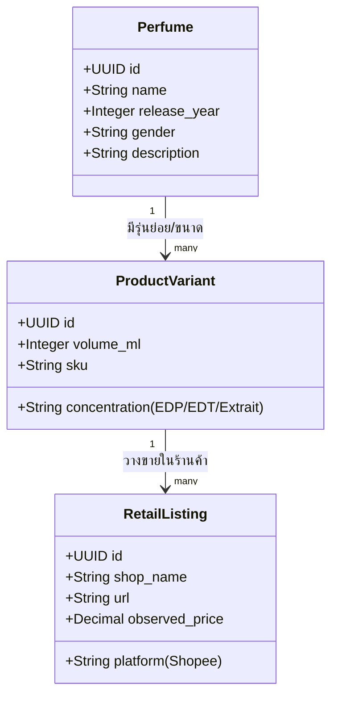
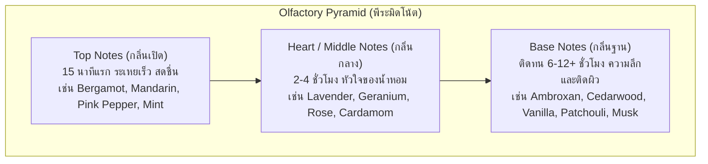

# Perfume and Note Taxonomy — DoomParfum By TK

> **Document Type:** Olfactory Structure & Classification
> **Source Baseline:** `../README.md` (Sections 3 and 4)
> **Status:** Draft / Partially Confirmed

---

## 1. Purpose / Scope

เอกสารนี้ให้คำจำกัดความโครงสร้างข้อมูลทางสุคนธศาสตร์ (Olfactory Taxonomy) รวมถึงการแยกชั้นโน้ต (Pyramid Notes), การจัดกลุ่มความรู้สึกของกลิ่น (Accords), ตระกูลกลิ่น (Fragrance Families), และการแยกแนวคิดระหว่าง **Perfume vs. Variant vs. Listing**

---

## 2. Fundamental Distinction: Perfume vs Variant vs Listing

เพื่อป้องกันความสับสนในการออกแบบระบบฐานข้อมูลและหน้าจอ ระบบนิยาม 3 แนวคิดนี้แยกออกจากกันอย่างเด็ดขาด:

1. **Perfume (น้ำหอมรุ่นหลัก):**
   - คือตัวตนทางสุคนธศาสตร์ (Canonical Scent Formula) เช่น *Dior Sauvage*, *BE CHERIE White Instinct*
   - เก็บโครงสร้าง Top / Heart / Base Notes และ Accords หลัก
2. **Product Variant (รุ่นย่อย/ขนาด):**
   - คือสินค้าตามขนาดบรรจุหรือรูปแบบ เช่น *Dior Sauvage EDP 60ml*, *100ml*, *200ml Refill*
3. **Retail Listing (รายการขายในร้านค้า):**
   - คือหน้าสินค้าจริงในร้านค้าออนไลน์ (เช่น ร้าน A บน Shopee ขายขวด 100ml ราคา ฿1,250)
   - เก็บ URL, ราคาสแนปช็อต, ชื่อร้าน, และความน่าเชื่อถือ

---

## 3. The Olfactory Pyramid (พีระมิดโน้ต)

> [!NOTE]
> คำว่า `Notes` ในระบบนี้คือ **Olfactory Perception Notes (โน้ตกลิ่นที่ประสาทสัมผัสรับรู้และผู้ผลิตสื่อสาร)** ไม่ใช่สูตรเคมี (Chemical Formula) หรือส่วนผสมทางอุตสาหกรรม (Raw Chemical Materials เช่น Iso E Super, Hedione เว้นแต่ถูกสื่อสารเป็นโน้ตทางการ)

### 3.1 Note Layers (ชั้นของโน้ต)
- **Top Notes (กลิ่นเปิด):** โมเลกุลขนาดเล็ก ระเหยง่าย มอบความประทับใจแรก มักเป็นตระกูล Citrus, Fresh Herbs, Fruity
- **Heart / Middle Notes (กลิ่นกลาง):** หัวใจหลักที่เชื่อมต่อกลิ่นเปิดและฐาน มักเป็น Floral, Spices, Aromatic Herbs
- **Base Notes (กลิ่นฐาน):** โมเลกุลหนัก ระเหยช้า สร้างความทนทานและความอบอุ่น มักเป็น Woods, Resins, Musks, Amber

### 3.2 Note Synonyms & Normalization (ชื่อพ้องและการจัดมาตรฐาน)
ในแหล่งข้อมูลต่าง ๆ มักใช้คำเรียกโน้ตต่างกัน ระบบจึงมีตาราง `note_aliases` เพื่อแปลงเข้าหา Canonical Note ID:
- `Heart Note` $\equiv$ `Middle Note` $\equiv$ `กลิ่นกลาง`
- `Bergamot` $\equiv$ `Calabrian Bergamot` $\equiv$ `มะกรูดฝรั่ง`
- `Ambroxan` $\equiv$ `Ambergris (synthetic)` $\equiv$ `แอมบรอกซาน`

### 3.3 Note Images & Attribution (ภาพประกอบวัตถุดิบ)
- หน้ารายละเอียดน้ำหอม (R13) แสดงภาพไอคอน/ภาพถ่ายของวัตถุดิบโน้ตแต่ละตัว
- ภาพโน้ตทุกภาพต้องบันทึกสิทธิ์การใช้งาน (Public Domain, Creative Commons, หรือสร้างเอง) ในตาราง `note_images` พร้อมข้อความ Alt text อธิบายภาพ

---

## 4. Accords vs. Fragrance Families

ความแตกต่างระหว่าง 2 แนวคิดนี้:

| มิติ | นิยาม | ตัวอย่าง | บทบาทในระบบ |
|---|---|---|---|
| **Fragrance Family** | ตระกูลกลิ่นใหญ่ตามมาตรฐานอุตสาหกรรม (เช่น Michael Edwards Fragrance Wheel) | `Woody`, `Oriental / Amber`, `Fresh`, `Floral` | ใช้เป็นตัวกรองระดับบนสุด และใช้คำนวณสัดส่วนใน Dashboard |
| **Accords** | ความรู้สึกเชิงฮาร์โมนีที่เกิดจากการผสานกันของหลายโน้ต | `Fresh Spicy`, `Citrus`, `Aromatic`, `Warm Spicy`, `Powdery` | ใช้วัดความคล้ายเชิงบุคลิกของกลิ่น (น้ำหนัก 25% ในร่าง Matching) |

---

## 5. Requirements Covered

- [[Requirements_Register#R03|R03]] — Top, Heart/Middle, Base Notes & Accords
- [[Requirements_Register#R13|R13]] — Perfume Pyramid with Note Images
- [[Requirements_Register#R14|R14]] — Note-based Interactive Search

---

## 6. Dependencies & Links

- พจนานุกรมข้อมูล: [[Data_Dictionary_Draft#notes|Data_Dictionary_Draft]]
- รายละเอียดหน้าจอพีระมิด: [[Perfume_Detail_Pyramid]]
- อัลกอริทึมการเปรียบเทียบ: [[Scent_Matching_Spec]]

---

## 7. Change Notes

- `2026-11-10`: บันทึกข้อกำหนด Perfume vs Variant vs Listing และรายละเอียด Olfactory Pyramid
