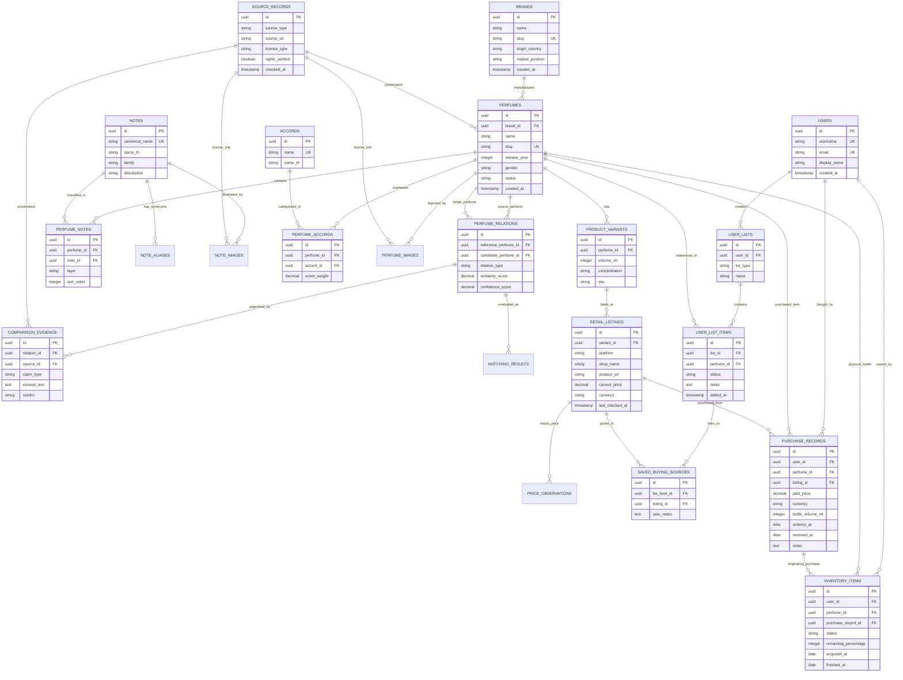

# ERD Draft — DoomParfum By TK

> **Document Type:** Entity-Relationship Diagram Draft
> **Source Baseline:** `../README.md` (Section 4)
> **Status:** Draft / Proposed Schema Architecture

---

## 1. Purpose / Scope

เอกสารนี้นำเสนอแบบจำลองความสัมพันธ์ระหว่างข้อมูล (Entity-Relationship Diagram) ในรูปแบบ Mermaid ERD ที่สอดคล้องกับ Bounded Contexts ทั้งหมดใน [[Domain_Model]] เพื่อเป็นพิมพ์เขียวสำหรับทำ Data Dictionary และ Drizzle ORM Schema ในระยะ P1

---

## 2. Mermaid Entity-Relationship Diagram

---

## 3. Key Relationships Explained

1. **Master Catalogue:**
   - 1 `BRANDS` $\rightarrow$ หลาย `PERFUMES`
   - 1 `PERFUMES` $\rightarrow$ หลาย `PRODUCT_VARIANTS`
   - `PERFUMES` และ `NOTES` เชื่อมกันแบบ Many-to-Many ผ่าน `PERFUME_NOTES` พร้อมระบุ `layer` (`TOP`, `HEART`, `BASE`)
   - `PERFUMES` และ `ACCORDS` เชื่อมกันแบบ Many-to-Many ผ่าน `PERFUME_ACCORDS`
2. **Matching & Evidence:**
   - `PERFUME_RELATIONS` เก็บการจับคู่ระหว่าง `reference_perfume` และ `candidate_perfume`
   - มี `COMPARISON_EVIDENCE` รองรับหลายข้อความอ้างอิง และเชื่อมไปยัง `SOURCE_RECORDS` เพื่อสอบทานที่มา
3. **Shopping & Personal Collection:**
   - `USER_LIST_ITEMS` สำหรับ `My Cart` เชื่อมกับ `SAVED_BUYING_SOURCES` เพื่อรองรับหลายร้านต่อหนึ่งน้ำหอม
   - `PURCHASE_RECORDS` เก็บข้อมูลการซื้อถาวรแบบอิสระ ไม่ถูกลบ
   - `INVENTORY_ITEMS` เก็บขวดที่มีอยู่จริง เชื่อมโยงประวัติการซื้อต้นทาง (`purchase_record_id`) แบบ Nullable

---

## 4. Requirements Covered

- [[Requirements_Register#R01|R01]], [[Requirements_Register#R02|R02]], [[Requirements_Register#R03|R03]]
- [[Requirements_Register#R10|R10]], [[Requirements_Register#R16|R16]], [[Requirements_Register#R17|R17]]
- [[Requirements_Register#R21|R21]], [[Requirements_Register#R26|R26]], [[Requirements_Register#R28|R28]]

---

## 5. Dependencies & Links

- รายละเอียดฟิลด์และคีย์: [[Data_Dictionary_Draft]]
- โดเมนโมเดล: [[Domain_Model]]
- ธรรมาภิบาลข้อมูล: [[Data_Quality_and_Provenance]]

---

## 6. Change Notes

- `2026-11-10`: ร่างผัง ERD ฉบับแรก รองรับครบทุก Bounded Context ตาม Blueprint
