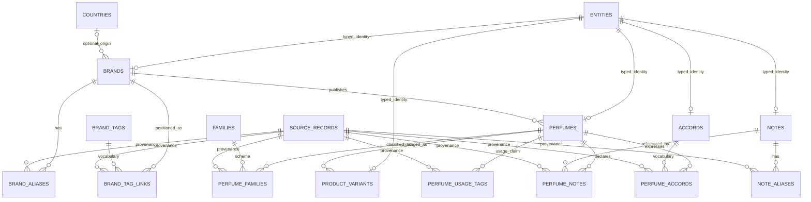
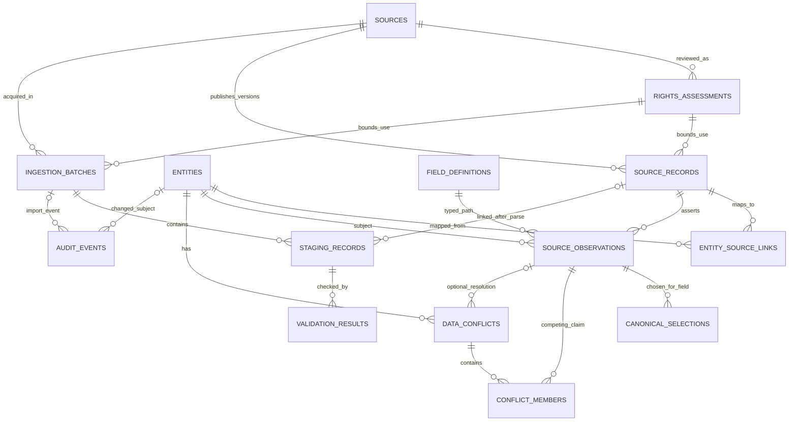

# ERD Draft — P1 Proposed Relationships

PROPOSED, not final/implemented. Column types, nullability, composite FKs and uniqueness are defined
in [[Data_Dictionary_Draft]]. Research drivers: [[P1_Data_Profiling_Findings]] and [[P1_Data_Conflict_Matrix]].
This replaces the baseline single-source-perfume association with versioned field-level claims.
Diagrams show the logical relationships; composite ownership/type guards remain mandatory even where
the diagram uses a single edge. No database was created.

## Catalogue, identity and taxonomy

A PERFUME is a concentration/edition-specific scent profile; EDP and EDT can have separate notes.
A PRODUCT_VARIANT is size/packaging/SKU. Flankers/reformulations use explicit evidence-backed relations,
not inferred name parsing. Unknown concentration/edition stays unknown. Country and positioning are
separate. Flat notes use general; notes represent declarations/perceptions, not a chemical formula.

## Provenance, conflict and ingestion

An entity has at most one current canonical selection per field. Composite FKs enforce the same
entity kind/path for selections, conflicts and their observations. Sources and observations are not
one-to-one with perfumes. Whole-layer lists are claims; the canonical note join derives from the
approved list selection. Missing status and conflict status remain separate. No facts are auto-filled.

## Media, evidence and personal records

```mermaid
erDiagram
    ENTITIES ||--o| IMAGE_ASSETS : typed_identity
    SOURCE_RECORDS ||--o{ IMAGE_ASSETS : source
    RIGHTS_ASSESSMENTS ||--o{ IMAGE_ASSETS : asset_rights
    IMAGE_ASSETS o|--o{ IMAGE_ASSETS : derived_from
    PERFUMES ||--o{ PERFUME_IMAGES : depicted_by
    IMAGE_ASSETS ||--o{ PERFUME_IMAGES : asset
    NOTES ||--o{ NOTE_IMAGES : illustrated_by
    IMAGE_ASSETS ||--o{ NOTE_IMAGES : asset
    ENTITIES ||--o| PERFUME_RELATIONS : typed_identity
    PERFUMES ||--o{ PERFUME_RELATIONS : reference
    PERFUMES ||--o{ PERFUME_RELATIONS : candidate
    PERFUME_RELATIONS ||--o{ COMPARISON_EVIDENCE : supported_by
    SOURCE_RECORDS ||--o{ COMPARISON_EVIDENCE : provenance
    PERFUME_RELATIONS ||--o{ MATCHING_RESULTS : versioned_result
    PERFUMES ||--o{ RATING_OBSERVATIONS : rated_by_source
    SOURCE_RECORDS ||--o{ RATING_OBSERVATIONS : provenance
    ENTITIES ||--o| RETAIL_LISTINGS : typed_identity
    USERS ||--o{ RETAIL_LISTINGS : privately_saves
    PERFUMES ||--o{ RETAIL_LISTINGS : offered_at
    PRODUCT_VARIANTS o|--o{ RETAIL_LISTINGS : known_packaging
    SOURCE_RECORDS ||--o{ RETAIL_LISTINGS : provenance
    RETAIL_LISTINGS ||--o{ PRICE_OBSERVATIONS : observed_price
    SOURCE_RECORDS ||--o{ PRICE_OBSERVATIONS : provenance
    USERS ||--o{ USER_LISTS : owns
    USER_LISTS ||--o{ USER_LIST_ITEMS : contains
    PERFUMES ||--o{ USER_LIST_ITEMS : saved_perfume
    USER_LIST_ITEMS ||--o{ SAVED_BUYING_SOURCES : links
    RETAIL_LISTINGS ||--o{ SAVED_BUYING_SOURCES : source
    USERS ||--o{ PURCHASE_RECORDS : manually_records
    PERFUMES ||--o{ PURCHASE_RECORDS : purchased_profile
    PRODUCT_VARIANTS o|--o{ PURCHASE_RECORDS : known_packaging
    RETAIL_LISTINGS o|--o{ PURCHASE_RECORDS : optional_seller
    USERS ||--o{ INVENTORY_ITEMS : owns_bottle
    PERFUMES ||--o{ INVENTORY_ITEMS : scent_profile
    PRODUCT_VARIANTS o|--o{ INVENTORY_ITEMS : known_packaging
    PURCHASE_RECORDS o|--o{ INVENTORY_ITEMS : optional_purchase
```

Optional seller/variant/purchase links must not imply a transaction or a forced price/date/size.
Composite owner/perfume FKs prevent a saved source, purchase or bottle from linking another owner's
record or a different perfume's variant. Purchase history survives cart removal and inventory lifecycle
changes. No checkout or Shopee synchronization is proposed. Private records require authorization/RLS.

Images store portable metadata and object locators separately from the image bytes. Database backups
do not back up objects. Rating, source performance claims, pairwise review evidence and computed
similarity/confidence are distinct. Matching results are versioned and nullable when evidence is insufficient.

## Evolution and approval gate

First implementation uses reviewed migrations and a bounded local pilot; no hosted environment until
[[P1_Pilot_Implementation_Plan]] readiness evidence and owner decisions. New source adapters preserve
source-specific fields in observations before any new canonical columns are proposed. This proposal
is more detailed than the bootstrap draft but remains subject to owner schema/identity approval.
