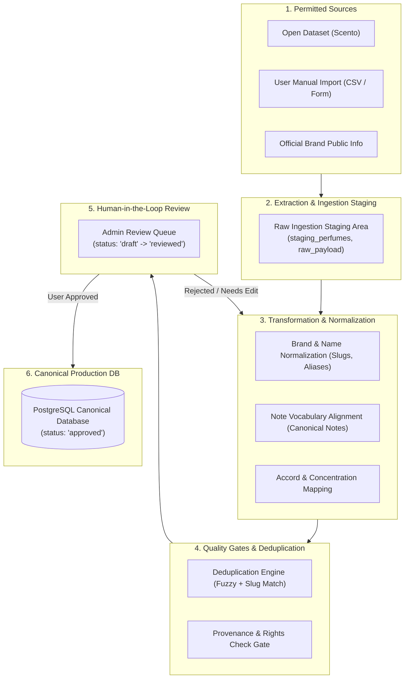

# Ingestion and ETL Pipeline — DoomParfum By TK

> **Document Type:** Data Extraction, Transformation, and Loading (ETL) Architecture
> **Source Baseline:** `../README.md` (Section 6)
> **Status:** Draft / Proposed Pipeline Architecture

---

## 1. Purpose / Scope

เอกสารนี้กำหนดสถาปัตยกรรมกระบวนการนำเข้าข้อมูล (Data Ingestion & ETL Pipeline) สำหรับแปลงข้อมูลดิบจากแหล่งที่ได้รับอนุญาตให้กลายเป็นแคตตาล็อกน้ำหอมมาตรฐาน โดยมีขั้นตอนการจัดระเบียบ (Normalization), การกำจัดข้อมูลซ้ำซ้อน (Deduplication), การตรวจสอบคุณภาพ (Validation), และการรีวิวโดยผู้ใช้ (Human Review) ก่อนนำเข้าฐานข้อมูลจริง

---

## 2. Ingestion Pipeline Stages

---

## 3. Detailed Stage Breakdown

### 3.1 Stage 1: Extraction & Ingestion Staging
- ข้อมูลดิบถูกนำเข้าสู่ระบบผ่านสคริปต์ Python หรือฟอร์มหน้าเว็บ โดยจะถูกจัดเก็บในตารางชั่วคราว (`staging_records`)
- ทุกระเบียนต้องมีข้อมูลเมทาดาทา: `source_url`, `source_type`, `ingested_at`, `raw_json`

### 3.2 Stage 2: Transformation & Normalization
1. **Brand Normalization:**
   - ตัดคำนำหน้า/ต่อท้ายที่ไม่จำเป็น (เช่น "Parfums", "House of", "Co., Ltd.")
   - ตรวจสอบผ่านตาราง `brand_aliases` เพื่อระบุ Canonical Brand ID
2. **Perfume Name & Flanker Normalization:**
   - แยกชื่อรุ่นหลักออกจากความเข้มข้น (เช่น "Sauvage" vs "Eau de Parfum")
   - กำจัดคีย์เวิร์ด SEO ที่ติดมากับชื่อร้านค้า Shopee (เช่น "ของแท้ 100% ส่งฟรี")
3. **Note Normalization:**
   - แปลงชื่อโน้ตเข้าหาคลังมาตรฐานสากล (เช่น "Calabrian Bergamot" $\rightarrow$ "Bergamot")
   - จำแนกชั้นโน้ตอย่างชัดเจน (`TOP`, `HEART`, `BASE`) หากต้นทางไม่ระบุชั้น ให้จัดเป็นกลุ่ม `GENERAL` และตั้งสถานะรอตรวจสอบ

### 3.3 Stage 3: Deduplication & Quality Gates
1. **Slug & Levenshtein Matching:**
   - เปรียบเทียบ Slug ของรุ่นใหม่กับรุ่นที่มีอยู่ในระบบ
   - หากค่าความเหมือนของชื่อมากกว่า 85% ในแบรนด์เดียวกัน ระบบจะส่งเข้าคิวสงสัยว่าซ้ำ (Duplicate Suspicion)
2. **Quality Gate Checks:**
   - มีชื่อรุ่นและแบรนด์ที่ถูกต้องหรือไม่
   - มีโน้ตอย่างน้อย 3 ตัว หรือมี Accords หรือไม่
   - มีข้อมูลแหล่งที่มา (Provenance) หรือไม่

### 3.4 Stage 4: Human-in-the-Loop Review (การอนุมัติโดยมนุษย์)
- ข้อมูลที่ผ่านการ Transform จะมีสถานะเป็น `draft`
- ผู้ใช้ (คุณ TK) สามารถตรวจสอบความถูกต้องผ่านหน้า Admin Review Dashboard:
  - ยืนยันความถูกต้องของชื่อรุ่น โน้ต และภาพ
  - ปรับสถานะเป็น `reviewed` $\rightarrow$ `approved`
- เฉพาะข้อมูลที่สถานะ `approved` เท่านั้นที่จะถูกนำไปใช้ในโมเดลคำนวณการจับคู่กลิ่น (Matching Engine)

---

## 4. Requirements Covered

- [[Requirements_Register#R19|R19]] — AI/ETL Responsible Ingestion Pipeline
- [[Requirements_Register#R20|R20]] — Non-open DB Ingestion (Thai Brands)
- [[Requirements_Register#R21|R21]] — Provenance & Rights Verification

---

## 5. Dependencies & Links

- ทะเบียนแหล่งข้อมูล: [[Source_Registry]]
- ธรรมาภิบาลและคุณภาพข้อมูล: [[Data_Quality_and_Provenance]]
- สิทธิ์การใช้งาน: [[Rights_and_Attribution]]

---

## 6. Change Notes

- `2026-11-10`: ร่างสเปก Ingestion & ETL Pipeline พร้อมกลไก Human Review
