# Ingestion and ETL — P1 Proposed Design

PLANNING ONLY. This file specifies future behavior; no pipeline, database or migrations were created.
See [[P1_Data_Foundation_Plan]], [[P1_Pilot_Implementation_Plan]] and [[P1_Source_to_Canonical_Mapping]].

```mermaid
flowchart LR
    A[Permissioned snapshot or user input] --> B[Rights and retention gate]
    B --> C[Bounded staging batch]
    C --> D[Parse and preserve source claims]
    D --> E[Normalize and propose identity links]
    E --> F[Validate and quarantine conflicts]
    F --> G[Human review]
    G --> H[Transactional canonical promotion]
    H --> I[Versioned export and audit]
```

## Acquisition and staging

1. Verify approved source/use, license/terms evidence, quota, retention and privacy. No rights → no fetch.
2. Pin source revision or snapshot locator and content digest. Never silently update a source revision.
3. Create `ingestion_batches` with source, revision, adapter version, rights assessment, timestamps,
   batch digest and state. Store raw JSONB only when retention rights permit it; otherwise retain a
   permitted reference/digest and validation result. Raw staging is private and bounded, never in Git.
4. Preserve source key, row locator and payload digest. Same batch/key/digest is idempotent. Changed
   payload for the same key creates a new source record version, not an overwrite.
5. Parse CSV as CSV, not naive comma splitting; list delimiters are source-specific. Validate JSONL
   types before coercion. Null, blank, absent, explicitly empty and withheld are distinct source states.

## Conservative transformations

Normalize Unicode and spacing for candidate search while retaining display spelling/diacritics.
Do not strip brand words such as Parfums or House of by default. Brand and note aliases are reviewed
mappings; broad/narrow and synthetic/natural terms may be related without being synonyms.
Do not collapse Ambergris into Ambroxan. Preserve flanker, version, concentration and locale labels.
`elixir` is not automatically an EDP strength. Fuzzy similarity only queues a candidate, never merges it.

A perfume is a concentration/edition-specific scent profile. Packaging size/refill SKU is a product
variant of that profile. Unknown concentration remains null and blocks automatic identity merge.
Flat notes map to `general`; if a pyramid exists, verify the flat set against its union without adding
redundant general rows. Do not synthesize missing layers, years, images, accords or prices.

## Validation and promotion gates

| Gate | Required result / disposition |
|---|---|
| Rights | Explicit permission for the proposed use; unknown/restricted → blocked |
| Structural | Valid source key/URL, expected fields/types and safe payload bounds; errors → quarantine |
| Relationships | Resolved brand and reviewed note crosswalk; unresolved names → review queue |
| Identity | EDT/EDP/flanker/edition distinct; name-only collision → no auto-merge |
| Claims | Whole-list notes and taxonomy scheme retained; conflicting values → separate observations |
| Catalogue minimum | Nonempty brand/name, application slug, provenance and review state; optional fields may remain unknown |
| Images | Metadata-only until reuse grant; acquired bytes require MIME/hash/size/dimension/attribution checks |
| Human | Reviewer approves identity, rights and canonical field selections; AI cannot approve itself |

Promotion writes canonical records, selected observations and audit events in one transaction.
Unresolved conflicts remain visible and can block matching eligibility without discarding the catalogue
record. No arbitrary three-note minimum is imposed. A source's family/character is not a main-accord vote.
No user-owned inventory state can change as a side effect of catalogue ingestion.

## Rollback, retention and evolution

Dry-run reports list inserts, candidate links, conflicts, unknowns and rejected rows with reason codes.
Re-running an approved batch must not add records or associations. Before promotion, record prior
canonical selections; rollback restores those selections and marks the batch reverted without deleting
purchases, inventory or immutable claims. Source withdrawal triggers a rights review and bounded removal
plan. Proposed pilot staging retention: 30 days, subject to narrower source terms and owner approval.

Version adapters and field mappings independently from SQL migrations. New fields first remain
source observations; explicit migrations add promoted canonical attributes. Use expand/backfill/validate/
contract, reviewed SQL and local restore evidence; do not use an unreviewed cloud schema push.
A batch state machine is proposed: discovered → staged → validated → review_required → approved →
promoted, with blocked/rejected/reverted terminal handling. Runtime tests are NOT RUN in this PR.
