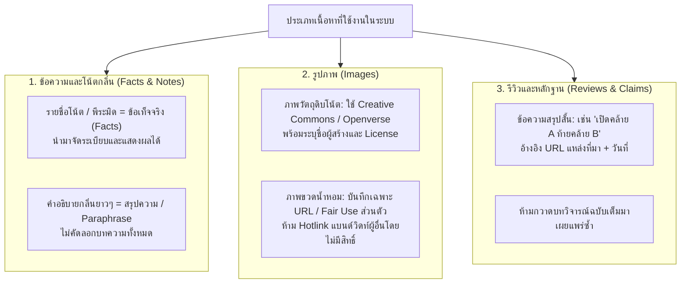

# Rights and Attribution Policy — DoomParfum By TK

> **Document Type:** Intellectual Property, Copyright & Responsible Usage Policy
> **Source Baseline:** `../README.md` (Sections 1.2, 6.2 & 6.4)
> **Status:** Draft / Strict Compliance Policy

---

## 1. Purpose / Scope

เอกสารนี้กำหนดแนวทางปฏิบัติทางกฎหมายและจริยธรรมเกี่ยวกับการจัดเก็บ การแสดงผล และการอ้างอิงเนื้อหาข้อความ รูปภาพ ฐานข้อมูล และรีวิวจากบุคคลภายนอก เพื่อปกป้องโครงการ DoomParfum By TK จากการละเมิดลิขสิทธิ์หรือข้อกำหนดการให้บริการ (Terms of Service)

---

## 2. Policy by Content Category

---

## 3. Strict Rules on Web Scraping & APIs

1. **เคารพเงื่อนไข Terms of Service (ToS):**
   - แหล่งข้อมูลใดที่ระบุใน ToS ห้ามการดึงข้อมูลอัตโนมัติ (Automated Scraping) ระบบจะไม่เขียนสคริปต์ดึงข้อมูลจากแหล่งนั้นโดยเด็ดขาด
2. **ไม่หลบหลีกกลไกป้องกัน (No Bypass of Safeguards):**
   - ไม่เขียนคำสั่งหลบเลี่ยง CAPTCHA, Cloudflare, ระบบ Login หรือข้อจำกัด Rate Limit ของเว็บไซต์ใดๆ
3. **การเข้าถึงบัญชี Shopee:**
   - ระบบ **ไม่เข้าถึงบัญชี Shopee ของผู้ใช้**, ไม่ใช้คุกกี้/เซสชันส่วนบุคคล และไม่มีการจำลองคำสั่งซื้ออัตโนมัติ การทำงานกับ Shopee ทำผ่านการแปะลิงก์ (URL Bookmark) เท่านั้น
4. **การตรวจสอบสิทธิ์อย่างสม่ำเสมอ:**
   - ข้อมูลและรูปภาพทุกชุดต้องมีฟิลด์ `rights_verified: boolean` และ `checked_at: timestamp` หากยังไม่ได้รับการตรวจสอบ จะต้องไม่เผยแพร่สู่สาธารณะ

---

## 4. Attribution Record Standards

เมื่อบันทึกข้อมูลจากแหล่งภายนอก ต้องเก็บบันทึกในตาราง `source_records` ดังนี้:
- `source_name`: ชื่อแหล่งข้อมูล (เช่น Openverse, Scento Dataset, Official Press Release)
- `source_url`: URL ต้นทางที่สามารถตรวจสอบย้อนหลังได้
- `license_type`: สัญญาอนุญาต (เช่น `CC-BY-4.0`, `CC0`, `Public Domain`, `Fair Use Personal`)
- `attribution_text`: ข้อความระบุเกียรติคุณเจ้าของผลงานตามเงื่อนไขสัญญา
- `checked_at`: วันและเวลาที่ทำการตรวจยืนยัน

---

## 5. Requirements Covered

- [[Requirements_Register#R17|R17]] — External Review Evidence with Permitted Rights
- [[Requirements_Register#R21|R21]] — Rights & Attribution Logging

---

## 6. Dependencies & Links

- ทะเบียนแหล่งข้อมูล: [[Source_Registry]]
- การประกันคุณภาพข้อมูล: [[Data_Quality_and_Provenance]]

---

## 7. Change Notes

- `2026-11-10`: จัดทำนโยบายสิทธิ์และการอ้างอิงอย่างเคร่งครัดตามข้อกำหนดใน README
