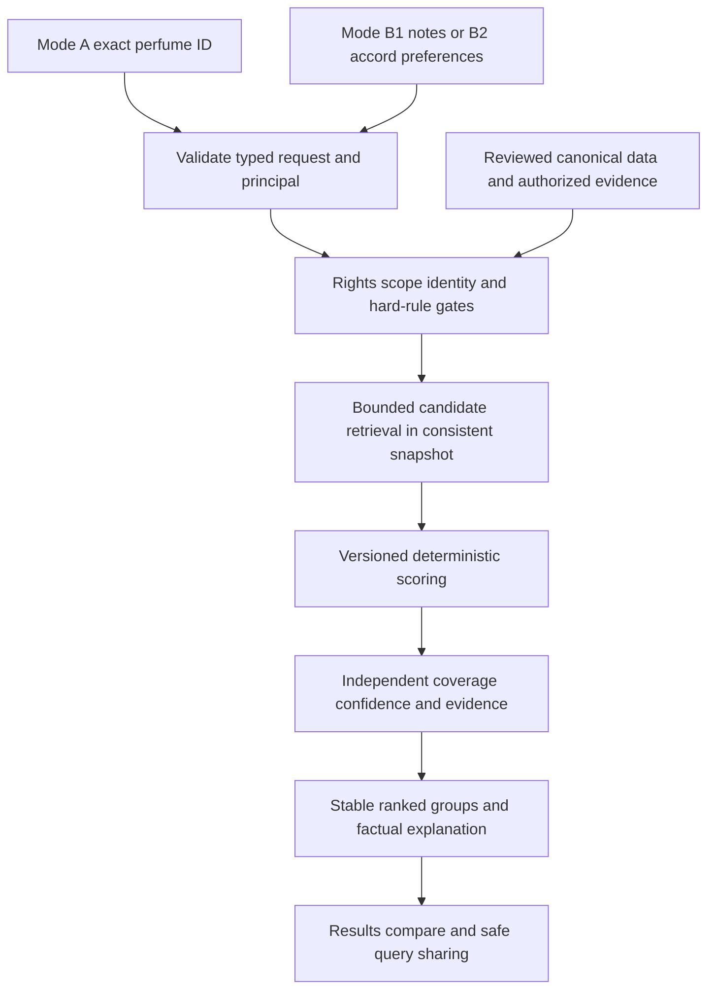

# Dual-Mode Matching Architecture and Formula Contract

All defaults are PROPOSED for Owner review, not calibrated scent accuracy. No algorithm is implemented
in this Planning PR. Synthetic examples are arithmetic oracles, not real perfume comparisons.

## S2 upstream capability boundary — still proposed

Merged PR #5 supplies local private intake, not matching readiness. All1479 matching flags are false;
44 held drafts do not enter candidate scoring. [[P2_Post_PR5_Matching_Reconciliation]] defines the
current data/gate matrix. Real A/B1 require explicit eligible selected inputs and reviewed enumeration/
absence semantics; both real B2 modes are unavailable because no accord labels or strengths are
materialized. Source family/character text cannot manufacture either input. Notes-only/flat formulas
below remain proposals with their original reduced coverage, not evidence of enabled routes.
No raw-staging or admin-read shortcut may bypass scope, rights, review, conflict or eligibility gates.

## Independent pipelines and deterministic contract

Each mode works without calling the other. A reference-to-builder shortcut creates a new B request;
editing it never mutates the catalogue. No external request belongs in the matching request path.
Use approved canonical IDs; notes are olfactory descriptors, not chemical formulas. Access/rights and
review selection gates precede candidate counts, scoring, explanations and caches, not just rendering.

Version names below identify draft specifications: dm-a-pyramid-v1, dm-a-flat-v1,
dm-a-accord-presence-v1, dm-bn-v1, dm-ba-numeric-v1, dm-ba-presence-v1. Persist versioned policy
constants, taxonomy/normalization version and contribution/coverage reason codes. Same visible input
snapshot, principal/policy and method must yield the same unrounded result and ordering. Rank on
unrounded fixed-point/rational values; display one decimal with round-half-up. Reject NaN/infinity,
negative/out-of-range inputs, unknown IDs and contradictory rules; never evaluate user-supplied formulas.

## Mode A — structural comparison

For finite canonical-ID sets, J(X,Y)=|intersection|/|union| when union is nonempty. Both empty is
undefined/null, not perfect similarity. Unknown/incomplete lists are not empty sets. Use a reviewed
complete-as-reported list, not a claim that the perfume's actual composition is exhaustively known.

For comparable closed top/heart/base lists, let L be valid layers and p=(1/4,3/8,3/8).
N=sum(p[l]*J[l], l in L)/sum(p[l], l in L); note coverage n_cov=sum(p[l], l in L).
For layered scoring require at least two comparable layers; a single layer is an explanatory partial
preview with N=null. Known empty vs nonempty can contribute zero; both-empty contributes no coverage.
If layered comparison is insufficient and both profiles have reviewed complete flat/general lists or a complete three-layer
union on the layered side, J(flatA,flatB) is a distinct flat fallback; do not mix general with invented top/heart/base. The latter is an explicit read-only flattening transform retaining source lineage, not a canonical
rewrite or an invented layer. Do not double-count general lists alongside a layered score. Its effective n_cov is capped at 1/2 as a proposed
reliability policy, not measured accuracy. No fallback is inferred from incomplete arrays.

Accord score A: numeric weighted Jaccard if both closed profiles have genuinely observed, finite [0,1]
strengths on the same reviewed taxonomy and compatible scale/normalization contract. For union U,
WJ(x,y)=sum(min(x[a],y[a]),a in U)/sum(max(x[a],y[a]),a in U), denominator>0.
Zero extension is allowed ONLY for explicitly complete-as-reported vectors under an approved
absent-means-zero scale contract, never from a missing row or strength=NULL. Otherwise use binary
Jaccard of reviewed positive accord labels in a separate presence-fallback group, with strength_unknown.
Rank-only input may participate as presence; rank is retained as evidence, not converted to intensity.
Unknown/unmapped/incompatible profiles make A=null. Reliability a_cov=1 numeric, 1/2 presence, 0 absent.

Family score F compares the same taxonomy scheme/version: 1 for equal reviewed primary IDs; 1/2 if
one reviewed primary appears in the other's reviewed secondary set; 0 for known complete incompatible
sets within that scheme; null if missing, unresolved or cross-scheme without a reviewed crosswalk.
No partial name similarity. Families are never auto-converted into notes or accord strengths.

Draft component weights wN=1/2, wA=3/10, wF=1/5. For available components K:
S_A=100*sum(w[k]*component[k],k in K)/sum(w[k],k in K).
Numeric output additionally requires usable N (two layers or flat fallback) OR usable A with at least
one positive label/vector entry. Family alone yields insufficient_data/null. Missing components do not
become zero or fake evidence; unrounded per-component contributions and effective weights are exposed.
Report coverage C=sum(w[k]*reliability[k]); family reliability is 1 when usable. Note reliability is
n_cov. C uses the original denominator 1, not the reduced scoring denominator. A notes-only perfect
match can be 100 with C=0.50 and limited confidence; it never implies complete data or direct evidence.

Grouping prevents false comparability: currentness bucket, then coverage band (C>=0.75, 0.50<=C<0.75,
0<C<0.50), then method family (numeric accords vs presence fallback vs flat), then score descending,
then canonical candidate UUID ascending. Display the ordering policy and groups, with a separate
insufficient-data section not silently scored. No implicit regional, popularity or evidence boost.
Explicit alternative-region/role filters may select Thai/ID/MY/Middle East or any other authorized
catalogue subset; references remain unrestricted. A's score is symmetric for the same chosen method;
filtering/ranking is reference-oriented and excludes self IDs, not different editions of the same line.

## Mode B1 — requested note fit

Normalize clauses to (canonical note ID, exact top/heart/base or any, role, weight). Prefer weight defaults
1; user-adjustable weights, if enabled, must be positive bounded integers 1..5. Must clauses also have
weight 1 by default; excludes have no score weight. Resolve aliases before deduplication. Duplicate
same-ID/same-layer clauses collapse; conflicting roles or any+exact clauses for the same note require
correction. The same note at two exact layers is two deliberate clauses, not an alias duplicate.
Default is exact layer; any matches any reviewed listed layer. Cross-layer partial credit is deferred.

Hard must means observed presence in the requested layer; exclude passes only when absence is
established by complete relevant lists. Unknown fails the strict gate with unverified reason, not a
false assertion of absence. Any-layer exclusion requires complete all-layer/general representation.
Match-all applies to positive clauses; match-any requires at least one positive match. Default minimum
matched positives is 1; a user-selected threshold is a separate gate and cannot be rescued by score.
Only-exclude, zero-positive or unknown-vocabulary queries produce validation/empty-query state, no 100.

For numeric fit, every requested domain must be complete and usable; otherwise show partial known
matches/unknowns without a main percentage. Let m_i in {0,1} indicate a positive clause matched by a
distinct candidate occurrence. A maximum-weight one-to-one assignment resolves eligible matches;
exact clauses cannot reuse one occurrence, and any/exact ambiguity was rejected above.
coverage Q=sum(weight_i*m_i)/sum(weight_i).
Let D be distinct (note ID,layer) occurrences in the comparable candidate domain: exact selected layers
only, or all reviewed listed occurrences if any-layer is requested. Focus H=matched occurrences/|D|,
with H=0 when D is known empty. This extra-note penalty measures reported-list focus, not chemistry.
S_BN=100*(4/5*Q+1/5*H). Report Q and H separately. No renormalization removes unmatched query clauses.
An unknown candidate domain gives null score; partial matches can appear in a labeled unranked preview.
Any-layer and exact-layer requests have different method input hashes. One positive query note always
shows Limited query specificity, even at 100 fit; B fit is directional, not symmetric scent similarity.

## Mode B2 — accord preference fit

User sliders are independent integers 0..100, q[a]=slider/100, not percentages summing to 100. A zero
slider removes the positive preference; it does not mean exclude. Must/exclude are separate controls.
Reject a zero-vector/empty query; zero-positive sliders cannot satisfy minimum matched accords.
If candidate c is a compatible complete observed vector, S_BA=100*WJ(q,c) over the full union of
positive user and candidate keys, not the desired subset alone. Extra strong candidate accords reduce
fit. Candidate components with unknown values are not padded with zero: numeric mode is unavailable.
Require a documented versioned source-scale transform; do not normalize each vector by its sum or max
silently. Preference scale and source relative scale must have an owner-approved comparison contract.

For rank/presence-only compatible profiles, fallback fit=100*sum(q[a] for requested positive labels
observed present)/sum(q[a] for requested positive labels). Label Desired-accord presence fit;
candidate intensity unknown; extra accords listed but not penalized for unobserved loudness. Exclude
and absence handling require complete relevant lists as in B1. Missing/unknown requested labels yield
null fallback score rather than presumed absence; known absence in a closed list contributes zero.
No numeric/presence mixed ranking. Minimum matched accords counts distinct positive requested IDs,
defaults to 1 and is enforced before scoring. B2 ranking within currentness/method/coverage groups is
score descending then stable UUID; confidence/evidence are not multiplied into fit.

## Data confidence and pairwise evidence are independent

Return Data Confidence as high/medium/limited with reasons, not a probability: high requires A's C>=0.75
(or B's complete requested domains and numeric-compatible accords for B2), all used claims selected/
approved, no relevant unresolved conflict, verified identity and known fresh provenance. Medium requires
A's C>=0.50 (or complete B1/B2 presence domains), approved inputs, known provenance; otherwise limited.
Single-note specificity, flat/presence fallback and unknown freshness cap at medium; any used field
under conflict is withheld, with confidence recalculated. A draft 730-day freshness cap is a policy
target requiring source-specific review, never permission to use expired grants. Confidence describes
input support, not evidence consensus. No review count can improve Data Confidence by itself.

Pairwise evidence panel returns none / supporting / disputed, independent publisher groups, exact pair
and editions, direction, claim type, dates, rights and permitted summaries/links. A reviewed direct
alternative claim with no unresolved opposition can produce Documented Alternative (reported), even
when structural score is null; never Official Inspired By without explicit primary evidence. Disputed
claims retain both sides. Ratings/review counts and reported source percentages are not structural
features. B has no reference pair, so no direct-pair evidence badge attaches to the custom query;
users may inspect catalogue-pair evidence separately after choosing two real perfumes.

## Service/performance/security design targets

Typed read-only interface is framework-neutral; SQL retrieval plus pure application scoring is the
proposal, SQL-only scoring is an alternative after benchmark. Python ETL is upstream only. No runtime
language/provider/ORM is accepted here. Proposed request caps: 30 positive/excluded note clauses total,
20 accord IDs, page size <=50, 8KiB serialized public query, 10k candidate ceiling, 5s query timeout.
These are test targets, NOT measured capacity/SLA. Reject out-of-bound requests; never silently truncate
the candidate pool and claim global best matches. A bounded scan is the exact baseline. A future
indexed shortlist must demonstrate top-k recall against it; over-cap result is explicit query_too_broad.

Snapshot covers catalogue selections, rights/membership policy, normalization/taxonomy and lifecycle
filters. Keyset pagination carries signed snapshot/version/filter hash and last full sort tuple; expiry
or policy change forces restart. No automatic N-squared relation creation/precompute. Revalidate rights
and principal membership before each page/render/export/asset delivery, including cache hits; snapshot
does not freeze authorization. Private input/evidence cannot contribute to public scores, counts or
labels. Cache keys include principal or exact authorized-scope set plus membership/rights epoch,
mode/input hash/policy/method/data snapshot; a TTL alone is not revocation handling. Revocation/expiry
invalidates results and removes affected explanations/counts. No shared browser/service-worker cache
of private queries or protected result payloads. Logs redact query/preferences/IDs where private.
