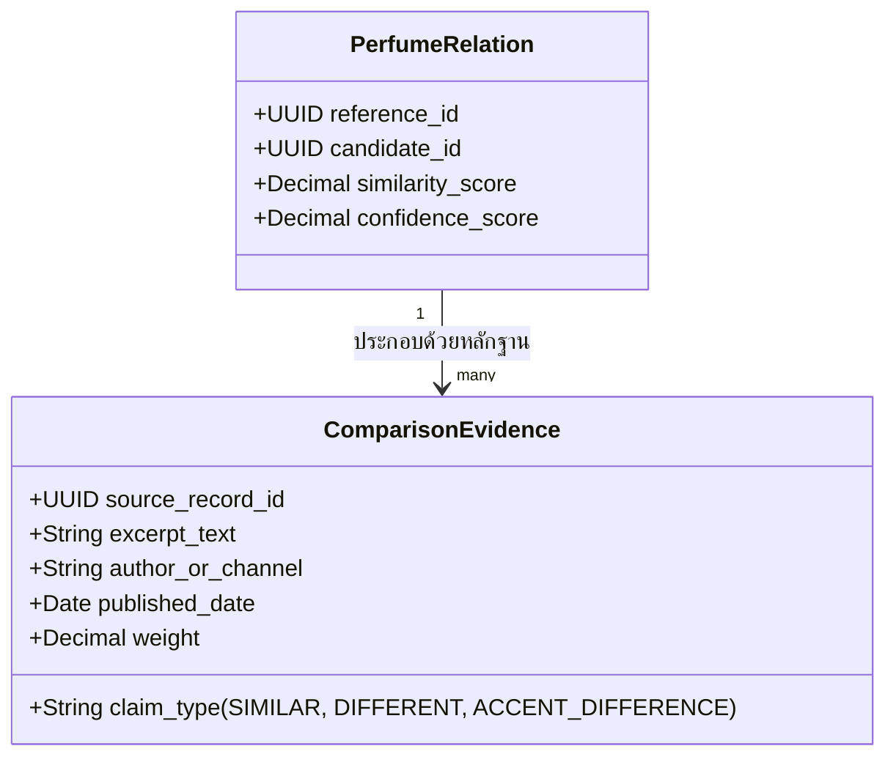
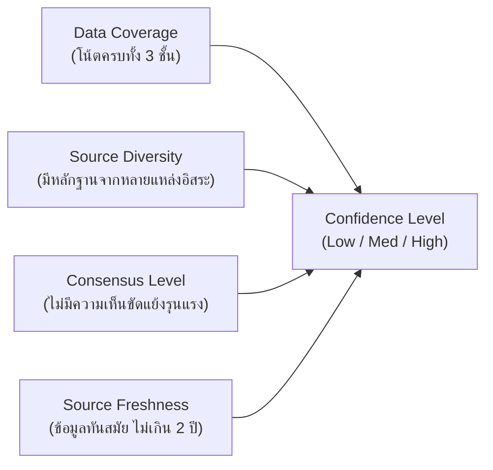

# Review Evidence and Confidence — DoomParfum By TK

> **Document Type:** Community Claims, Evidence Modeling & Confidence Scoring
> **Source Baseline:** `../README.md` (Sections 4.2 & 5.2)
> **Status:** Draft / Proposed Formulation

---

## 1. Purpose / Scope

เอกสารนี้กำหนดวิธีการจัดเก็บ การประเมิน และการถ่วงน้ำหนัก **หลักฐานความคิดเห็นจากชุมชนและผู้เชี่ยวชาญ (Review Evidence)** เพื่อสนับสนุนการเปรียบเทียบกลิ่น พร้อมกำหนดกฎเกณฑ์ป้องกันการตีความคะแนนผิดพลาด

---

## 2. Fundamental Distinctions (ข้อห้ามปะปนข้อมูล)

> [!CAUTION]
> **กฎเหล็กของโมเดลหลักฐาน [CONFIRMED]:**
> 1. **Rating $\neq$ Similarity:**
>    คะแนนความพึงพอใจโดยรวมของน้ำหอม (Overall Rating เช่น 4.5/5 ดาว) หรือคะแนนความติดทน (Longevity) **ไม่ได้แปลว่าน้ำหอมนั้นมีกลิ่นเหมือนกับรุ่นต้นแบบ** ห้ามนำคะแนนความนิยมมาบวกเป็นคะแนนความเหมือนเด็ดขาด
> 2. **Pairwise Evidence is Specific:**
>    หลักฐานความเหมือนต้องระบุคู่เฉพาะเจาะจง (Pairwise Claim ระหว่าง Perfume A และ Perfume B)
> 3. **Preserve Contradictions:**
>    หากรีวิว A บอกว่า "เหมือน 90%" แต่รีวิว B บอกว่า "ไม่เหมือนเลย กลิ่นสังเคราะห์กว่ามาก" ระบบต้องบันทึกทั้งสองมุมมองและปรับลดคะแนนความเชื่อมั่น (Confidence) ลง

---

## 3. Evidence Data Structure

หลักฐานความคล้ายจะถูกจัดเก็บในตาราง `comparison_evidence` เชื่อมโยงกับ `perfume_relations`:

### 3.1 Claim Types (ประเภทข้อความอ้างอิง)
- `DIRECT_DUPE`: ระบุว่าสร้างขึ้นเพื่อทดแทนกัน หรือกลิ่นแทบแยกไม่ออก
- `CLOSE_ALTERNATIVE`: ระบุว่าเปิดกลิ่นคล้ายกันมาก แต่ช่วงดรายดาวน์มีเอกลักษณ์เฉพาะ
- `DIFFERENT_PROFILE`: ระบุว่ามีบางโน้ตตรงกัน แต่ดมแล้วให้ความรู้สึกคนละแนว
- `PERFORMANCE_CONTRAST`: ระบุความต่างด้านความทน การกระจายตัว หรือเกรดของวัตถุดิบ

---

## 4. Confidence Calculation Factors

ดัชนีความเชื่อมั่น ($C_{score}$) คำนวณจาก 4 ปัจจัยหลัก:

1. **Source Diversity & Independence:**
   - 1 แหล่งข้อมูล (เช่น บล็อกเกอร์คนเดียว) = ค่าความเชื่อมั่นต่ำ
   - 3+ แหล่งข้อมูลที่เป็นอิสระต่อกันและให้ความเห็นไปในทิศทางเดียวกัน = ค่าความเชื่อมั่นสูง
2. **Freshness & Reformulation Awareness:**
   - น้ำหอมที่มีการปรับสูตร (Reformulation) ในช่วงปีหลังอาจทำให้รีวิวเก่าไม่ตรงกับขวดปัจจุบัน ข้อมูลที่มีอายุน้อยกว่าจะมีค่าน้ำหนักความสดใหม่สูงกว่า

---

## 5. UI Evidence Representation (การแสดงผลในหน้าจอ)

ในหน้าจอเปรียบเทียบ ([[Compare_View]]) ข้อมูลหลักฐานจะถูกแสดงอย่างโปร่งใส:
- **แถบความคล้าย (Similarity Bar):** แสดงตัวเลข % พร้อมระบุ "คำนวณจากโครงสร้างโน้ตและสถิติ"
- **แถบความเชื่อมั่น (Confidence Badge):**
  - 🟢 **High Confidence:** มีข้อมูลพีระมิดครบ และมีรีวิวรับรองตรงกัน 3 แหล่งขึ้นไป
  - 🟡 **Medium Confidence:** ข้อมูลโน้ตครบถ้วน แต่มีรีวิวอ้างอิงเพียง 1 แหล่ง
  - ⚪ **Low / Experimental:** ข้อมูลโน้ตบางส่วนยังไม่สมบูรณ์ หรือไม่มีรีวิวเปรียบเทียบโดยตรง
- **กล่องข้อความอ้างอิง (Evidence Quotes):** แสดงโควทสั้นๆ และลิงก์ไปยังที่มาต้นทาง

---

## 6. Requirements Covered

- [[Requirements_Register#R07|R07]] — Notes/Accords & Review Evidence Comparison
- [[Requirements_Register#R17|R17]] — External Review Evidence Display
- [[Requirements_Register#R18|R18]] — Separate Similarity from Confidence

---

## 7. Dependencies & Links

- สูตรการจับคู่: [[Scent_Matching_Spec]]
- ทะเบียนแหล่งข้อมูล: [[Source_Registry]]
- หน้าจอเปรียบเทียบ: [[Compare_View]]

---

## 8. Change Notes

- `2026-11-10`: ร่างข้อกำหนดการจัดการหลักฐานรีวิว แยกคะแนนความนิยมออกจากความเหมือนชัดเจน
