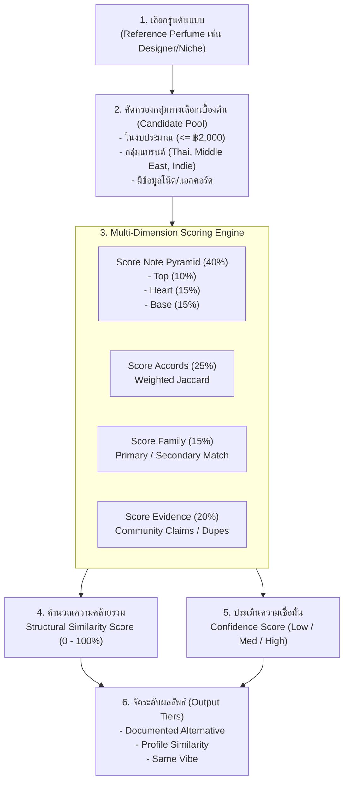

# Scent Matching Specification — DoomParfum By TK

> **Document Type:** Scent DNA Matching Algorithm & Logic
> **Source Baseline:** `../README.md` (Section 5)
> **Status:** Draft / Proposed Formulation

---

## 1. Purpose / Scope

เอกสารนี้กำหนดข้อกำหนดทางคณิตศาสตร์และตรรกะสำหรับ **เครื่องมือจับคู่กลิ่น (Scent Matching Engine)** เพื่อค้นหาน้ำหอมทางเลือกที่มีกลิ่นใกล้เคียงกับน้ำหอมต้นแบบ (Reference Perfume) โดยอาศัยโครงสร้างพีระมิดโน้ต, แอคคอร์ด, ตระกูลกลิ่น, และหลักฐานจากรีวิว

> [!NOTE]
> ค่าน้ำหนักคะแนนและสูตรคำนวณในเอกสารนี้อยู่ในสถานะ **`[PROPOSED]`** เพื่อการทดลองในระยะ P2 ยังไม่ใช่สูตรตายตัว

---

## 2. Matching Pipeline Architecture

---

## 3. Mathematical Formulation `[PROPOSED]`

### 3.1 Composite Similarity Score ($S_{total}$)

คะแนนความคล้ายคลึงเชิงโครงสร้างรวมคำนวณจากสูตรถ่วงน้ำหนัก:

$$S_{total} = (w_{notes} \cdot S_{notes}) + (w_{accords} \cdot S_{accords}) + (w_{family} \cdot S_{family}) + (w_{evidence} \cdot S_{evidence})$$

โดยมีค่าน้ำหนักข้อเสนอดังนี้:
- $w_{notes} = 0.40$ (โครงสร้างพีระมิดโน้ต)
- $w_{accords} = 0.25$ (ความเด่นของ Accords)
- $w_{family} = 0.15$ (ตระกูลกลิ่นหลักและรอง)
- $w_{evidence} = 0.20$ (หลักฐานความคล้ายจากรีวิวภายนอก)

### 3.2 Note Pyramid Scoring ($S_{notes}$)
พีระมิดโน้ตถูกแบ่งน้ำหนักตามชั้น:
$$S_{notes} = (0.25 \cdot J(Top_A, Top_B)) + (0.375 \cdot J(Heart_A, Heart_B)) + (0.375 \cdot J(Base_A, Base_B))$$
โดย $J(A, B)$ คือดัชนี **Jaccard Similarity Coefficient** ระหว่างเซตของโน้ตที่ผ่านการ Normalize แล้ว:
$$J(A, B) = \frac{|A \cap B|}{|A \cup B|}$$

### 3.3 Accord Scoring ($S_{accords}$)
คำนวณโดยใช้ Weighted Cosine Similarity หรือ Weighted Jaccard ตามค่าน้ำหนักความเด่น (`score_weight`) ของแต่ละ Accord ที่มีในน้ำหอมทั้งสองรุ่น

### 3.4 Handling Missing Data & Coverage Penalties
- หากน้ำหอมฝั่ง Candidate ขาดข้อมูลชั้นโน้ต (เช่น มีเฉพาะ All Notes ไม่แยกชั้น):
  - ระบบจะไม่ถือว่าคะแนนชั้นที่ขาดเป็น 0% ทันที แต่จะคำนวณ $S_{notes}$ จาก Overall Note Overlap
  - **แต่ระบบจะปรับลด Confidence Score ลงตามสัดส่วนการขาดหายของข้อมูล**

---

## 4. Evidence Confidence Score ($C_{score}$)

> [!IMPORTANT]
> **แยก Similarity Score ออกจาก Confidence Score เด็ดขาด (R18):**
> น้ำหอมสองรุ่นอาจมีคะแนน Similarity สูงมาก (เช่น 92%) แต่ถ้ามีข้อมูลเพียง 3 โน้ตและไม่มีรีวิวใดๆ ค่า Confidence จะอยู่ในระดับ **LOW** เพื่อเตือนให้ผู้ใช้ทราบว่าผลลัพธ์นี้อ้างอิงจากข้อมูลจำกัด

ปัจจัยที่มีผลต่อ Confidence Score:
1. **Data Coverage:** มีข้อมูล Top, Heart, Base, Accords ครบทั้งสองรุ่น (+40%)
2. **Review Quantity & Quality:** มีการกล่าวถึงความคล้ายจากหลายแหล่งอิสระ (+30%)
3. **No Contradictions:** ไม่มีรีวิวที่โต้แย้งอย่างรุนแรงว่ากลิ่นต่างกันสิ้นเชิง (+20%)
4. **Source Freshness:** ข้อมูลได้รับการตรวจสอบและอัปเดตอย่างสม่ำเสมอ (+10%)

---

## 5. Output Classification Tiers (ผลลัพธ์ 3 ระดับ)

ระบบจะจัดกลุ่มผลการจับคู่ออกเป็น 3 ระดับเพื่อให้ผู้ใช้เข้าใจได้ง่าย:

| Output Tier | เกณฑ์การจัดกลุ่ม | คำอธิบายให้ผู้ใช้ |
|---|---|---|
| **Tier 1: Documented Alternative** | มีหลักฐานรีวิวชัดเจน ($S_{evidence} > 70\%$) และโครงสร้างคล้าย ($S_{total} \ge 75\%$) | มีชื่อเสียงและหลักฐานในชุมชนว่าเป็นตัวเลือกทดแทนกันได้โดยตรง |
| **Tier 2: Profile Similarity** | โครงสร้างโน้ตและ Accords ตรงกันสูง ($S_{notes+accords} \ge 70\%$) แม้ไม่มีรีวิวตรง | มี DNA ของกลิ่นใกล้เคียงกันตามสูตรโน้ต เหมาะสำหรับผู้ชอบแนวกลิ่นนี้ |
| **Tier 3: Same Vibe** | ตระกูลกลิ่นเดียวกันและมีโน้ตหลักตรงกันบางส่วน ($50\% \le S_{total} < 70\%$) | บุคลิกภาพหรืออารมณ์ของกลิ่นคล้ายกัน แต่อาจมีเอกลักษณ์เฉพาะตัวต่างออกไป |

---

## 6. Explainability (การอธิบายเหตุผล)

ทุกผลลัพธ์การจับคู่ต้องมีกล่องคำอธิบาย (Explainability Box):
- **จุดที่ตรงกัน (Shared Elements):** รายชื่อโน้ตที่ตรงกันในแต่ละชั้น (เช่น "เปิดด้วย Bergamot เหมือนกัน, ฐานมี Ambroxan เหมือนกัน")
- **จุดที่ต่างกัน (Key Divergences):** โน้ตเด่นที่มีในรุ่นหนึ่งแต่ไม่มีในอีกรุ่นหนึ่ง (เช่น "รุ่น B มีกลิ่นควัน Birch เพิ่มเข้ามา ทำให้เข้มกว่ารุ่น A")
- **คำเตือน (Caveats):** "รุ่นทางเลือกอาจมีความหวานมากกว่าในกลิ่นเปิดตามความเห็นของผู้ใช้"

---

## 7. Requirements Covered

- [[Requirements_Register#R05|R05]] — Designer/Niche Reference Lookup
- [[Requirements_Register#R07|R07]] — Note/Accord Structural Matching
- [[Requirements_Register#R16|R16]] — Structural Similarity Scoring
- [[Requirements_Register#R18|R18]] — Separate Similarity from Confidence

---

## 8. Dependencies & Links

- หลักฐานรีวิวและความเชื่อมั่น: [[Review_Evidence_and_Confidence]]
- กรณีทดสอบจำลอง: [[Matching_Test_Cases]]
- สเปกหน้าจอเปรียบเทียบ: [[Compare_View]]

---

## 9. Change Notes

- `2026-11-10`: ร่างสเปกการจับคู่กลิ่น กำหนดสูตรน้ำหนัก 40/25/15/20 และแบ่ง 3 Tiers ผลลัพธ์

## Research addendum — distinguish 80% structural features and 20% evidence (2026-11-11, PROPOSED)

The v0 composite formula combines note pyramid 40%, accords 25%, family 15% and community evidence 20%, but labels the whole as *Structural Similarity*. Review NEW-08 before coding: present structural note/accord/family scoring separately from source-backed Dupe reports and evidence confidence; an optional combined recommendation rank should have a distinct name/version. A high structural overlap is an exploratory candidate, not confirmed same scent. Missing layers/accords limit confidence; never insert fake zero/100% values. Exact perfume-to-perfume relationship claims need publisher evidence, dates, independent sources, rights and contradictions. See [[DPT-PLAN-002_Catalogue_Coverage_Images_Matching_Addendum]]; no implementation is authorized by this addendum.
