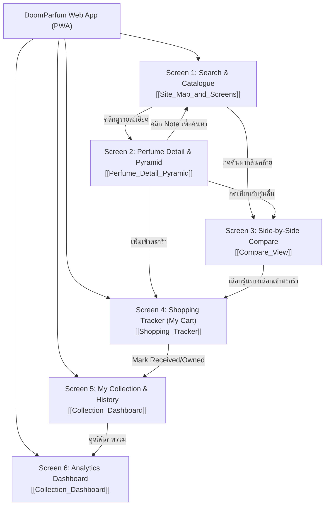

# Site Map and Screens Overview — DoomParfum By TK

## Proposed dual-mode discovery routes — DPT-PLAN-003

[[Dual_Mode_Scent_Search_UX]] adds independent Similar to a perfume and Build a scent profile entries
with B1 Notes/B2 Accords tabs, safe sharing, coverage groups and separate evidence. Existing Compare
remains side-by-side real profiles; older mockups do not authorize chemical/intensity/dupe assertions.
These are planning requirements, no screens/routes implemented; cart/ownership semantics unchanged.

> **Document Type:** UX Architecture, Navigation Hierarchy & Screen Inventory
> **Source Baseline:** `../README.md` (Section 5.4 & Section 2)
> **Status:** Draft / Proposed UX Structure

---

## 1. Purpose / Scope

เอกสารนี้ระบุโครงสร้างแผนผังเว็บไซต์ (Site Map), ลำดับการเข้าถึงหน้าจอ (Navigation Hierarchy), และภาพรวมของ 6 หน้าจอหลักในแอปพลิเคชัน เพื่อให้การออกแบบ UI สอดคล้องกับพฤติกรรมการใช้งานจริงของผู้ใช้

---

## 2. Information Architecture & Site Map

---

## 3. Inventory of Core Screens

| Screen # | Screen Name | Route Path | หน้าที่หลัก | ข้อกำหนดที่รองรับ |
|---|---|---|---|---|
| **Screen 1** | **Search & Catalogue** | `/` หรือ `/explore` | ค้นหาน้ำหอมตามชื่อ แบรนด์ กรองตามช่วงราคา (<= ฿2,000), เพศ, ฤดูกาล, และ Accords | R01, R04, R06, R08 |
| **Screen 2** | **Perfume Detail & Pyramid** | `/perfumes/:slug` | แสดงพีระมิดโน้ต Top/Heart/Base พร้อมภาพวัตถุดิบ, คลิก Note เพื่อหาต่อ, ข้อมูลแบรนด์ | R02, R03, R13, R14 |
| **Screen 3** | **Side-by-Side Compare** | `/compare?ref=:id&cand=:id` | เปรียบเทียบสองรุ่นเคียงข้าง ไฮไลต์โน้ตตรง/ต่าง, คะแนนความคล้าย, หลักฐานรีวิว | R05, R07, R15, R16, R17, R18 |
| **Screen 4** | **Shopping Tracker (My Cart)** | `/cart` | รายการเตรียมซื้อส่วนตัว, บันทึกลิงก์ Shopee หลายร้าน, ปุ่ม Mark as Ordered (ไม่มี Checkout) | R09, R10, R23, R24, R25, R30 |
| **Screen 5** | **My Collection & Inventory** | `/collection` | จัดการขวดน้ำหอมที่ครอบครองจริง สถานะ Owned, Finished, Sold, Gifted พร้อมประวัติการซื้อ | R11, R26, R28, R29 |
| **Screen 6** | **Collection Dashboard** | `/dashboard` | แดชบอร์ดวิเคราะห์สถิติน้ำหอมที่เคยซื้อ vs มีอยู่จริง, สัดส่วนแบรนด์, ตระกูลกลิ่น, โน้ต | R27, R31 |

---

## 4. Global UI States & Edge Cases

ในทุกหน้าจอ ต้องรองรับสถานะระบบตามจริง:
1. **Empty State:** เมื่อผู้ใช้ยังไม่เคยเพิ่มข้อมูล (เช่น ตะกร้าว่าง, คอลเลกชันยังไม่มีรายการ) แสดงคำแนะนำและปุ่มลัด
2. **Missing Data State:** หากน้ำหอมบางรุ่นไม่มีข้อมูล Top/Heart/Base แสดง Badge `ข้อมูลพีระมิดยังไม่สมบูรณ์` อย่างตรงไปตรงมา
3. **Loading / Skeleton State:** แสดง Skeleton Placeholder ระหว่างการดึงข้อมูลเพื่อประสบการณ์ที่ลื่นไหล
4. **Network Offline State:** รองรับการบันทึกข้อมูลแบบ Offline-first ผ่าน PWA Local Cache

---

## 5. Requirements Covered

- [[Requirements_Register#R01|R01]], [[Requirements_Register#R04|R04]], [[Requirements_Register#R08|R08]]
- [[Requirements_Register#R13|R13]], [[Requirements_Register#R14|R14]], [[Requirements_Register#R15|R15]]
- [[Requirements_Register#R23|R23]], [[Requirements_Register#R25|R25]], [[Requirements_Register#R27|R27]]

---

## 6. Dependencies & Links

- หน้ารายละเอียดพีระมิด: [[Perfume_Detail_Pyramid]]
- หน้าเปรียบเทียบ: [[Compare_View]]
- หน้าจัดการตะกร้า: [[Shopping_Tracker]]
- หน้าคอลเลกชันและแดชบอร์ด: [[Collection_Dashboard]]

---

## 7. Change Notes

- `2026-11-10`: ร่างโครงสร้าง Site Map และระบุ 6 หน้าจอหลักครบถ้วน

## Post-PR28 architecture refinement checkpoint — 2026-11-16

Verified main `168715bc9bc5fff968524074257dc106a8a63638` contains Owner-merged PR26, PR27 and PR28. PR28 merged from head `6521c5201f4f4d0e85c4fd8542db222284e96e9e` at UTC `2026-11-15T17:39:38Z`. Its general direction is confirmed; exact POST27 A–I choices are not accepted. POST27-ODP-1 and SHA `0ccf48fa57401635a3f1b5898f4547978ebdc408e522cd3cc52138f3f341b18c` remain unchanged. IMP-ENR-01 is not started.

[[DPT-PLAN-010_System_Architecture_Refinement]] owns one docs-only amendment branch `plan/post-pr28-architecture` and a future Draft Planning PR. [[System_Architecture_Refinement]] joins eight C4-style/sequence diagrams, 30 components and an explicit source dependency DAG, 17 proposed routes retaining the full product roadmap, 28 proposed operation interfaces, strict DTO/state/rights contracts and [[UI_Element_Function_Matrix]]. All UI handlers/application services are PROPOSED, not source APIs. No framework/driver/ORM/auth provider/port/image, numeric transport policy or new rights are selected.

[[Architecture_Alternatives_and_ADR]] recommends retaining CLI now and a Python-first boundary with logically separate UI after exact decisions; [[Architecture_Owner_Review_Packet]] version POST28-ARCH-ODP-1 proposes choices and A–I impacts without answering them. [[Dependency_Based_Implementation_Roadmap]] separates preview, selected fields/eligibility, genuine principal, read service, shell/pages, media, real methods, private records, dashboard and operations. Factual catalogue access does not require real matching eligibility, but it still needs an authorized accessible scope and field rights.

Current code remains approved Python/operator/SQL tooling plus fixed-fixture synthetic M1/B1. Real records must never be relabelled as synthetic. Genuine nonadmin initial LOGIN, object/field/use rights and current snapshots precede restricted lookup/count/page/scoring/bytes; no admin fetch/filter or browser identity claim. Fit, confidence and direct evidence remain separate. Unknown is not zero; incomplete is not absent. No new live DB/source/media/runtime proof is inferred from historical tests or diagrams.

All 24 prior receipts, eight migrations, accepted contracts, 43 proposals, 44 holds and Khamrah evidence are protected. PR8 remains OPEN/DRAFT/BLOCKED at `84dccb117971ab65e0bf39fa3d1d84a12d344f8d`; no temporal/replay experiment or speculative fix. No acquisition, image bytes, normalization, hold/eligibility change, API/UI/auth/cache/service-worker/framework implementation, installation/configuration, database operation, cloud, Production mutation or agent merge. [[DPT-PLAN-010_Architecture_Verification]] records actual research/static/independent evidence and future NOT RUN tests separately.

IA reconciliation: the older six-page presentation remains historical product intent. [[Unified_Information_Architecture]] is the canonical proposed IA inside this amendment: three areas and17routes retain My Cart, manual Ordered, physical collection, EverPurchased/history, Dashboard and matching-specific views. Mock counts/prices/wireframe charts here are illustrations, not current catalogue or personal facts. No route is implemented and no old requirement is removed.
