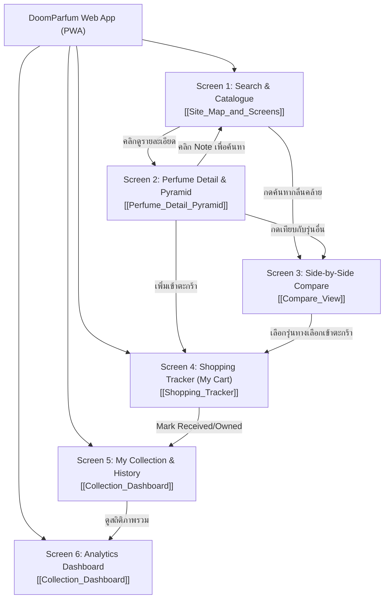

# Site Map and Screens Overview — DoomParfum By TK

> **Document Type:** UX Architecture, Navigation Hierarchy & Screen Inventory
> **Source Baseline:** `../README.md` (Section 5.4 & Section 2)
> **Status:** Draft / Proposed UX Structure

---

## 1. Purpose / Scope

เอกสารนี้ระบุโครงสร้างแผนผังเว็บไซต์ (Site Map), ลำดับการเข้าถึงหน้าจอ (Navigation Hierarchy), และภาพรวมของ 6 หน้าจอหลักในแอปพลิเคชัน เพื่อให้การออกแบบ UI สอดคล้องกับพฤติกรรมการใช้งานจริงของผู้ใช้

---

## 2. Information Architecture & Site Map

---

## 3. Inventory of Core Screens

| Screen # | Screen Name | Route Path | หน้าที่หลัก | ข้อกำหนดที่รองรับ |
|---|---|---|---|---|
| **Screen 1** | **Search & Catalogue** | `/` หรือ `/explore` | ค้นหาน้ำหอมตามชื่อ แบรนด์ กรองตามช่วงราคา (<= ฿2,000), เพศ, ฤดูกาล, และ Accords | R01, R04, R06, R08 |
| **Screen 2** | **Perfume Detail & Pyramid** | `/perfumes/:slug` | แสดงพีระมิดโน้ต Top/Heart/Base พร้อมภาพวัตถุดิบ, คลิก Note เพื่อหาต่อ, ข้อมูลแบรนด์ | R02, R03, R13, R14 |
| **Screen 3** | **Side-by-Side Compare** | `/compare?ref=:id&cand=:id` | เปรียบเทียบสองรุ่นเคียงข้าง ไฮไลต์โน้ตตรง/ต่าง, คะแนนความคล้าย, หลักฐานรีวิว | R05, R07, R15, R16, R17, R18 |
| **Screen 4** | **Shopping Tracker (My Cart)** | `/cart` | รายการเตรียมซื้อส่วนตัว, บันทึกลิงก์ Shopee หลายร้าน, ปุ่ม Mark as Ordered (ไม่มี Checkout) | R09, R10, R23, R24, R25, R30 |
| **Screen 5** | **My Collection & Inventory** | `/collection` | จัดการขวดน้ำหอมที่ครอบครองจริง สถานะ Owned, Finished, Sold, Gifted พร้อมประวัติการซื้อ | R11, R26, R28, R29 |
| **Screen 6** | **Collection Dashboard** | `/dashboard` | แดชบอร์ดวิเคราะห์สถิติน้ำหอมที่เคยซื้อ vs มีอยู่จริง, สัดส่วนแบรนด์, ตระกูลกลิ่น, โน้ต | R27, R31 |

---

## 4. Global UI States & Edge Cases

ในทุกหน้าจอ ต้องรองรับสถานะระบบตามจริง:
1. **Empty State:** เมื่อผู้ใช้ยังไม่เคยเพิ่มข้อมูล (เช่น ตะกร้าว่าง, คอลเลกชันยังไม่มีรายการ) แสดงคำแนะนำและปุ่มลัด
2. **Missing Data State:** หากน้ำหอมบางรุ่นไม่มีข้อมูล Top/Heart/Base แสดง Badge `ข้อมูลพีระมิดยังไม่สมบูรณ์` อย่างตรงไปตรงมา
3. **Loading / Skeleton State:** แสดง Skeleton Placeholder ระหว่างการดึงข้อมูลเพื่อประสบการณ์ที่ลื่นไหล
4. **Network Offline State:** รองรับการบันทึกข้อมูลแบบ Offline-first ผ่าน PWA Local Cache

---

## 5. Requirements Covered

- [[Requirements_Register#R01|R01]], [[Requirements_Register#R04|R04]], [[Requirements_Register#R08|R08]]
- [[Requirements_Register#R13|R13]], [[Requirements_Register#R14|R14]], [[Requirements_Register#R15|R15]]
- [[Requirements_Register#R23|R23]], [[Requirements_Register#R25|R25]], [[Requirements_Register#R27|R27]]

---

## 6. Dependencies & Links

- หน้ารายละเอียดพีระมิด: [[Perfume_Detail_Pyramid]]
- หน้าเปรียบเทียบ: [[Compare_View]]
- หน้าจัดการตะกร้า: [[Shopping_Tracker]]
- หน้าคอลเลกชันและแดชบอร์ด: [[Collection_Dashboard]]

---

## 7. Change Notes

- `2026-11-10`: ร่างโครงสร้าง Site Map และระบุ 6 หน้าจอหลักครบถ้วน
