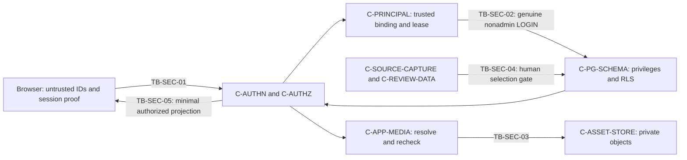

# Authorization and trust boundaries

**PROPOSED — DPT-PLAN-010, documentation only.** Source inspection baseline: `168715bc9bc5fff968524074257dc106a8a63638`. No application authentication, principal provisioning, API, UI, real ranking, cache, source intake or media delivery is implemented by this document. [[System_Architecture_Refinement]], [[C4_Context_and_Container_Design]], [[Architecture_Owner_Review_Packet]] and [[State_and_Error_Contracts]] govern the connected proposal. Machine-readable acceptance design: [[Architecture_Security_and_Cache_Model.json]].

## Verified current boundary

`database/migrations/005_contract_functions.sql` defines `dpt_guard.principal_id()` as the user whose immutable `users.auth_subject` equals `session_user::text`. `can_read_scope` admits public scope, the private owner, or a non-revoked member of an explicitly shared scope. Membership does not convert another user's private scope into a shared one. Immutable guards reject subject, scope-kind and private-owner changes. They are not application login provisioning.

`database/matching_input.py` has operator Python/SQL adapter source. Its query starts `READ COMMITTED READ ONLY`, enables row security, and sets existing statement/lock limits of three/one seconds. Its admission guard requires `session_user=current_user`, `dpt_runtime` membership, no `dpt_owner` membership and no superuser/BYPASSRLS attribute for those identities. These are existing adapter controls, not proposed application performance budgets and not complete least-privilege proof. `read_profile` returns a rights/provenance-aware input with ranking disabled; it is not an application session, transport or authorized real scorer.

Migration 006 adds operation-specific media rights checks and deferred integrity contracts. Migration 008 coalesces validation scheduling and retains the existing validators; it does not create a web principal or relax identity. Existing privileged operator tooling is a separate trust plane. Historical test receipts remain historical; no live PostgreSQL/RLS, Docker, role, session or application test ran in this task. Live server version is **UNKNOWN**. Historical Docker absence was **not revalidated**.

## Trust boundaries — PROPOSED

| Boundary | Components and interfaces | Required control |
|---|---|---|
| TB-SEC-01 — Browser to application service | C-UI-PAGES, C-TRANSPORT, C-AUTHN, C-AUTHZ; IF-AUTH-SESSION-1 | Treat all IDs, headers, filters, claimed roles and DTO fields as untrusted; validate session proof at the service. Browser authentication does not prove a PostgreSQL login. |
| TB-SEC-02 — Service to PostgreSQL | C-PRINCIPAL, C-PG-READ, C-PG-WRITE, C-PG-SCHEMA; IF-PRINCIPAL-LEASE-1 | Lease a genuine nonadmin LOGIN connection for the exact authenticated subject; retain immutable session_user mapping, current privilege checks, RLS and transaction cleanup. |
| TB-SEC-03 — Application to media objects | C-APP-MEDIA, C-ASSET-VALIDATOR, C-ASSET-STORE; IF-MEDIA-RESOLVE-1, IF-MEDIA-DELIVER-1 | Resolve only authorized metadata, then operation-specific source and asset rights; private object keys and hashes are not bearer grants. |
| TB-SEC-04 — Intake to reviewed canonical selection | C-SOURCE-CAPTURE, C-REVIEW-DATA, C-APP-REVIEW, C-PG-WRITE; IF-SOURCE-INTAKE-REQUEST-1, IF-REVIEW-DECISION-WRITE-1 | Acquisition, raw claims, normalization proposals, review decisions, selected fields and eligibility remain independent gated records. |
| TB-SEC-05 — Private operational data to browser/storage/audit | C-APP-CATALOGUE, C-APP-MATCH, C-APP-PRIVATE, C-UI-PAGES, C-AUDIT; IF-SESSION-END-1, IF-PRIVATE-SETTINGS-1 | Project only authorized fields; no persistent operational browser/shared caches, secrets, private payload logs or cross-principal state reuse. |

## Genuine principal alternatives and recommendation

| Alternative | Exact consequence | Design recommendation and gate |
|---|---|---|
| Clean application-private pilot | Establish a new genuine nonadmin LOGIN identity and private scope **before** any separately authorized intake. Preserve operator identities, observations, owners and scopes. Verify new-scope provenance and exact rights rather than moving old private rows. | Recommended **PROPOSED** first application-principal option. Requires exact H decision, bounded provisioning/intake plan, approved implementation task and fresh isolation tests. |
| Explicit binding-model amendment | Specify a new, versioned browser-login-to-database-principal contract, revocation, grant model and migration tests. Preserve original subjects and source history. Any required migration must be a later new migration; never rewrite migration 008 or the original eight. | Alternative **PROPOSED**, higher review cost. A generic shared service login plus a browser user ID is not a valid amendment. |
| Defer application access | Retain existing CLI/operator and exact synthetic M1/B1 work only; no real application data access. | Safe fallback until principal, source-rights and implementation gates are accepted. |

The immutable packet `POST27-ODP-1`, SHA-256 `0ccf48fa57401635a3f1b5898f4547978ebdc408e522cd3cc52138f3f341b18c`, remains historical and unedited. Its H design choice is not an exact application-authentication contract. The new review packet must version the proposed H refinement: genuine authenticated LOGIN origin, subject mapping, lease ownership, effective privileges, revocation and pool/error acceptance. General PR28 acceptance does not accept it. A/B/I remain unapproved; `IMP-ENR-01` is not started. PR8 remains blocked.

## Required trust chain before any future application read

1. `IF-AUTH-SESSION-1` validates actual session proof at the trusted server. A browser ID, UUID, header, cookie presence or claimed role is merely input. Provider, transport, cookie/token format, TLS configuration, session renewal and server-side credential custody remain unresolved implementation choices.
2. The trusted server resolves an approved, revocable binding from the authenticated application subject to one immutable database subject. A successful browser authentication does not itself prove which PostgreSQL principal is connected. The server must establish and verify both sides of that binding.
3. `IF-PRINCIPAL-LEASE-1` obtains a connection authenticated originally as that genuine nonadmin LOGIN. A shared administrator login switched with `SET ROLE`, a custom GUC, browser-controlled `auth_subject`, admin-side filtering or superuser `SET SESSION AUTHORIZATION` is rejected. Identity equality after superuser impersonation does not prove genuine origin. The adapter's existing equality check therefore remains necessary but insufficient for the complete new service.
4. Verify effective privileges, not a role label: login origin, `session_user=current_user` at admission, required runtime membership, no owner/writer/curator/admin memberships for the initial read pilot, no superuser/BYPASSRLS, no schema ownership, dangerous function grants, CREATE or role-management paths. Review direct, PUBLIC and indirect grants, security-definer entry points, INHERIT/SET options and applicable RLS. A proposed NOINHERIT choice must prove required grants still work without role switching; membership alone does not grant every effective capability. No GRANT/role command is authorized here.
5. Start a fresh bounded read transaction, validate current scope membership and operation/source/field rights, and only then query restricted objects. Keep authorization inside the query/adapter boundary where possible. Do not fetch privileged rows and filter them afterward. A public perfume does not publish private source observations, buying sources, collections, images or related metadata.
6. Recheck current session, membership, rights, selection and asset binding after processing and before publishing fields, scores or bytes. A statement snapshot is not an instantaneous revocation barrier. A later exact contract must bound the race, cancellation and final delivery boundary; it cannot retract bytes already delivered.
7. End or roll back the transaction on success, error, timeout, logout or cancellation. Clear request buffers and prevent stale responses from rendering. Start with dedicated per-principal connections or a pool partitioned and verified by genuine login identity. Never repurpose one connection authenticated as A into B. Reject/discard uncertain leases; later pool optimizations require isolation, reset and failure tests.

These steps constrain a future design; they do not select an auth provider or implement a credential broker/pool.

## Authorization gates — PROPOSED

| Gate | Before | Required proof | Connected interfaces |
|---|---|---|---|
| G-SEC-01 — Authenticate and validate request | Any user-bound lookup | Validated server-side session proof; exact DTO schema and explicit operation; no browser identity override. | IF-AUTH-SESSION-1 |
| G-SEC-02 — Lease genuine principal | Any restricted database operation | Exact subject-to-LOGIN server binding, session_user=current_user, nonadmin effective privileges, fresh transaction, immutable subject/scope ownership. | IF-PRINCIPAL-LEASE-1 |
| G-SEC-03 — Authorize object and field scope | Restricted lookup, counts, pagination, aggregates or source details | Current ownership/shared membership and allowed field/source provenance; public entity visibility does not publish private related records. | IF-CATALOGUE-QUERY-1, IF-PROFILE-READ-1, IF-COMPARISON-READ-1, IF-PERSONAL-STATE-READ-1, IF-COLLECTION-READ-1, IF-DASHBOARD-READ-1 |
| G-SEC-04 — Recheck source/asset operation rights | Use, render or read/deliver bytes and after long processing | Current grant, purpose/audience/action, evidence binding, review deadline, revocation and full derivative lineage; unknown denies. | IF-RIGHTS-REVIEW-1, IF-MEDIA-RESOLVE-1, IF-MEDIA-DELIVER-1, IF-BUYING-SOURCES-READ-1 |
| G-SEC-05 — Validate matching eligibility and partition | Candidate expansion and scoring | Authorized selected observations, policy/version compatibility, completeness, no conflict/hold, accepted real-data contract; synthetic remains separate. | IF-CAPABILITY-READ-1, IF-MATCH-VALIDATE-1, IF-MATCH-EXECUTE-1 |
| G-SEC-06 — Authorize private/reviewer mutation | Any future write or intake | Exact object/action permission, replay/version protection and separate approved task; no generic admin browser endpoint. | IF-PERSONAL-STATE-WRITE-1, IF-BUYING-SOURCE-WRITE-1, IF-PURCHASE-STATUS-WRITE-1, IF-PURCHASE-RECORD-WRITE-1, IF-COLLECTION-WRITE-1, IF-REVIEW-DECISION-WRITE-1, IF-SOURCE-INTAKE-REQUEST-1, IF-ASSET-INTAKE-REQUEST-1 |
| G-SEC-07 — Project safe response and ephemeral state | Response, error, log or UI update | Final authorization/rights check, uniform private unavailable result, no restricted IDs/counts/paths, no-store operational response and redacted audit. | IF-MEDIA-DELIVER-1, IF-MATCH-EXECUTE-1, IF-CATALOGUE-QUERY-1 |
| G-SEC-08 — Revoke and release | Reuse, logout, expiry or cancellation completion | Abort/rollback request, invalidate session and in-flight publication, clear UI buffers, discard suspect connections, verify fresh lease; no cross-principal reuse. | IF-SESSION-END-1, IF-PRINCIPAL-LEASE-1 |

Catalogue, global search and facet counts, matching candidate sets, pagination, comparison, dashboard aggregates, buying sources and media all inherit these gates. `IF-REVIEW-QUEUE-READ-1` and `IF-OPERATOR-STATUS-READ-1` require an explicit authorized review/status projection, not exposure of operator CLI powers. `IF-VOCABULARY-READ-1` must filter private or source-restricted terms. User-private writes and settings require action-specific permissions and a later accepted write/replay contract.

`IF-PERSONAL-STATE-READ-1`/`IF-PERSONAL-STATE-WRITE-1` govern the caller's wishlist/research/app_cart/tried/skipped state independently of saved buying-source rows. `IF-PURCHASE-STATUS-WRITE-1` changes only a manual Ordered bookmark stamp. `IF-PURCHASE-RECORD-WRITE-1` records the caller's separate manual purchase history, with optional paid price, volume, date and seller; it does not create an external order. `IF-COLLECTION-WRITE-1` governs physical bottles, remaining amount/unit and personal notes. Each write uses the same G-SEC-06 action/object gate and retains separate record/version authority. Selected source-rights state being Unknown must not make owner-private records public. A manual missing-perfume proposal from Cart may request only the caller's private metadata workflow through `IF-SOURCE-INTAKE-REQUEST-1`; it grants no curator, capture, automation or canonical-selection power. A screenshot-based asset-intake request is metadata-only; it does not authorize upload, binary acquisition, display, transform or public use. Exact later intake/write acceptance remains required.

## Errors, revocation and audit

Externally, a hidden, missing, revoked, expired or unauthorized private object receives the same safe **Unavailable** presentation and response contract. A route may announce sign-in is required without confirming an object's existence. Never include restricted object IDs, counts, source paths, SQL, storage keys or differing private explanations. Avoid existence-dependent work before authorization; require later timing analysis instead of claiming a constant-time implementation.

An authenticated curator with the **specific** current right to inspect a record/assessment may receive held, conflicted, expired or revoked detail in a private review view. A curator label alone does not widen another user's private scope or grant acquisition, display or export. This distinction must follow [[State_and_Error_Contracts]].

Log only a bounded internal request correlation, authorized subject reference, operation class, gate result and policy versions needed for audit, with separately approved access/retention. Do not log session secrets, credentials, private queries, raw source values, asset paths or hidden IDs into broadly visible logs. No audit store or numeric retention policy is created. Rights withdrawal stops future authorized operations, invalidates unpublished projections and cancels in-flight work best effort. It cannot guarantee erasure from a remote browser, screenshots, existing downloads or networks.

## Negative acceptance design — all NOT RUN

| Test | Scenario | Required result | Status |
|---|---|---|---|
| SEC-N01 — Forged browser identity | Forge user UUID, claimed role, scope header and principal DTO while holding another session. | Service ignores client identity claims; no principal lease or restricted lookup for forged subject. | NOT RUN |
| SEC-N02 — Admin/BYPASSRLS and origin | Try superuser, BYPASSRLS, owner membership, direct excessive ACL and initially-admin impersonated connection. | Lease rejected before object access, even if identity equality holds after impersonation. | NOT RUN |
| SEC-N03 — Cross-user object access | Use valid private perfume, buying-source, collection and asset IDs owned by another principal. | Uniform private Unavailable; no object fields, identifiers, counts or paths disclosed. | NOT RUN |
| SEC-N04 — Role/GUC substitution | Change SET ROLE, custom GUC, request header or claimed auth_subject instead of genuine LOGIN. | No identity substitution accepted; session_user contract and equality gate remain intact. | NOT RUN |
| SEC-N05 — Stale membership | Revoke a shared membership between operations and while a response is prepared. | Fresh next operation denies; final check discards unpublished response and clears stale UI state. | NOT RUN |
| SEC-N06 — Revoked/expired source rights | Revoke grant or cross review deadline after lookup but before projection/scoring. | No new counts, score publication or field display from stale permission; no cached allow fallback. | NOT RUN |
| SEC-N07 — Unauthorized media and lineage | Deny acquire/display/cache/transform/redistribution independently, including a parent derivative grant. | No reader callback before authorization; final binding/right change aborts publication; no storage key exposed. | NOT RUN |
| SEC-N08 — Pool reuse and cancellation | Interleave owner A and owner B, timeout, exception, rollback and logout on leased connections. | No cross-principal connection, transaction, prepared state, result buffer or snapshot reuse; suspect lease discarded. | NOT RUN |
| SEC-N09 — Public/private relationship leak | Request public entity with private observations, seller rows, collection overlay or media. | Public entity does not widen related records; projection omits unauthorized fields before aggregates. | NOT RUN |
| SEC-N10 — Existence/error/timing leakage | Compare nonexistent, hidden, expired, revoked and unauthorized private IDs and deliberate parser failures. | Uniform externally observable error shape/class, no restricted IDs/counts/paths; assess timing statistically before acceptance, without claiming perfect constant time. | NOT RUN |
| SEC-N11 — Persistent/shared cache leakage | Inspect HTTP/framework/client caches, service workers, IndexedDB, localStorage, SSR payloads and log exports after logout and user switch. | Operational data is no-store/request-local only; no persistent/shared private entry or hidden query history. | NOT RUN |
| SEC-N12 — Rights/selection race and restore | Change selected claim, hold, asset binding or rights while work runs; restore an old backup. | Revalidate current dependency versions; reject stale publication; restored permission never reactivates withdrawn use automatically. | NOT RUN |
| SEC-N13 — Private mutation authorization | Forge collection/status/review writes; retry stale or duplicate write intent. | Validate exact action, object, version/replay and user scope; no order placement or generic admin operation. | NOT RUN |
| SEC-N14 — Logout/offline behavior | Expire/logout session during display, then disconnect and reopen routes. | New operation denied, pending results discarded, local controlled renders cleared; no stale offline results, automatic replay or promise of remote erasure. | NOT RUN |

## Research and evidence limits

Official findings and design inferences are separated in [[Architecture_Technical_Research_Security]]. The principal design draws on S-SEC-01–10, with cache/volume limits in S-SEC-11–12. Actual evidence for this task is static source/document inspection and architecture consistency checking only. Future negative tests need approved disposable databases, genuine principals and exact application source. Existing synthetic test success does not prove these service boundaries.
