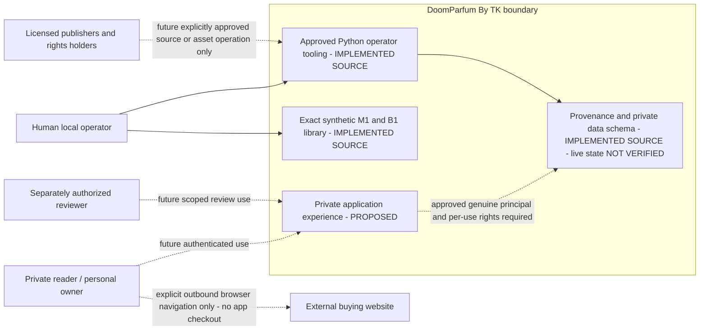
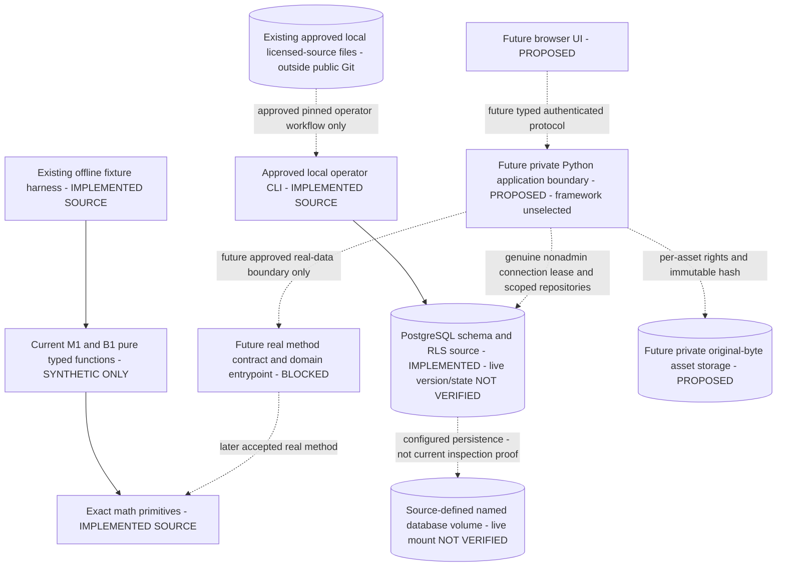
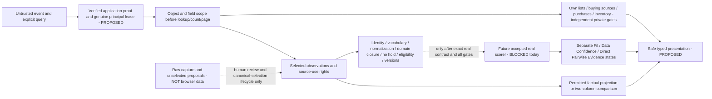
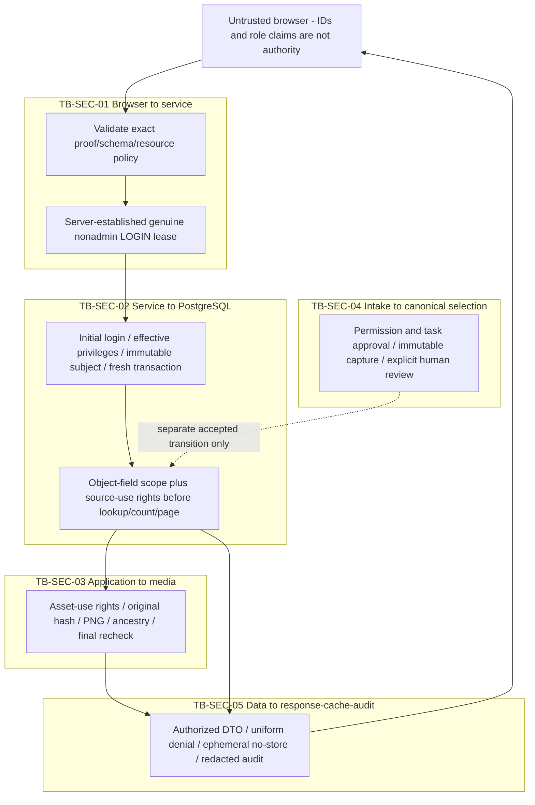
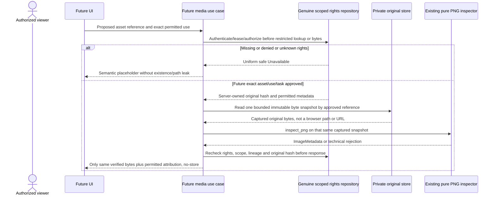

# C4-style architecture and request sequences

These eight diagrams belong to [[System_Architecture_Refinement]]. They use standard Mermaid notation with C4-style system/container/component responsibilities. A C4 container is a logical deployable application or data store, not a requirement to use Docker. Research and source versions are recorded in [[Architecture_Technical_Research_UX]], [[Architecture_Technical_Research_Security]] and [[Architecture_Technical_Research_Python]].

**Legend:** IMPLEMENTED SOURCE means the pinned repository contains the code/schema. It does not establish a currently running service or database. PROPOSED is not implemented or Owner-selected. BLOCKED means required exact decisions/data/rights are absent. Every application flow below is a future acceptance design, not an executed test. Existing synthetic scorers are fixed-fixture functions, not real-data application endpoints.

## DGM-A — System context



Public catalogue identity never publishes a private source, image, listing or collection record. A reviewer is not a database superuser application identity. The publisher arrow is a permission-gated lifecycle, not authorization to acquire anything in this task. Cart and Ordered are personal records; no order, payment, account extraction or marketplace synchronization occurs.

## DGM-B — Logical containers and storage



There is no arrow that relabels catalogue rows as fixed synthetic fixtures. Physical deployment, frontend framework, server framework/driver/ORM, authentication provider, ports and container image are not selected. The future UI can be logically separate even if later co-hosted; it must not import server/domain implementations or receive database credentials. Operator tools remain outside the normal application path.

## DGM-C — Components and dependency inversion

```mermaid
flowchart TB
  subgraph Presentation[Future presentation]
    UI[C-UI-SHELL and C-UI-PAGES - PROPOSED]
    DTO[C-DTO - versioned wire contracts - PROPOSED]
  end
  subgraph Boundary[Future request boundary]
    T[C-TRANSPORT - PROPOSED]
    A[C-AUTHN - PROPOSED]
    P[C-PRINCIPAL - PROPOSED]
    Z[C-AUTHZ - PROPOSED]
  end
  subgraph Application[Future use cases]
    Cat[C-APP-CATALOGUE]
    Match[C-APP-MATCH - BLOCKED]
    Compare[C-APP-COMPARE]
    Media[C-APP-MEDIA]
    Private[C-APP-PRIVATE]
    Review[C-APP-REVIEW]
    Ports[C-PORTS and C-DOMAIN-TYPES]
    Config[C-CONFIG]
  end
  subgraph Infrastructure[Existing source and future adapters]
    Read[C-PG-READ - internal adapter IMPLEMENTED SOURCE]
    Write[C-PG-WRITE - PROPOSED]
    Store[C-ASSET-STORE - PROPOSED]
    PNG[C-ASSET-VALIDATOR - IMPLEMENTED SOURCE]
    Audit[C-AUDIT - schema plus proposed application adapter]
    PG[C-PG-SCHEMA - IMPLEMENTED SOURCE]
    Ops[C-OPERATOR-CLI - IMPLEMENTED SOURCE]
    Capture[C-SOURCE-CAPTURE - approved tooling SOURCE]
    ReviewData[C-REVIEW-DATA - schema SOURCE]
  end
  subgraph Domain[Pure matching boundary]
    Real[C-DOMAIN-REAL - BLOCKED]
    M1[C-SYNTHETIC-M1 - IMPLEMENTED SOURCE]
    B1[C-SYNTHETIC-B1 - IMPLEMENTED SOURCE]
    Math[C-MATH-PRIMITIVES - IMPLEMENTED SOURCE]
  end
  Compose[C-COMPOSITION - PROPOSED]
  UI --> DTO
  UI -. future protocol - not an import .-> T
  T --> A --> P
  T --> Z
  T --> Cat
  T --> Match
  T --> Compare
  T --> Media
  T --> Private
  T --> Review
  Cat --> Ports
  Match --> Ports
  Compare --> Ports
  Media --> Ports
  Private --> Ports
  Review --> Ports
  Config --> Ports
  Read -. implements approved read port later .-> Ports
  Write --> Ports
  Store --> Ports
  Audit --> Ports
  Read --> PG
  Write --> PG
  PNG --> Ops
  Capture --> Ops
  ReviewData --> PG
  Match --> Real --> Math
  M1 --> Math
  B1 --> Math
  Compose -. wires only approved implementations .-> T
  Compose -. wires .-> Read
  Compose -. wires .-> Write
  Compose -. wires .-> Store
```



This collaboration view includes protocol and implementation arrows. The separately checked **source dependency DAG** in [[Component_and_Dependency_Registry]] has 30 components and 53 consumer-to-dependency edges. In that DAG UI pages depend on shell/wire DTO contracts, not C-TRANSPORT server controllers. Composition wires adapters; the domain has no UI, HTTP, database-connection or filesystem dependency. The existing local registered-image helper depends on operator tooling and cannot simply become an ordinary HTTP media endpoint.

## DGM-D — Authorized data flow



Factual display is not matching eligibility. Unknown or incomplete facts do not establish absence. A source observation can remain visible as an explicitly permitted claim while being unusable for strict matching. Neither private-data writes nor data-quality review inherits a scoring authorization. No raw staging data or unauthorized source fragments cross into UI DTOs.

## DGM-E — Authorization and trust boundaries



G-SEC-01 through G-SEC-08 are defined in [[Authorization_and_Trust_Boundaries]]. The return arrow is an authorized response, not a dependency cycle or a browser authority upgrade. Initial privileged login followed by impersonation is rejected even if later session_user equals current_user. No shared administrator connection, SET ROLE, GUC, browser user ID or superuser SET SESSION AUTHORIZATION is an application identity design. A future binding amendment needs its own exact approval and implementation; the eight existing migrations/subjects/owners remain unchanged.

## DGM-F — Future matching request sequence

```mermaid
sequenceDiagram
  actor U as Private user
  participant UI as Future UI client
  participant B as Future request boundary
  participant L as Future principal lease
  participant P as Policy and scoped repository
  participant D as Future real domain method
  U->>UI: Explicit method/config and query intent
  UI->>B: Proposed IF-MATCH-EXECUTE-1 typed request
  B->>B: Validate proof/schema/accepted numeric budget
  B->>L: Establish approved genuine nonadmin LOGIN
  L->>L: Verify initial identity, effective privileges and clean transaction
  B->>P: Authorize before target lookup/count/candidate expansion
  alt Real method contract or capability absent today
    P-->>B: Safe Unavailable - no scoring or fallback
  else Future exact real boundary and all prerequisites accepted
    P->>P: Selected fields, rights, vocabulary, closure, holds, eligibility and snapshot
    P->>D: Trusted immutable domain context in one compatible partition
    D-->>P: Exact rational fit and explanation; separate evidence channels
    P->>P: Recheck current scope/rights/selection revisions before publication
    P-->>B: Authorized bounded DTO or discard stale result
  end
  B->>L: Rollback/complete read-only scope and release or discard lease
  B-->>UI: Safe states; rational order preserved before display rounding
  UI->>UI: Apply only to matching current session/query generation
```

This sequence never invokes the locked synthetic functions on real records. When no valid score exists, return Unavailable instead of 0%; a genuine computed zero is a separate valid value. Exact fractions determine ordering before serialization/display rounding. No total ranking spans incompatible method/config/vocabulary/domain/query/selection partitions. Data Confidence and Direct Pairwise Evidence may remain unknown independently of a fit value.

## DGM-G — Future media request sequence



The existing registered-asset helper returns ImageMetadata, not an HTTP response or the bytes to stream. A future adapter must bind delivery to the same validated immutable byte snapshot; validating and then re-reading a mutable path is not sufficient. It also needs an approved genuine-session adapter rather than exposing local operator db/user/loader parameters. No source URL fetch, new codec, resizing, conversion or metadata stripping occurs. Revocation stops future operations and can cancel remaining in-flight delivery under an accepted contract; already delivered bytes cannot be remotely erased by this architecture.

## DGM-H — Future intake and human review sequence

```mermaid
sequenceDiagram
  actor O as Separately authorized operator
  actor H as Human reviewer and Owner gates
  participant R as Source and permission registry
  participant C as Approved capture/validation workflow
  participant Q as Immutable observations and proposed normalization
  participant S as Canonical selection and materialization
  participant E as Eligibility and authorized projection
  O->>R: Discover source and record exact method/use/budget/authority
  R->>H: Permission verification plus bounded acquisition/task request
  alt Permission, exact task or source rights absent
    H-->>O: BLOCKED - no capture or image bytes
  else Future approved operation
    H->>C: Exact approval version and permitted source revision/fields
    C->>C: Raw capture, hashes, locators and validation; preserve failures
    C->>Q: Unselected immutable claims and versioned normalization proposals
    Q->>H: Conflicts/occurrences/unknown domains retained for review
    alt Held or conflicting or unsupported assertion
      H-->>Q: Hold/reject/defer with evidence; no implicit winner
    else Exact per-field reviewed transition approved
      H->>S: Explicit selected observation and materialization decision
      S->>E: Separate compatible rights/closure/eligibility assessment
      E-->>O: Authorized projection only after its independent gates
    end
  end
```

The full ten-transition lifecycle, actors, evidence, versions, operation limits and rollback/revocation rules are in [[Data_and_Media_Lifecycle_Architecture]]. A future five-record IMP-ENR-01 preview stops at unselected review candidates and remains unapproved despite PR28 merge. Forty-four held profiles, 43 normalization proposals and independent Khamrah conflicts are not changed by any arrow. New failed/rejected attempts append evidence; they do not overwrite immutable observations, automatically release holds or reactivate rights through restore.

## Verification boundary

Static checks verify diagram IDs/references, eight fenced diagrams, component/operation naming and the separate acyclic dependency graph. No Mermaid/browser rendering or application/security/runtime execution is implied. All new flows remain PROPOSED pending exact Owner decisions, Planning/Implementation Gates and any source/asset permissions. See [[Architecture_Owner_Review_Packet]] and [[Dependency_Based_Implementation_Roadmap]].
