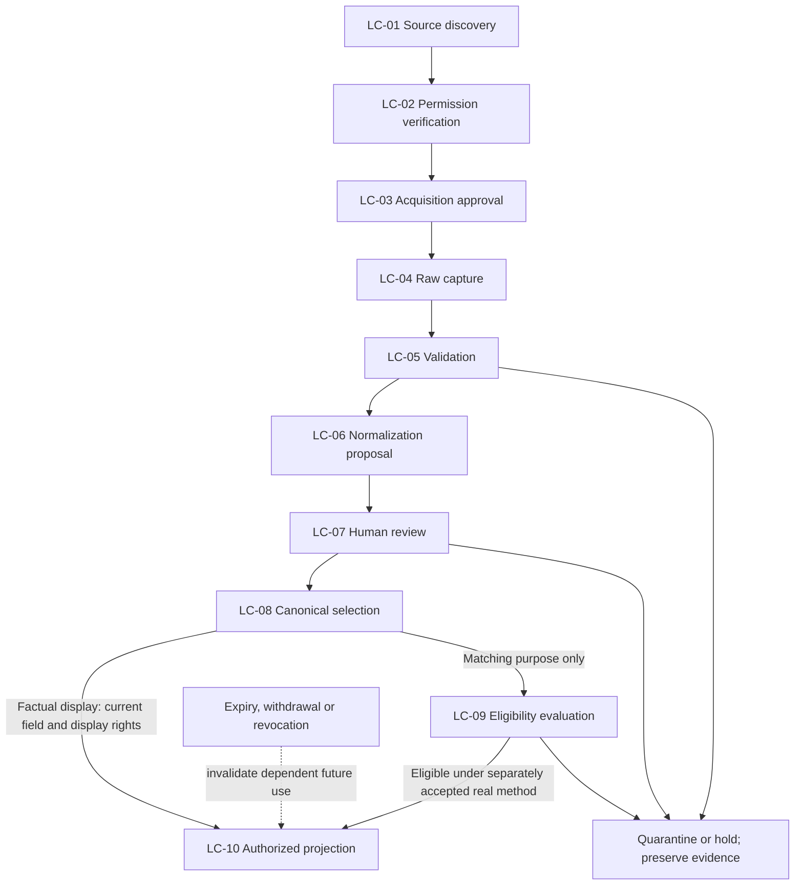

# Data and media lifecycle architecture

**PROPOSED — DPT-PLAN-010, documentation only.** Source inspection baseline: `168715bc9bc5fff968524074257dc106a8a63638`. No application authentication, principal provisioning, API, UI, real ranking, cache, source intake or media delivery is implemented by this document. [[System_Architecture_Refinement]], [[C4_Context_and_Container_Design]], [[Architecture_Owner_Review_Packet]] and [[State_and_Error_Contracts]] govern the connected proposal. Machine-readable acceptance design: [[Architecture_Security_and_Cache_Model.json]].

## Independent records and authority

Licensed source records, immutable raw observations, normalization proposals, human review decisions, selected canonical fields, purpose-specific matching eligibility, media permissions and user-private records are separate authorities. A raw source claim is not a canonical fact; a canonical selection is not a matching grant; an eligible profile is not a public redistribution grant. Note pyramids remain declared/perceived notes, not chemical formulas. Personal buying/ownership observations never silently become product-source evidence.

This design preserves **43 normalization proposals**, **44 existing holds**, all original occurrences and independent **Khamrah conflict records**. No conflict winner, normalization promotion, selection, eligibility or hold release occurs. [[Post_PR27_Data_Readiness_and_Pilot]], [[Post_PR27_Media_Rights_and_Storage]], [[Rights_and_Attribution]] and [[Post_PR27_Application_Integration_and_Security]] retain their historical evidence.

## Complete lifecycle — all transitions PROPOSED



Every row requires the proposed lifecycle-contract version and exact source/capture, transform, review, selection and policy versions applicable to that operation. Omitted or unknown evidence denies advancement. A review record can authorize a future transition only within the separate accepted mutation task; the diagram itself authorizes none.

LC-10 is operation-specific. Independently authorized factual catalogue/detail/comparison fields may be projected from LC-08 under current display rights without LC-09 or an accepted real matching method. Scoring additionally requires the separate LC-09 decision and exact real method/configuration. Blocked or unknown matching eligibility never establishes factual absence or blocks otherwise permitted facts; factual display does not establish matching eligibility. Media has its own current per-asset/lineage/display gates and does not inherit a scoring prerequisite.

| Transition | Preconditions | Required evidence and version binding | Actor/reviewer | Allowed operation | Rollback, withdrawal or revocation |
|---|---|---|---|---|---|
| LC-01 — Source discovery | No content capture requested; metadata-only research scope accepted | Candidate URL, publisher and intended purpose, rights unknown; exact versions required | Authorized researcher | Record a lead; no raw bytes or ingestion | Withdraw lead; preserve provenance and denial history |
| LC-02 — Permission verification | Exact candidate identity and intended actions recorded | Authority, terms/license revision, action/audience flags, expiry, evidence location; exact versions required | Rights reviewer | Record allowed/denied/unknown actions; no acquisition | Supersede assessment; unknown, expired or revoked actions deny |
| LC-03 — Acquisition approval | Permission supports exact method, fields/files, source revision and purpose | Owner-approved bounded acquisition task, allowlist, attribution and rollback plan; exact versions required | Human Owner | Approve only named capture; no implied linked pages or images | Withdraw pending task; cancel future capture and review permitted retention |
| LC-04 — Raw capture | Separate task approved; permissions rechecked immediately before action | Immutable capture revision, timestamp, ordinal, byte/content hash and provenance; exact versions required | Bounded intake operator | Capture only approved fields/bytes to isolated staging | Quarantine/withdraw access; retention deletion needs separately reviewed operation |
| LC-05 — Validation | Raw evidence isolated; no canonical promotion | Schema/type/size/rights checks, versions, failures and exact source linkage; exact versions required | Validator and operator | Produce technical validation outcomes; no right granted by validation | Quarantine failures; rerun new validator version without rewriting raw claims |
| LC-06 — Normalization proposal | Validated raw claim and explicit transform policy | Proposal version, input references, transform version, conflicts and unknown states; exact versions required | Proposal author | Propose mappings; preserve original occurrence and unresolved alternatives | Supersede proposal; preserve 43 existing proposals and 44 holds |
| LC-07 — Human review | Exact proposal, source evidence, rights and conflict dossier available | Named reviewer decision, version, reasons, permitted fields and audience; exact versions required | Authorized human reviewer | Accept/reject/hold a proposal for an explicit later operation | Withdraw decision with audit; never erase conflicting Khamrah observations |
| LC-08 — Canonical selection | Reviewed choice and separate mutation approval; current rights valid | Versioned selected claim links, provenance, field-specific rights, prior selection; exact versions required | Authorized curator in approved task | Select named fields without rewriting raw observations | Withdraw/supersede selection; invalidate dependent views and preserve prior versions |
| LC-09 — Eligibility evaluation | Selected fields and exact real-data policy separately accepted | Selection snapshot, vocabulary/normalization/method versions, completeness and conflict/hold evaluation; exact versions required | Authorized policy evaluator | Produce purpose-specific eligible/blocked/unknown decision; no score activation | Invalidate decision on dependency change, expiry, revocation or hold; reevaluate |
| LC-10 — Authorized projection | Current principal, action, scope, selected evidence and operation-specific rights pass; LC-09 additionally required only for matching | Request-bound subject/scope, rights and selection versions; safe projection/audit result; exact versions required; real method/config and eligible decision for scoring only | Future authorized service | Render independently permitted factual fields or separately cleared media without a matching prerequisite; scoring additionally passes LC-09; authorize before lookup, counts, pagination and bytes | Stop future operations; cancel unfinished delivery best effort; clear local buffers without claiming delivered bytes erased |

## Proposed ingestion and review sequence

```mermaid
sequenceDiagram
  actor Owner as Human Owner
  participant Intake as C-SOURCE-CAPTURE
  participant Review as C-REVIEW-DATA / C-APP-REVIEW
  participant Rights as C-AUTHZ
  participant DB as C-PG-WRITE / C-PG-SCHEMA
  Intake->>Review: Metadata-only lead and action-specific rights dossier
  Review->>Owner: Exact bounded acquisition proposal
  Owner-->>Intake: Separate approval required; absent means stop
  Intake->>Rights: Recheck source, method, revision, fields and purpose
  Rights-->>Intake: Allow only approved action or deny
  Intake->>Review: Isolated immutable raw capture plus validation/proposal versions
  Review->>Owner: Per-claim review, conflicts and held alternatives
  Owner-->>Review: Explicit decision; no automatic normalization promotion
  Review->>Rights: Recheck selection action and field rights
  Review->>DB: Separately approved versioned selection intent
  DB-->>Review: Selection evidence; eligibility remains separate
```

`IF-SOURCE-INTAKE-REQUEST-1` requests the bounded workflow; it is not an automatic scraper. A caller may later submit an authorized owner-private missing-perfume metadata proposal from Cart without curator powers; that request does not itself acquire a source, create canonical truth or advance any lifecycle gate. `IF-ASSET-INTAKE-REQUEST-1` may request a screenshot dossier as metadata only; no screenshot bytes are acquired or uploaded by that request contract. `IF-REVIEW-QUEUE-READ-1`, `IF-REVIEW-DECISION-WRITE-1` and `IF-RIGHTS-REVIEW-1` operate only under their specific scope/action gates. Canonical candidates and rights may be inspected for an authorized purpose without becoming application-visible or scoreable. Source evidence includes retrieval date, revision, attribution, usage rights and confidence. A public URL, search preview or community review does not supply missing permission.

## Media responsibilities and rights

| Record or operation | Required separation |
|---|---|
| Note illustration | Symbolic note association; must not imply disclosed perfume ingredients or a chemical formula. A reviewed canonical note/asset binding remains separate from file rights. |
| Bottle photograph | Exact product/version association and creator/authority evidence; brand URL or recognizable bottle does not establish image permission. |
| Asset metadata | Asset ID, source/file revision, original URL, creator, license/permission record, attribution, scope, measured hash/dimensions/MIME, parent lineage and object binding. Metadata is not byte acquisition or clearance. |
| Original bytes | Separately approved acquisition method and storage purpose; immutable original outside Git. No bytes acquired in this task. |
| License/permission evidence | Exact rightsholder authority, license/terms version, allowed actions, audience, review/expiry and denial/revocation state. Unknown action is denied. Source and asset permissions both apply. |
| Attribution | Preserve required notices/links and modification notices as part of authorized projection. Attribution does not substitute for permission. |
| Private display | Current subject/scope plus source/asset display permission; does not imply public display or caching. |
| Public display | Separate exact audience/action approval, permitted provenance projection and publication rights; private assets never become public because their perfume is public. |
| Derivative | Separate transform permission and complete parent permission lineage, exact transform specification/version and own validation/binding. No implicit resize, strip, codec conversion or thumbnail. |
| Withdrawal/revocation | Stop project-authorized future action, reevaluate descendants and selections, clear managed temporary copies where possible; preserve permitted audit/provenance. Do not claim the underlying CC grant is revocable at will. |

Project operation denial and a third-party license are different concepts. S-SEC-13 records that compliant CC BY-SA freedoms are not revocable at will; this project may still suspend its own operations when exact binding, authority, attribution or other rights are uncertain. Suspension does not erase rights recipients already hold. No proposal can retract delivered bytes, screenshots or lawful earlier downloads; cancellation and managed-copy cleanup are best effort. Applicable retention/deletion duties need an approved operation without rewriting immutable provenance arbitrarily.

## Existing PNG validator: implemented source, bounded limitations

`database.image_validation.inspect_png(content: bytes, limits: Limits = Limits()) -> ImageMetadata` implements `local-static-png-v1`. Current bounds are **5 MiB** input, **4096** each edge, **4,000,000** pixels, **20 MiB** decoded bytes and **1024** chunks. It accepts static **8-bit RGB/RGBA PNG** only: valid signature/CRC, one IHDR, contiguous IDAT data and final IEND, correct bounded deflate scanline length and filter values. Extra chunks, palettes, ICC/EXIF/text, animation, interlace, unknown chunks, trailing bytes and unsupported encodings are rejected. This is a constrained structural/stream validator, not a generic visual-decoder, malware, content-truth or legal-clearance guarantee. It performs no conversion, stripping or resizing.

`validate_registered_asset(asset_id, read_content, *, operation, db, user, limits=Limits()) -> ImageMetadata` authorizes an already registered asset with `dpt_guard.can_use_asset`, reads through a trusted bounded local callback, compares measured metadata, then rechecks the complete registered binding and current rights. Operations are the existing `acquire`, `display`, `transform`, `redistribution` allowlist. Its return value is technical metadata, never a reusable serving token or cached grant. It is operator/local source, not an implemented HTTP downloader, object-store adapter or browser-delivery service. A future callback must be bound to the exact permitted local object; arbitrary paths, URLs and unbounded readers are forbidden.

The existing proposal **MEDIA-PNG-PAIR-B1-PROPOSED** remains exactly **B1-MEDIA-021 BergamotEssOil.png** and **B1-MEDIA-022 Ginger.png**. Their historical metadata dossiers do not establish downloaded bytes, actual SHA-256, binary validation, canonical association or display approval. No substitutes, extra files or acquisition occur here.

## Proposed media request sequence and storage

```mermaid
sequenceDiagram
  participant Browser as C-UI-PAGES
  participant Service as C-APP-MEDIA
  participant Gate as C-AUTHN / C-PRINCIPAL / C-AUTHZ
  participant DB as C-PG-READ
  participant Store as C-ASSET-STORE
  Browser->>Service: IF-MEDIA-RESOLVE-1 (untrusted asset reference)
  Service->>Gate: Validate session, genuine lease, scope and display action
  Gate->>DB: Read only authorized metadata and current source/asset/lineage rights
  DB-->>Service: Minimal binding or uniform Unavailable
  Service->>Store: IF-MEDIA-DELIVER-1 bounded exact-object read only after allow
  Store-->>Service: Measured bytes/binding
  Service->>Gate: Recheck current rights, membership and binding before delivery
  Gate-->>Service: Current allow or abort
  Service-->>Browser: Authorized bytes and attribution, no-store; or uniform Unavailable
```

Recommended **PROPOSED** storage uses private immutable originals outside Git, scope-bound opaque object references and content hashes, with database metadata/permissions kept separate from bytes. A hash identifies content; it never proves caller access. Do not expose filesystem paths, internal bucket/object keys or permanently public URLs. Database binary storage remains an alternative with different backup/size costs. No filesystem layout, bucket, volume, CDN, URL signer, worker or storage provider is provisioned or selected here.

Backup/restore must bind metadata and objects consistently, verify hashes and reevaluate **current** rights/membership/lineage before serving restored objects; restoring an old allowed snapshot cannot revive revoked use. Orphan handling, permitted retention, encrypted storage/backup keys, external transfer, RPO/RTO and deletion plans require separate approval. Docker named volumes provide persistence, not per-user application authorization (S-SEC-12).

## Evidence and acceptance limits

All ten lifecycle rows, media sequences, storage policy, rollback and revocation behavior are **PROPOSED**. Actual source inspection verifies only existing operator/SQL/validator code. No import, source/image request, image download, binary decode test, permission contact, database write, role/session change, new selection or eligibility computation ran. The negative designs SEC-N06/07/09/12 in [[Authorization_and_Trust_Boundaries]] remain **NOT RUN**. See [[Cache_Offline_and_Privacy_Policy]] for operation-specific retention constraints.
