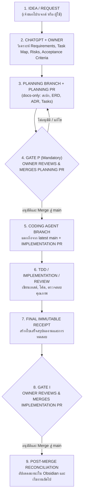

# GitHub and Development Workflow Specification — DoomParfum By TK

> **Document Type:** Version Control Strategy, Multi-Agent Collaboration & PR Protocols
> **Source Baseline:** `../DEVELOPMENT_WORKFLOW.md` (v1.0.0 proposed-canonical)
> **Current Status:** 🟡 **PROPOSED-CANONICAL — WORKFLOW SPECIFIED (Awaiting First Planning PR Merge)**

---

## 1. Operating Contract & Status Notice

ผู้ใช้ได้กำหนดเอกสารเวิร์กโฟลว์กลางอย่างเป็นทางการผ่าน `DEVELOPMENT_WORKFLOW.md` (ปรับใช้จาก AEGIS Unified Development Workflow ให้ตรงกับบริบทของ DoomParfum By TK)

### หลักการสำคัญ (The Golden Rule):
> **"แผนต้องตรวจรับก่อนเขียนโค้ด; โค้ดต้องพิสูจน์ก่อนอ้างว่าเสร็จ; Obsidian ต้องตรงกับ Git และหลักฐาน; ทุก PR ให้ Human Owner เป็นคน Merge"**

---

## 2. Two-Gate Development Workflow

ระบบแบ่งกระบวนการพัฒนาออกเป็น **สองประตูหลัก (Two-Gate Model)** เพื่อแยกการอนุมัติแผนออกจากขั้นตอนการเขียนโค้ด:



---

## 3. Core Operating Rules

1. **One Task $\rightarrow$ One Branch $\rightarrow$ One PR $\rightarrow$ One Final Receipt:**
   - สำหรับทุกฟีเจอร์ใหม่ ต้องมีอย่างน้อย 2 PRs ที่แยกกันชัดเจน:
     - **Planning PR:** จัดการเอกสารและสเปก (ห้ามแก้โค้ดระบบ)
     - **Implementation PR:** พัฒนาโค้ดจริง (เริ่มจาก `main` หลัง Planning PR ถูก Merge)
2. **Obsidian Vault Consistency:**
   - เอกสาร Markdown ใน `Structure DB Obsidian/` ต้องได้รับการปรับปรุงในทุก checkpoint ที่มีนัยสำคัญ
   - ข้อมูลใน Obsidian ต้องสะท้อนสถานะจริงของซอร์สโค้ดใน Git เสมอ
3. **Strict Authority & No Auto-Merge:**
   - **Human Owner** เป็นผู้อนุมัติขอบเขต, สิทธิ์, และเป็นผู้กด Merge ทุก PR
   - Agent ห้าม Force Push, ห้ามกด Merge PR เอง, ห้ามลบ Branch โดยไม่ได้รับคำสั่ง, และห้ามแตะต้อง Production
4. **Data Sourcing Compliance:**
   - การสืบค้นและนำเข้าข้อมูลทำเฉพาะจากแหล่งที่ได้รับอนุญาต ห้าม Mass Scrape Fragrantica หรือเข้าถึงบัญชี Shopee ของผู้ใช้โดยพลการ

---

## 4. Repository & Directory Structure Alignment

```text
DoomParfum By TK/
├── README.md                                # Product blueprint / requirement baseline
├── DEVELOPMENT_WORKFLOW.md                  # Canonical workflow contract
├── AGENTS.md                                # Agent entry point (ชี้มาที่ DEVELOPMENT_WORKFLOW.md)
├── Structure DB Obsidian/                   # Canonical Obsidian vault (ใน Git เดียวกัน)
│   ├── 00_Home/Project_Index.md
│   ├── 00_Home/Project_Status.md
│   ├── 01_Product/...
│   ├── 02_Domain/...
│   ├── 03_Data/...
│   ├── 04_Matching/...
│   ├── 05_UX/...
│   ├── 06_Engineering/...
│   ├── 07_Delivery/Tasks/                   # per-task canonical notes
│   ├── 07_Delivery/Planning_PRs/            # planning PR specifications
│   ├── 08_Operations/Receipts/              # immutable final receipts
│   ├── 08_Operations/Handoffs/              # continuity packs
│   ├── 09_References/...
│   └── 90_Templates/...
├── web/                                     # [FUTURE] Next.js frontend
├── data-pipeline/                           # [FUTURE] Python ETL
├── database/                                # [FUTURE] Drizzle migrations
└── .github/                                 # [FUTURE] Workflows หลังอนุมัติ
```

---

## 5. Current repository/workflow status and next gate

Public repository exists at https://github.com/kraveerachat/DoomParfum-By-TK. AGENTS.md and
DEVELOPMENT_WORKFLOW.md already exist. Existing PR #1 on plan/p1-data-discovery-schema-foundation is
OPEN/DRAFT and is being corrected after review; no new governance/planning PR is created for this task.
Workflow presence is verified; proposed-canonical adoption/technical decisions remain unaccepted until
Human Owner explicitly decides and merges. This is not a missing-workflow blocker.

Owner reviews PR #1/OD-01..06; implementation/provisioning remains gated. Documentation CI TSK-DOC-001
is proposed separately in [[Backlog]], with no Actions/settings changes in this planning correction.
Secrets/private exports/user data never enter this public repository. No merge/auto-merge by agents.

---

## 6. Change Notes

- `2026-11-10`: ปรับปรุงเอกสารจากสถานะ Pending เป็น Proposed-Canonical สอดคล้องกับ `DEVELOPMENT_WORKFLOW.md`
