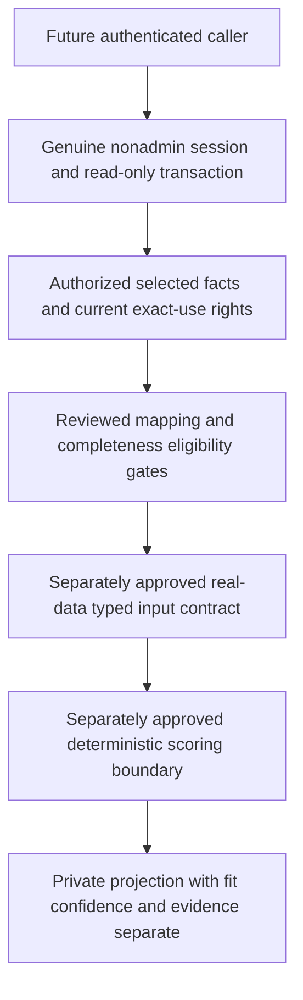

# Post-PR27 application integration and security preparation

This is the C-lane consolidation for [[Post_PR27_Consolidated_Next_Wave_Plan]]. It refines dependencies after the two synthetic implementations merged. It does not replace or approve [[Private_Application_Architecture_Plan]], [[Private_Operation_Contracts_and_UX_Acceptance]], [[Matching_Nonadmin_Session_and_Publication_Proposal]] or the wider DM/OP choices. Current decisions remain visible in [[Post_PR27_Owner_Decision_Packet]] and [[Matching_Owner_Decision_Register]].

## Verified repository baseline and limits

The source baseline is `8eef8f13265adc14db0cae82ff77cfc4863853ce`. Owner-merged PR26 introduced M1 at `604d447e599aa8359d3427dfbfbceaac85373e48`; Owner-merged PR27 introduced B1 at the current baseline. The PR27 reviewed publication source `3ed276f298c082b7450c4bbe338c8965eacc25a7` has the same tree as this main baseline. The exact scoped M1 and B1 approvals are established by their separate Owner acceptance records, not inferred from the merges.

This lane inspected committed source and existing documents. It did not execute a scorer, adapter, SQL, Docker command, network request or application. The coordinator's Docker diagnostic reports an unavailable engine; current database populations, effective roles, mounts and active rights are **NOT VERIFIED**. Historical operator-private catalogue ownership and missing genuine application-owner bindings remain historical evidence, not a fresh query result. PR8 remains OPEN / DRAFT / BLOCKED; no timestamp experiment or guard change is part of this plan.

| Surface | Implemented repository capability | Boundary still missing |
|---|---|---|
| PostgreSQL catalogue | Eight numbered migrations define catalogue identities, associations, source observations/selections, scoped rights, personal records, RLS and deferred contracts | No live-state, migration execution, database availability or application entitlement is established by inspecting SQL |
| Local operator tooling | Python local lifecycle, licensed ETL, research, image verification and verification utilities exist | Tooling is not an application server or an approved application identity; lifecycle/write commands must not be run in this wave |
| Read-only input adapter | `database/matching_input.py` constructs guarded per-login read-only SQL and decodes a bounded internal profile DTO | Its trusted `execute` callable is not implemented web authentication, a safe connection pool, public serialization or a real-scoring bridge |
| Mathematical primitives | Exact deterministic helpers and invariant tests exist | Generic arithmetic is not an accepted full matching method or relevance evaluation |
| M1 synthetic scorer | `score_synthetic_notes_layered(reference, candidates, *, vocabulary, config)` implements the accepted synthetic typed contract | No catalogue adapter-to-M1 production bridge, real-data method approval, API or UI |
| B1 synthetic scorer | `score_synthetic_b1(query, candidates, *, vocabulary, config)` implements the accepted synthetic typed contract | No real-source completeness/absence acceptance, real-data ranking or query transport |
| Image validation | `local-static-png-v1` bounded validation and registered-asset rights checks exist | No approved new image intake, delivery service, new codec or public display permission |
| Private application | No tracked application package manifest, routes or frontend runtime was found in the baseline inventory | Stack, authentication/session architecture, transport contracts, user-facing authorization, deployment and publication decisions remain PROPOSED |

The sanitized [source inventory](../08_Operations/Test_Evidence/Post_PR27_Application_Inventory.json) pins source hashes, interfaces and static observations. Hashes prove inspected bytes; they do not prove every module has executed or a live database matches the schema.

The fresh Windows worktree uses the existing `core.autocrlf=true` configuration. Its raw M1/B1 contract files therefore contain 310/494 CRLF pairs; their canonical Git LF bytes still match the exact approved SHA-256 values. The first C checker incorrectly compared those raw checkout hashes with canonical approval hashes: 88 checks passed and two failed. The retained operand evidence proves that replacing CRLF with LF reproduces the exact approved bytes, with no other difference and unchanged Git blobs. The corrected checks bind both representations explicitly. No contract, repository configuration or algorithm was edited to address this checker assumption.

## Stack choice and proposed sequencing

[[ADR_Post_PR27_Local_Private_Integration_Proposed]] compares continued CLI operation, a local Python service and a TypeScript backend. Continue the existing CLI/operator baseline while exact decisions are unresolved. A local Python service is the recommended future service option because it can reuse the two Python reference scorers directly. That recommendation selects no framework, HTTP server, ORM, authentication vendor, container configuration or hosting provider. TypeScript would require a reviewed Python boundary or a separately verified exact-rational port; translating the formulas is not enough to establish parity.

First approve a small data-preview task independently of any application. Separately decide the genuine session architecture, selected-field and rights contract, real completeness/vocabulary/normalization semantics and a versioned real-data input contract. An approved future service task may begin only after its applicable Planning Gate and exact Owner choices. Neither the data pilot nor the stack choice alone enables catalogue access, matching, image delivery or a public endpoint.

## Genuine principal and authorization design — PROPOSED

Current SQL resolves `dpt.users.auth_subject` from genuine PostgreSQL `session_user`. Subject and scope ownership immutability must be preserved. The current adapter checks a fresh `READ COMMITTED READ ONLY` transaction, `session_user = current_user`, membership of `dpt_runtime`, absence of `dpt_owner` membership, and absence of superuser/BYPASSRLS flags. Its SQL sets row security on, a three-second statement timeout and a one-second lock timeout. Those are inspected adapter controls, not a complete proof of least privilege or application isolation.

Recommended future policy is a genuine nonadmin principal with only explicitly reviewed read capabilities. Inspect inherited privileges, role-change capabilities, ownership, grants, helper functions, function search paths and effective access; role names or `NOINHERIT` alone do not prove safety. Application-specific denial of writer/curator/DDL/role-management capabilities needs its own reviewed contract and tests. Do not claim the current adapter already proves every such condition.

The existing three binding alternatives remain unaccepted:

1. Create a separately approved clean disposable application-private pilot, establishing a genuine nonadmin subject and private scope before controlled intake. Recheck exact local source rights and new-scope provenance. Preserve the old operator pilot unchanged.
2. Propose a versioned login-to-principal binding amendment with audited revocation, narrowly scoped privileges and SQL/RLS tests. Preserve the original migrations and observations; any new migration requires its own approved task.
3. Defer real application access and continue synthetic/offline work.

Do not substitute `SET ROLE`, a GUC, request header or caller-supplied user ID for a genuine authenticated principal. Do not use a superuser transport plus `SET SESSION AUTHORIZATION`, rewrite old `auth_subject`/scope ownership, downgrade the administrator, grant everyone curator membership, or publish operator-private records to manufacture an application path.

For a future request, authenticate before lookup, candidate counts, cursors, rights checks, scoring, cache access or asset retrieval. A pool must not carry another caller's login, role, transaction, prepared context or snapshot. A service must demonstrate how each physical connection obtains the correct genuine session identity; a logical user label on one shared admin connection is insufficient. Commit/rollback and cancellation must leave no principal or transaction state for the next borrower. These are proposed acceptance requirements, not implemented pooling behavior.

## Rights, privacy and error boundaries — PROPOSED

Authorize every selected field for the exact caller, access scope, use, source record and current assessment. Current adapter source already binds selected observations, entity/field identity, source/capture rights and conflict status. Its rights predicate requires evidence, nonrevocation, a checked time not in the future, an unexpired review window when present, and allowed storage/display/automation. A new application contract must additionally specify every intended cache, persistence, derivative, redistribution or publication use; no such use follows from a public URL or from a catalogue entity being public.

Public, shared and user-private identities must never cause private sources, observations, prices, collection entries or images to cross users through joins, explanations, pagination, counts, logs, cache keys or error messages. A revoked shared membership must not become access to a user-private scope. Private overlays remain private even when they refer to a public perfume. Missing and inaccessible identifiers need the same approved unauthorized-result envelope; precise HTTP status, size and timing classes require later transport tests. The current internal Python exceptions are not a proven public response policy.

Recommended initial result lifetime is authenticated local-private, ephemeral and uncached. This remains PROPOSED. If caching is approved later, bind it to caller/scope, selected snapshot, source/rights/review revisions, vocabulary, method/configuration and query. Reauthorize before the next operation or page and invalidate on selection, rights or membership changes. Exact in-flight revocation semantics and request deadlines must be chosen explicitly; this plan does not promise instantaneous interruption of an already executing statement. A backup restore must not reactivate withdrawn rights or cached private results.

Future browser access needs an accepted origin/host/session/CSRF policy, including loopback exposure, DNS rebinding, session fixation and cross-origin requests. "Local" is not authentication. No cookies, tokens, credentials, private observations, raw source payloads or private query histories should reach public logs or third-party telemetry. The Cart remains a personal bookmark; no checkout, payment, order placement or Shopee synchronization is proposed.

## Future real-data input contract — NOT AUTHORIZED

The two accepted scorers validate fixed synthetic fixture contexts. These context labels are typed contract checks, not a cryptographic oracle that authenticates the origin of arbitrary supplied facts. Do not relabel catalogue records with synthetic fixture, scope, vocabulary, domain, normalization or selection versions to make them pass the frozen functions. A real-data boundary needs a separately reviewed versioned contract and implementation scope; keep the existing synthetic contracts and tests unchanged.

This is an architecture diagram, not an implemented data flow. Its rendering has not been tested in a browser.

| Future input component | Required preserved meaning | Fail-closed behavior |
|---|---|---|
| Algorithm/configuration | Exact method, schema, config and formula versions; no hidden fallback | Unsupported/missing configuration is unavailable; never fall back to another method silently |
| Canonical identity | Reviewed perfume/edition and canonical note IDs under the correct scope | Ambiguous identity or alias remains unselected; do not merge editions or guess an ID |
| Vocabulary/domain | Fingerprint/version, layer domains, alias/normalization version and declared comparison partition | Incompatible domains are incomparable; general-only notes do not become top/heart/base |
| Selection snapshot | Selected observation IDs, field path, source record, revision/hash, locator, transform and reviewer evidence | No selected accessible claim means UNKNOWN, not a materialized-value shortcut |
| Layer completeness | Accepted field/list-specific closure evidence, including an explicit distinction between unknown and complete-empty | Populated lists, missing lists and absence of a selected claim do not prove closure or negative absence |
| B1 required/excluded rules | Closed searched domains and compatible positive witnesses under the separately accepted real policy | Excluded notes cannot pass merely because evidence is missing; unknown never becomes zero |
| Rights and authorization | Genuine principal, scope, active exact operation rights and current permission assessment | Missing, expired, revoked, inaccessible or unsupported-use evidence denies the affected operation |
| Review/eligibility | Conflict resolution, holds, selected mapping and explicit eligibility are separate AND conditions | No release of 44 holds, adoption of 43 normalization proposals, selection or eligibility is implicit |
| Results | Exact rational computation before approved display rounding; deterministic ties/partitions and bounded explanation | No cross-partition global ranking, silent candidate truncation or missing-score zero |

Structural Fit is a model result for an explicitly approved method. Data Confidence is a separate evidence-quality assessment. Direct Pairwise Evidence is a separate cited relationship with its own provenance, rights and uncertainty. Do not blend these into one percentage or describe model fit as measured smell similarity. Family and accords require their own compatible selected taxonomy/domain evidence; real accord strengths, Full Mode A and B2 remain gated.

The adapter's current internal DTO cap (2 MiB), per-selected-payload cap (64 KiB), eight fields and 512 memberships do not select an HTTP request or response limit. The accepted synthetic scorers retain their exact typed-input resource bounds. No transport DTO parser, proposed 8 KiB request parser or serialization boundary is implemented or approved by this note. Future transport bounds and deterministic pagination/lookahead must be approved and tested separately, without turning a truncated candidate subset into a claimed full-catalogue result.

## Six-screen map — design only

No screen below has a runtime implementation. "Conditional" means only after a genuine authorized read path and the field-specific data/rights checks pass; it is not a current ability to display the operator catalogue.

| Proposed screen | Potential content after its prerequisites | Gated/unavailable state |
|---|---|---|
| Catalogue | Accessible reviewed name, brand and edition identifiers with source attribution | No current app session; unknown identity/rights stays unavailable; do not expose private counts or raw staging |
| Perfume Details | Individually selected facts, provenance appropriate to the caller and licensed media or a neutral placeholder | Missing year/concentration stays UNKNOWN; a source URL does not authorize an image |
| Note Pyramid | Reviewed compatible top/heart/base memberships with explicit partial/unknown states | General notes remain a separate section; empty/incomplete display is not a claim that a note is absent |
| Matching Search | Separately approved real M1-style reference selection or B1-style canonical clauses | Real-data search remains disabled pending the real contract, closure, rights, normalization and eligibility gates; B2 unavailable |
| Matching Results | Approved fit, explanation, Data Confidence and Direct Pairwise Evidence as separate fields | No score or ranking when the chosen method cannot evaluate; never show missing fit as 0% |
| Side-by-Side Comparison | Authorized selected facts with explicit differences, unknowns and sources | Comparing displayed facts does not itself authorize scoring, infer chemical equivalence or expose the other user's private overlay |

## Future implementation dependencies and acceptance — SPECIFIED / NOT RUN

These are proposed review units, not allocated or approved implementation tasks. The coordinator's first bounded data-preview proposal can proceed independently once its own exact Owner and Planning Gates pass. It is not an application milestone or automatic route to real matching.

| Unit | Prerequisites | Required acceptance before use |
|---|---|---|
| App/session contract | Owner stack/private audience and genuine binding choice; any required approved amendment | Genuine owner/other-user/shared/revoked/anonymous/admin/BYPASSRLS/SET ROLE/GUC/forged-header and pool-reuse tests; no operator identity rewrites |
| Real selected-field reader | Approved scope and exact-use rights, reviewed source/canonical mapping and protected provenance policy | Read-only SQL, active source/capture/asset rights, conflict/hold rejection, bounded malformed DTOs and uniform unauthorized responses |
| Real typed matching contract | Exact real vocabulary, domains, closure/absence, normalization, algorithm/configuration and eligibility decisions | Missing/complete-empty/incomplete and duplicate-note goldens; mismatch rejection; no synthetic relabeling; deterministic explanations and partitions |
| Private local service | Above identity/reader/transport policy plus implementation approval | Bound input/output/candidate count, injection/XSS/CSRF/origin tests, cancellation/rollback, safe logs and no admin connection fallback |
| Private UI/media delivery | Approved service, display projection and per-asset storage/display/attribution/lineage permissions | Six-screen unknown/unavailable states; no cross-user leaks; image placeholder on missing/revoked rights; no public cache or unauthorized bytes |

All app/API/UI, live SQL/RLS/roles, concurrent sessions, pool, revocation, browser, transport, real-data ranking, source acquisition and image tests in this acceptance matrix are **NOT RUN**. Existing synthetic and adapter test evidence is evidence of narrower source-bound modules only. The coordinator records any actually executed offline regression and documentation checks separately.

## Owner decisions required

The packet must explicitly select or defer: (G) CLI versus a proposed local Python or TypeScript service and private publication boundary; (H) genuine nonadmin session architecture; and (I) the first independently bounded future implementation. Real-data completeness/closure, selected-field/source-rights eligibility and normalization/held-record outcomes remain separate decisions A–D. Media decisions E/F do not follow from stack approval. All recommendations in this note and the ADR remain **PROPOSED** until exact Owner acceptance is recorded. No plan merge alone fills any unanswered policy row.

## Evidence and preservation

Static source interfaces, canonical Git hashes, source-only boundary checks and this lane's document checks are recorded in [Post_PR27_Application_Inventory.json](../08_Operations/Test_Evidence/Post_PR27_Application_Inventory.json). New records are additive. No existing migration, scorer, contract, old receipt, selected observation, rights assessment, eligibility flag or application configuration changed. No framework installation, API route, authentication bridge, source/image acquisition, database mutation, cloud/Production operation or agent merge occurred.
