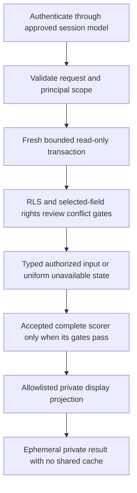

# Private application architecture — decision preparation

## Scope and actual implemented baseline

This is **PROPOSED planning only** at main `58ceafe72129b70f0333c7c4f2c6f38dba855272`. No server,
endpoint, account, credential, framework, UI dependency, image gallery, cloud resource or deployment
is created. Owner must choose the architecture/session boundary and merge the applicable Planning
Gate before implementation. Merging this document does not select an unanswered option.

The tracked-tree inspection found Python/PostgreSQL database/research tooling, a local reference
input adapter and generic synthetic mathematics. It found no tracked JS/TS application files or
package/requirements/pyproject/Pipfile dependency manifests in the checked inventory. This is not a
claim about every globally installed machine package. A proposed Next.js/Drizzle stack, or Node used
by local agent tooling, is not an implemented application stack.

database/matching_input.py is versioned reference behavior around a **trusted injected transport**.
The caller must not supply that callback. It executes the complete script on a genuine login,
requests READ COMMITTED READ ONLY, checks real session/current user and rejects administrator,
owner/BYPASSRLS/role-change paths before catalogue access. Existing RLS and selected-field/source
rights enforce scope. Internal typed provenance is not a browser/public serialization contract.
ranking_allowed remains false. Generic math does not provide full Mode A/B1 routes or real B2 data.

Existing catalogue counts and app-session limitations cited in main are historical evidence, not a
fresh database audit by this task. WorkstreamG's current coverage report must support a future pilot.
No existing operator scope, any of the 44 held profiles, or matching flag is changed by this plan.

## Architecture alternatives — Owner chooses none yet

| Option | Fit with actual code | Authentication and data work | Cost/operation classes | Migration and review surface |
|---|---|---|---|---|
| A: local Python service | can reuse reference types/SQL semantics after reviewing a real driver/transport; web framework is not selected or installed | genuine nonadmin binding first; future service must prove per-request principal and transaction isolation | local process, maintenance, driver/framework dependencies, tests and backup operations; no hosted fee is incurred by this proposal | explicit application projection/driver/lifecycle/error handling; no assumed schema change, but an auth amendment may require its own reviewed new migration |
| B: TypeScript service | may share future client types, but current Python adapter is a reference to port/test rather than an existing TS API | same database identity/rights constraints; no header/GUC substitute or administrator filter | Node build/toolchain, driver/framework/possible ORM, type/parity tests and operating effort; no cloud/provider chosen | exact parity for states/UUIDs/times/bounds/transactions; ORM/provider/framework choice needs Owner review and must not rewrite original migrations |
| C: continue local CLI/reference work | least new runtime surface while policy/data gates are unresolved | no new application account or service; current genuine-session synthetic verification remains narrower evidence | existing local tooling only; still needs operator maintenance and source-rights discipline | no application implementation until explicit later choice; does not meet browser UX by itself |

No vendor prices, capacity, latency, staffing estimates or service SLA were measured here. Relative
cost classes are design considerations, not quotations or a hosting recommendation. Recommendation:
approve the framework-neutral boundary and session approach first, then choose A/B/C explicitly.
Do not install an ORM/framework or choose an auth/cloud provider by default. Keep source/data/storage
contracts portable and preserve all original eight migrations.

## Genuine nonadmin session is a prerequisite

Actual principal_id uses dpt.users.auth_subject=session_user. The authenticated subject, access-scope
kind and owner are immutable. Shared memberships apply only to shared scopes. They cannot share an
existing user_private scope or convert the operator administrator into an app principal. A local
API bound to loopback still needs authorization; localhost is not proof of user identity.

Owner alternatives remain those in [[Matching_Nonadmin_Session_and_Publication_Proposal]]:

1. Separately approve a clean application-private pilot with stable genuine nonadmin subject/scope
   established at intake, followed by an explicitly approved controlled import with accurate rights,
   actor and provenance. Keep the original operator pilot unchanged.
2. Separately approve an authentication-model Planning Amendment with an audited revocable binding
   design and independent security tests. Do not change old migrations or add a broad bypass.
3. Defer application reads and remain on synthetic/reference inputs.

None is accepted here. Never rewrite auth_subject/private ownership, downgrade an administrator,
use privileged SET SESSION AUTHORIZATION, trust role/user headers or editable identity GUCs, or
fetch all rows as administrator and filter afterward. Do not grant curator/owner/writer membership
merely to make a read capability appear available. Inspect effective inherited privileges, schema
usage and function/table access during the future implementation; role names alone prove nothing.

A single shared service login is not automatically a multi-user authorization model: under current
identity rules it resolves to one database principal. Connection pooling must preserve the approved
genuine-principal boundary. A different service-to-user model needs the separate accepted amendment.
No session account, secret storage method or key lifetime is selected or provisioned in this wave.

## Proposed request and result flow

This diagram is a future contract, not an implemented route. Rights and scope apply before candidate
lookup, totals, pagination, scoring and explanations. A database eligibility boolean is not enough.
Any denied/incomplete prerequisite stops that operation; no empty vector, fabricated fit, inferred
accord strength or private source explanation substitutes for missing permission or data.

## Framework-neutral logical operations

Names below identify contracts, not live HTTP routes or selected transport/framework methods.

| Operation | Validated input | Proposed authorized response | Gate / unavailable behavior |
|---|---|---|---|
| Read profile capability | exact canonical perfume UUID; identity from trusted session, never request user ID | bounded authorized field/layer states and safe display attribution; no raw staging/source dump | session and selected-use rights first; missing and unauthorized IDs share one unavailable envelope |
| Mode A comparison | authorized reference UUID, accepted method/version and allowed filters | candidate UUID, separate fit/coverage/confidence/pair evidence, method/coverage/missing reasons | full accepted Mode A, compatible domains, selected rights and explicit eligibility; no current route |
| Mode B1 search | reviewed canonical note IDs; exact/any-layer required/optional/excluded clauses | separately explained query fit/coverage and allowed factual matches | accepted query/closure/absence policy and full B1; reject contradictions/ambiguous aliases and unknown hard-rule satisfaction |
| B2 capability | accepted method capability request only | unavailable/unsupported reason while reviewed compatible strengths or presence data are absent | no fake slider values or fallback inferred from pyramid order; real B2 remains disabled |
| Private media reference | authorized asset/variant ID bound to intended use, not arbitrary URL/path | placeholder now; later controlled private delivery only when format, rights and bindings pass | WorkstreamG plan/permissions, active source/per-asset/derivative rights and accepted delivery contract |

The internal reference DTO includes observation/capture/rights/locator hashes useful for authorized
engineering, but a private browser needs a separately allowlisted display projection. Do not expose
raw rows, private actor/source IDs, filesystem paths, source-restricted URLs or internal SQL errors.
Display only authorized facts and required attribution/license/change notices under reviewed terms;
if those obligations cannot be met, withhold the fact/asset rather than silently drop credit.

For an authorized profile, explicit states can distinguish known usable, reported-but-incomplete,
unknown, held/conflicted, rights-unavailable and eligibility-unavailable. Unauthorized IDs must not
reveal that distinction. Null/unknown is not zero, absence, an empty complete pyramid or a candidate
count of zero. No claim of scientifically measured smell similarity; Data Confidence and pairwise
evidence stay separate from Structural/Query Fit.

## Bounds, counts and pagination proposal

The existing reference adapter has tested local defensive limits: one exact UUID, 512 note links,
64 KiB selected payload, 8 KiB variable provenance and 2 MiB transport response; SQL statement/lock timeouts
are 3s/1s. These are not acceptance of future search limits or service performance. The current
transport must remain trusted and bounded; public clients never submit SQL or execute callbacks.

Existing matching architecture proposes an 8 KiB request, 30 positive/excluded note clauses, 20 accord IDs,
page size at most 50, 10k candidate ceiling and 5s query target. **All are unaccepted search targets,
not measured capacity or installed defaults.** Owner may choose smaller measured limits. An API
implementation needs explicit request/response/candidate/time budgets, denial behavior and tests.
Reject/refine an over-budget query without disclosing inaccessible totals; never silently truncate
the candidate pool and claim the global best result. The 8 KiB request and 8 KiB provenance are different
limits on different objects.

Recommended initial response omits total_count. Return a bounded page and, if approved, has_more
based only on authorized lookahead. Do not count held/private/source-restricted rows then filter.
Pagination uses accepted unrounded score/method/group policy and canonical UUID tie breaking.
Opaque integrity-protected cursors must bind principal/scope, normalized query, method/policy,
dataset and membership/rights/review versions. A future cursor-signing key is a credential decision,
not created here. An invalid or stale cursor returns a redacted refresh/unavailable result; it must
not reveal which private row, source or member disappeared.

Fresh read-only transactions re-evaluate each request/statement snapshot. No absolute claim that
a revocation committed after a statement snapshot can be retroactively removed from an in-flight
response is made. Later requests/pages must reauthorize; no old repeatable-read snapshot or cross-user
pooled connection may preserve access. Bound cancellation/rollback, timeouts, connection cleanup and
principal isolation are future transport acceptance, not solved merely by binding a local port.

The eventual browser contract must validate its allowed host/origin and selected authentication
model; loopback must not become a wildcard CORS or cross-origin credential bypass. Review relevant
CSRF and local-origin/DNS-rebinding controls before a browser is connected. Render untrusted names,
notes, attribution and source metadata as escaped data, not executable HTML/SQL. Client input is an
authorized canonical ID, not an arbitrary source URL or filesystem path to fetch. No browser policy,
certificate, token or security header is selected or deployed by this text.

## No-cache starting policy and revocation

Recommendation: no shared cache, query history or durable result persistence initially. Ephemeral
request processing is not permission to create reusable cross-user results. A later approved cache
must independently satisfy cache/retention rights and include caller/scope, rights/membership/review,
source/dataset/selection and method/query versions in its isolation/invalidation contract.

Revalidate access before every hit/page/media delivery. Revocation/expiry/member removal/selection
conflict/eligibility change must make the next operation unavailable without leaking removed counts
or facts. Derivative media replacement/deletion/quarantine/retention follows the separately approved
source/per-asset/legal contract; this plan does not invent a retention grant. Public catalogue entity
visibility never publishes a private source, collection, shopping list, seller link or image asset.

Operation-time checks use current reviewed local assessments and version state. They do not authorize
external scraping/polling or prove that every remote publisher change is already known. A permitted
source-update/revocation intake mechanism needs Workstream G's source-specific plan, permissions and
tests. No scheduler, polling job or rights renewal is implemented or implicitly licensed here.

## Small proposed private UX journey

1. Enter the future local-private app through the approved genuine-session model. If that binding
   or catalogue capability is unavailable, show a neutral unavailable explanation and no real list.
2. Select an authorized perfume for Mode A, or reviewed note IDs and explicit layers for B1. Show
   required/excluded/optional distinctions and reject contradictions before any candidate evaluation.
3. Present only gated results: method/version, fit separate from confidence/evidence, covered/missing
   domains and honest partial/unknown messages. No actual result exists until full scorer/data gates.
4. Keep B2 unavailable when accord input is absent. Use neutral placeholders for unsupported/unlicensed
   media; a filename extension or Commons page does not prove usable image bytes or permissions.
5. A future private saved-source list may retain an approved seller bookmark under the user's scope.
   It is not checkout, payment, order placement or automatic Shopee-cart synchronization.

My Cart, saved buying sources, price observations, Purchased/Owned states and collection CRUD are
future scoped tasks. Status is manually recorded unless a separate approved integration exists.
The initial read-only matching API has no write/cart/order endpoint. Separate write authorization,
source/price provenance and privacy tests are required before implementing those tasks. This wave
creates no browser view, account, gallery, frontend component or UI package.

## Proposed implementation sequence and acceptance

| Step | Required approval / evidence | What remains forbidden before it |
|---|---|---|
| E0: choose boundary | explicit Owner stack/session/private-public answer; approved architecture Planning Gate | no chosen runtime/framework/auth provider or live API/UI |
| E1: identity and transport | approved genuine-principal approach; isolated synthetic session/connection/transaction tests; no operator-scope rewrite | no real catalogue application read or administrator fallback |
| E2: input/display projection | reviewed parity with reference states, selected claims, rights, bounds and redacted errors | no raw/internal DTO exposure or inaccessible candidate counts |
| E3: matching operations | full independently reviewed A/B1 methods and accepted DM/domain/eligibility rules; controlled permissioned data pilot | no real-data matching from generic primitives or an eligibility boolean alone |
| E4: private read-only UI | accepted API plus tested authorization/unknown messages and approved media-placeholder behavior | no public UI, arbitrary media URL or unlicensed gallery |
| E5: collection/cart planning | separately accepted manual bookmark/collection/write scope and provenance/access tests | no checkout/Shopee sync/order API or unapproved writes |
| Separate publication gate | explicit Owner security/source/asset/publication/cache/deployment decision | no public endpoint/cache/cloud/Production by this plan |

These steps elaborate the future IMP-MATCH-05/06/07 dependencies, not a new approval or completed
task claim. Original migrations/receipts and all source/hold/eligibility state remain unchanged.

| Future case | Required acceptance assertion | Status in this planning task |
|---|---|---|
| EA01 | genuine owner/other-user/shared/revoked-member/admin/BYPASSRLS/role-change cases enforce scope before facts/counts | SPECIFIED, NOT RUN |
| EA02 | immutable subject/private owner cannot be rewritten, shared-login/GUC/header claims cannot impersonate users | SPECIFIED, NOT RUN |
| EA03 | private overlay/public entity and ordinary-runtime unavailable provenance do not trigger broad grants or leakage | SPECIFIED, NOT RUN |
| EA04 | expired/revoked permissions and relevant conflicts deny selected facts, explanations and media | SPECIFIED, NOT RUN |
| EA05 | reused snapshots, pooled principal reuse, cancellation and connection cleanup cannot retain stale/cross-user access | SPECIFIED, NOT RUN |
| EA06 | malformed UUID/time/DTO/enum and request/response/domain/candidate limits fail with redacted bounded errors | SPECIFIED, NOT RUN |
| EA07 | unknown closure/absence, ambiguous aliases, contradictory clauses and missing accord values cannot pass strict/scoring gates | SPECIFIED, NOT RUN |
| EA08 | missing/unauthorized IDs and invalid/stale cursors reveal no inaccessible source/row/count details | SPECIFIED, NOT RUN |
| EA09 | deterministic accepted method/group/UUID order and authorized lookahead do not hide candidate truncation | SPECIFIED, NOT RUN |
| EA10 | membership/source/selection/rights changes reauthorize next page/cache/media operation with no cross-user cache | SPECIFIED, NOT RUN |
| EA11 | private source/collection/listing/price/actor data is absent from public DTOs, logs and unauthorized UI | SPECIFIED, NOT RUN |
| EA12 | unsupported/unlicensed image uses placeholders; mandatory attribution and derivative/revocation controls gate later delivery | SPECIFIED, NOT RUN |
| EA13 | host/origin/auth/CSRF and escaped-display controls prevent a local private browser boundary becoming cross-origin or injection access | SPECIFIED, NOT RUN |

Existing adapter/primitive tests remain narrower historical source evidence; none passes the above
unimplemented API/UI acceptance by inference. Performance/relevance/SLA and full application security
need tests against the eventually accepted implementation, not a documentation promise.

## Decision and source handoff

Use [[Matching_Owner_Decision_Register]], [[Matching_Nonadmin_Session_and_Publication_Proposal]],
[[Matching_Data_Readiness_and_Closure_Gates]], [[Dual_Mode_Matching_Data_Contract]] and
[[Post_PR4_Application_Readiness]] as source context. Wave1C's separate answer packet, D's readiness
matrices and G's source/media plan must be cross-reviewed by the coordinator before their independent
PRs are treated as compatible; this branch does not add unresolved cross-branch links or approve them.

Owner questions: choose A/B/C stack direction, choose a permitted nonadmin binding route, accept or
modify the local-private/no-cache boundary and search budgets, and identify evidence required for
the next task. Unanswered choices stay PROPOSED. Coordinator records actual replies and applicable
Gate P; no automatic approval by silence or merge. No new service, credential, role, dataset intake,
public permission, source acquisition or Production change is authorized by this planning artifact.
