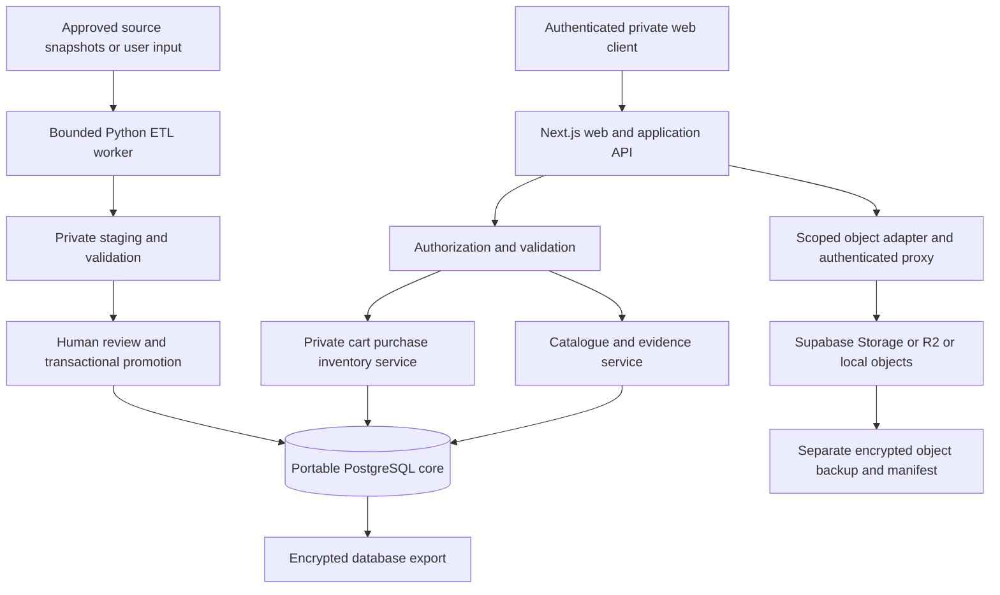

# Proposed System Architecture — P1 Foundation

All technology/provider choices below remain PROPOSED. No application, database, ETL worker, storage
bucket, migration, CI or deployment exists at the reviewed baseline or is created by this planning PR.
The owner must review and merge [[P1_Data_Foundation_Plan]] before a separate implementation task.

## Responsibilities and data boundaries

Next.js/TypeScript web/API with Drizzle remains the initial stack proposal. Vercel is a candidate web
host; long ETL work belongs in a separate bounded Python worker, initially manual/local. No LLM call
is required for the pilot. Any later AI proposal goes to human review, not directly into canonical facts.

PostgreSQL stores normalized catalogue relationships, versioned source/rights/field observations,
conflicts and private purchase/inventory records. JSONB holds qualified source-specific claims/staging,
not an unstructured substitute for core relational integrity. Slugs/external IDs are crosswalks;
UUIDs and SQL constraints do not replace access control. Details: [[ERD_Draft]], [[Data_Dictionary_Draft]].

Images live in object storage; PostgreSQL stores original/source-page URLs, rights, creator/attribution,
MIME/dimensions/hash, derivative lineage and portable provider/bucket/key locators. A URL is not a reuse
grant. Store no expiring signed URL as identity. Images require a separate object backup.

Private server authorization and database RLS/private schemas protect carts, saved sellers, source
locators, purchases, inventory and private assets. The application does not sync Shopee carts, place
orders or process checkout. Manual purchase history survives cart and bottle lifecycle changes.
No private sample/export belongs in this public GitHub repository.

## Hosting and migration alternatives

[[P1_Storage_Hosting_and_Recovery]] compares Vercel, Supabase PostgreSQL/Storage, R2, Python worker and
Docker server with dated quotas, explicit capacity assumptions and separate backup contracts. Select
providers only after local correctness, measured capacity and restore evidence, plus owner approval.
Region, budget, auth provider, worker host and recovery targets remain open.

Core domain tables do not require a Supabase auth/storage schema. Auth subject and object access are
adapters. Export SQL schema/data/migrations plus object manifests/bytes; reconstruct roles, RLS and auth
mapping for a fresh PostgreSQL/Docker target. Full self-hosted Supabase is an additional operational
choice, not a requirement for restoring the domain database.

Migrations are reviewed, versioned SQL in a future implementation PR, first tested against disposable
PostgreSQL. No direct schema push command is prescribed. Use expand/backfill/validate/contract and
record rollback/restore evidence. PostgreSQL major, ORM version, container digest, extensions and pooler
compatibility are to be pinned in that implementation task, not guessed here.

## Research-driven changes and gate

Country and concentration may be unknown; concentration/edition belongs to the scent profile while
volume belongs to packaging. Flat notes require general layer. Source families, weighted accords,
ratings and pairwise matching evidence stay distinct. Competing claims retain evidence rather than
being silently replaced. Four priority Thai brands still lack new permissioned product samples.

See [[Tech_Stack_and_ADRs]], [[P1_Pilot_Implementation_Plan]], [[Security_and_Privacy]],
[[DPT-PLAN-001_P1_Data_Foundation]]. No runtime validation/deployment is claimed by this architecture.

## Post-review boundaries — PROPOSED

47-table proposal adds access_scopes/scope_members and asset_permissions. Non-null scope follows all
provenance/media/private records through composite FKs; public-or-same-scope catalogue references do
not propagate access. Public canonical materialization consumes public claims only; private/shared
selections stay overlays and their derived search/evidence/matching/cache/export outputs stay scoped.
Private/shared image requests pass through an authenticated proxy that checks access and rights;
upstream signed URLs remain internal. No public bucket or public profile link grants private asset access.
Exact asset/source/capture/assessment permissions and derivative parent rights are verified separately.

RLS plus least-privilege runtime roles and server authorization are future implementation requirements,
including raw staging restrictions, membership revocation, generic inaccessible-ID errors and scoped
exports. Source/image licensing and access ownership are independent. See [[Security_and_Privacy]].
Repository is public; workflow exists; neither fact makes private app data public. Documentation CI is
a separate proposed backlog task, not an installed GitHub Action. No provisioning/implementation here.

## Post-PR28 architecture refinement checkpoint — 2026-11-16

Verified main `168715bc9bc5fff968524074257dc106a8a63638` contains Owner-merged PR26, PR27 and PR28. PR28 merged from head `6521c5201f4f4d0e85c4fd8542db222284e96e9e` at UTC `2026-11-15T17:39:38Z`. Its general direction is confirmed; exact POST27 A–I choices are not accepted. POST27-ODP-1 and SHA `0ccf48fa57401635a3f1b5898f4547978ebdc408e522cd3cc52138f3f341b18c` remain unchanged. IMP-ENR-01 is not started.

[[DPT-PLAN-010_System_Architecture_Refinement]] owns one docs-only amendment branch `plan/post-pr28-architecture` and a future Draft Planning PR. [[System_Architecture_Refinement]] joins eight C4-style/sequence diagrams, 30 components and an explicit source dependency DAG, 17 proposed routes retaining the full product roadmap, 28 proposed operation interfaces, strict DTO/state/rights contracts and [[UI_Element_Function_Matrix]]. All UI handlers/application services are PROPOSED, not source APIs. No framework/driver/ORM/auth provider/port/image, numeric transport policy or new rights are selected.

[[Architecture_Alternatives_and_ADR]] recommends retaining CLI now and a Python-first boundary with logically separate UI after exact decisions; [[Architecture_Owner_Review_Packet]] version POST28-ARCH-ODP-1 proposes choices and A–I impacts without answering them. [[Dependency_Based_Implementation_Roadmap]] separates preview, selected fields/eligibility, genuine principal, read service, shell/pages, media, real methods, private records, dashboard and operations. Factual catalogue access does not require real matching eligibility, but it still needs an authorized accessible scope and field rights.

Current code remains approved Python/operator/SQL tooling plus fixed-fixture synthetic M1/B1. Real records must never be relabelled as synthetic. Genuine nonadmin initial LOGIN, object/field/use rights and current snapshots precede restricted lookup/count/page/scoring/bytes; no admin fetch/filter or browser identity claim. Fit, confidence and direct evidence remain separate. Unknown is not zero; incomplete is not absent. No new live DB/source/media/runtime proof is inferred from historical tests or diagrams.

All 24 prior receipts, eight migrations, accepted contracts, 43 proposals, 44 holds and Khamrah evidence are protected. PR8 remains OPEN/DRAFT/BLOCKED at `84dccb117971ab65e0bf39fa3d1d84a12d344f8d`; no temporal/replay experiment or speculative fix. No acquisition, image bytes, normalization, hold/eligibility change, API/UI/auth/cache/service-worker/framework implementation, installation/configuration, database operation, cloud, Production mutation or agent merge. [[DPT-PLAN-010_Architecture_Verification]] records actual research/static/independent evidence and future NOT RUN tests separately.

Architecture reconciliation: [[System_Architecture_Refinement]] and its eight diagrams are the new proposed amendment, not proof of runtime deployment. Earlier offline-first PWA/framework/AI suggestions remain historical/deferred intent. Conservative operation-specific privacy cache, genuine initial principal and separate real/synthetic boundaries require explicit Owner decisions; no package/provider, auth bridge, service worker or private cache is installed or implemented.
