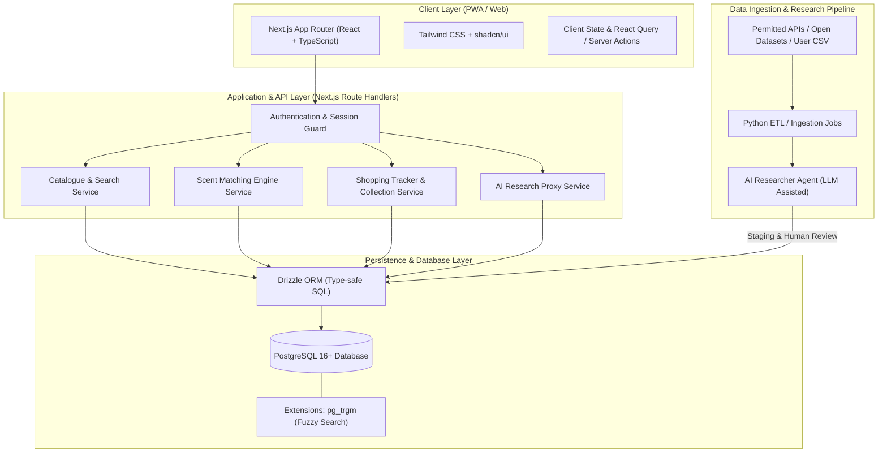

# Proposed System Architecture — DoomParfum By TK

> **Document Type:** Technical & System Architecture Blueprint
> **Source Baseline:** `../README.md` (Section 7)
> **Status:** Draft / Proposed Architecture `[PROPOSED]`

---

## 1. Purpose / Scope

เอกสารนี้ระบุสถาปัตยกรรมระบบทางวิศวกรรมที่นำเสนอ (Proposed Technical Architecture) สำหรับระบบ DoomParfum By TK รวมถึงโครงสร้างส่วนหน้า (Frontend/PWA), ส่วนหลังบ้าน (API & Backend), ฐานข้อมูล (PostgreSQL & Drizzle ORM), และไปป์ไลน์ข้อมูล (ETL & Research Assistant)

> [!NOTE]
> เทคโนโลยีทั้งหมดในเอกสารนี้อยู่ในสถานะ **`[PROPOSED]`** ตาม [[Decision_Log#DEC-008|DEC-008]] ยังไม่ถือเป็นการล็อกสแต็กถาวรจนกว่าจะได้รับความเห็นชอบจากผู้ใช้

---

## 2. High-Level System Architecture Diagram

---

## 3. Technology Stack Components `[PROPOSED]`

### 3.1 Frontend & User Experience
- **Framework:** Next.js (App Router, Server Components & Server Actions)
- **Language:** TypeScript (Strict Mode)
- **UI & Design System:** Tailwind CSS, Radix UI Primitives, shadcn/ui
- **Icons & Visuals:** Lucide Icons, Custom Olfactory SVGs
- **PWA Capabilities:** Service Worker สำหรับ Caching สภาพแวดล้อม และรองรับการเปิดใช้งานบนมือถือเสมือน Native App

### 3.2 Backend & Business Logic
- **Architecture:** Monolithic Next.js Route Handlers (สำหรับ MVP เพื่อความเรียบง่ายและลดความซับซ้อนในการดูแล)
- **Validation:** Zod สำหรับ Schema Validation ทั้งฝั่ง Client และ Server
- **Search Engine:** PostgreSQL Full-Text Search ร่วมกับ Trigram (`pg_trgm`) สำหรับ Fuzzy matching ชื่อรุ่นและแบรนด์ ก่อนพิจารณา Vector Database ในระยะยาว

### 3.3 Database & Object-Relational Mapping (ORM)
- **Database:** PostgreSQL 16+ (ACID compliant, relational integrity, JSONB support)
- **ORM:** Drizzle ORM (Lightweight, zero-overhead, type-safe schema declaration)
- **Migration Tool:** Drizzle Kit (`drizzle-kit generate:pg` / `push`)

### 3.4 Data Pipeline & Research Assistant
- **ETL Environment:** Python 3.11+ (Pandas, Pydantic, Scrapy/Playwright เฉพาะแหล่งที่อนุญาต)
- **AI Research Assistant:** LLM API Client (Google Gemini / OpenAI) มีหน้าที่ช่วยดึงโครงสร้างโน้ตจากข้อความรีวิว และเสนอข้อมูลให้ผู้ใช้ตรวจอนุมัติ

---

## 4. Deployment & Infrastructure Strategy

- **Local Development:** Docker Compose รวม Next.js และ PostgreSQL
- **Private-First Deployment:** โฮสต์บน Private Server / VPS หรือ Cloud PaaS (เช่น Railway / Fly.io) โดยไม่เปิด Public ให้บอทภายนอกเข้าถึง
- **Environment & Secrets:** จัดการผ่าน `.env.local` และ Secret Manager ไม่ Commit ข้อมูลลับขึ้น Git โดยเด็ดขาด

---

## 5. Requirements Covered

- [[Requirements_Register#R01|R01]] — Global Search Architecture
- [[Requirements_Register#R12|R12]] — AI Research Assistant
- [[Requirements_Register#R16|R16]] — Matching Engine Service
- [[Requirements_Register#R23|R23]] — Collection & Cart Backend

---

## 6. Dependencies & Links

- บันทึกการตัดสินใจสแต็ก: [[Tech_Stack_and_ADRs]]
- นโยบายความปลอดภัย: [[Security_and_Privacy]]
- สถานะเวิร์กโฟลว์ GitHub: [[GitHub_and_Workflow_PENDING]]

---

## 7. Change Notes

- `2026-11-10`: ร่างสถาปัตยกรรมระบบทางวิศวกรรม Proposed Stack ตามข้อกำหนดใน README
