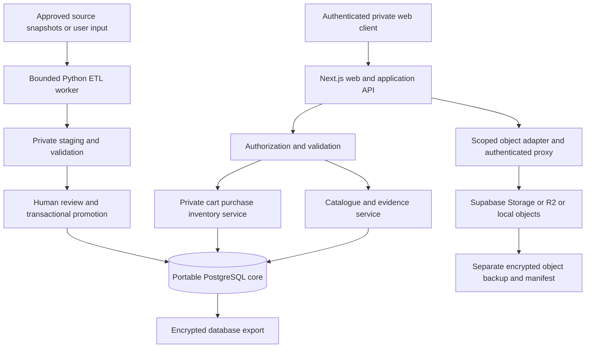

# Proposed System Architecture — P1 Foundation

All technology/provider choices below remain PROPOSED. No application, database, ETL worker, storage
bucket, migration, CI or deployment exists at the reviewed baseline or is created by this planning PR.
The owner must review and merge [[P1_Data_Foundation_Plan]] before a separate implementation task.

## Responsibilities and data boundaries

Next.js/TypeScript web/API with Drizzle remains the initial stack proposal. Vercel is a candidate web
host; long ETL work belongs in a separate bounded Python worker, initially manual/local. No LLM call
is required for the pilot. Any later AI proposal goes to human review, not directly into canonical facts.

PostgreSQL stores normalized catalogue relationships, versioned source/rights/field observations,
conflicts and private purchase/inventory records. JSONB holds qualified source-specific claims/staging,
not an unstructured substitute for core relational integrity. Slugs/external IDs are crosswalks;
UUIDs and SQL constraints do not replace access control. Details: [[ERD_Draft]], [[Data_Dictionary_Draft]].

Images live in object storage; PostgreSQL stores original/source-page URLs, rights, creator/attribution,
MIME/dimensions/hash, derivative lineage and portable provider/bucket/key locators. A URL is not a reuse
grant. Store no expiring signed URL as identity. Images require a separate object backup.

Private server authorization and database RLS/private schemas protect carts, saved sellers, source
locators, purchases, inventory and private assets. The application does not sync Shopee carts, place
orders or process checkout. Manual purchase history survives cart and bottle lifecycle changes.
No private sample/export belongs in this public GitHub repository.

## Hosting and migration alternatives

[[P1_Storage_Hosting_and_Recovery]] compares Vercel, Supabase PostgreSQL/Storage, R2, Python worker and
Docker server with dated quotas, explicit capacity assumptions and separate backup contracts. Select
providers only after local correctness, measured capacity and restore evidence, plus owner approval.
Region, budget, auth provider, worker host and recovery targets remain open.

Core domain tables do not require a Supabase auth/storage schema. Auth subject and object access are
adapters. Export SQL schema/data/migrations plus object manifests/bytes; reconstruct roles, RLS and auth
mapping for a fresh PostgreSQL/Docker target. Full self-hosted Supabase is an additional operational
choice, not a requirement for restoring the domain database.

Migrations are reviewed, versioned SQL in a future implementation PR, first tested against disposable
PostgreSQL. No direct schema push command is prescribed. Use expand/backfill/validate/contract and
record rollback/restore evidence. PostgreSQL major, ORM version, container digest, extensions and pooler
compatibility are to be pinned in that implementation task, not guessed here.

## Research-driven changes and gate

Country and concentration may be unknown; concentration/edition belongs to the scent profile while
volume belongs to packaging. Flat notes require general layer. Source families, weighted accords,
ratings and pairwise matching evidence stay distinct. Competing claims retain evidence rather than
being silently replaced. Four priority Thai brands still lack new permissioned product samples.

See [[Tech_Stack_and_ADRs]], [[P1_Pilot_Implementation_Plan]], [[Security_and_Privacy]],
[[DPT-PLAN-001_P1_Data_Foundation]]. No runtime validation/deployment is claimed by this architecture.

## Post-review boundaries — PROPOSED

47-table proposal adds access_scopes/scope_members and asset_permissions. Non-null scope follows all
provenance/media/private records through composite FKs; public-or-same-scope catalogue references do
not propagate access. Public canonical materialization consumes public claims only; private/shared
selections stay overlays and their derived search/evidence/matching/cache/export outputs stay scoped.
Private/shared image requests pass through an authenticated proxy that checks access and rights;
upstream signed URLs remain internal. No public bucket or public profile link grants private asset access.
Exact asset/source/capture/assessment permissions and derivative parent rights are verified separately.

RLS plus least-privilege runtime roles and server authorization are future implementation requirements,
including raw staging restrictions, membership revocation, generic inaccessible-ID errors and scoped
exports. Source/image licensing and access ownership are independent. See [[Security_and_Privacy]].
Repository is public; workflow exists; neither fact makes private app data public. Documentation CI is
a separate proposed backlog task, not an installed GitHub Action. No provisioning/implementation here.
