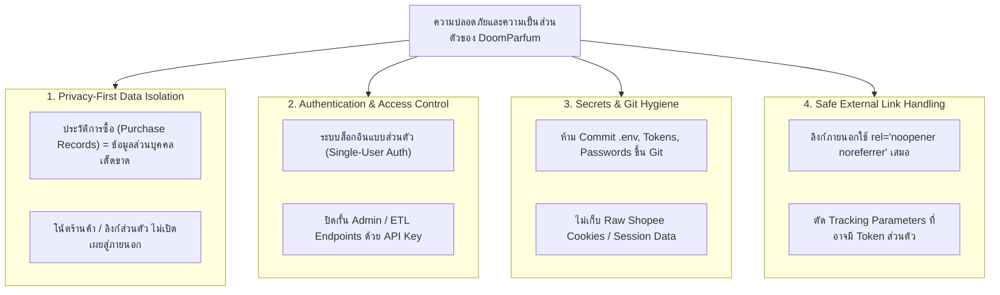

# Security and Privacy — DoomParfum By TK

> **Document Type:** Security Architecture & Privacy Safeguards
> **Source Baseline:** `../README.md` (Sections 1.2, 7 & 9)
> **Status:** Draft / Strict Security Baseline

---

## 1. Purpose / Scope

เอกสารนี้กำหนดนโยบายความปลอดภัยของระบบ (System Security) และการคุ้มครองข้อมูลส่วนบุคคล (Privacy Safeguards) โดยเฉพาะประวัติการสั่งซื้อ ราคาจ่ายจริง โน้ตส่วนตัว และการจัดการความลับ (Secrets) ของระบบ

---

## 2. Core Security Pillars

---

## 3. Detailed Security Policies

### 3.1 Authentication & Authorization (การยืนยันตัวตน)
- แม้ระบบเริ่มต้นจะถูกออกแบบสำหรับคุณ TK เพียงคนเดียว แต่แอปพลิเคชันต้องมีระบบ Authentication (เช่น NextAuth / Iron-Session) เพื่อป้องกันไม่ให้บุคคลภายนอกเข้าถึงข้อมูลคอลเลกชันและประวัติการซื้อ
- เส้นทาง API สำหรับ Ingestion และ Admin (`/api/admin/*`, `/api/etl/*`) ต้องมีการตรวจสอบ Bearer Token ลับ

### 3.2 Secrets Management & Git Repository Hygiene
- **ไฟล์ `.env`:** ต้องอยู่ใน `.gitignore` ตลอดเวลา และใช้ `.env.example` เป็นตัวอย่างโครงร่างเท่านั้น
- **ห้ามบันทึกคุกกี้/เซสชัน Shopee:** ระบบบันทึกเฉพาะ URL สาธารณะของสินค้า ไม่ดึงหรือบันทึก Raw Cookies หรือ Session Token จากเบราว์เซอร์ของผู้ใช้
- **Private Repository Strategy:** หากนำขึ้น GitHub โครงการควรตั้งเป็น **Private Repository** ก่อนจนกว่าจะตรวจสอบว่าไม่มีข้อมูลส่วนบุคคลรั่วไหล

### 3.3 Protection of Personally Identifiable Shopping Data
- ประวัติการซื้อจริง (`purchase_records`) ประกอบด้วย:
  - ราคาที่จ่ายจริง (Paid Price)
  - วันที่สั่งซื้อและร้านค้าที่ซื้อ
- ข้อมูลเหล่านี้ถือเป็นข้อมูลส่วนบุคคลชั้นความลับสูง ระบบต้องไม่นำข้อมูลเหล่านี้ไปแสดงผลในหน้า Public หรือส่งต่อไปยัง AI Provider ภายนอกโดยไม่จำเป็น

### 3.4 Safe External Links & Referrer Policy
- เมื่อผู้ใช้คลิกลิงก์ Shopee หรือร้านค้าภายนอก:
  - ต้องเปิดในแท็บใหม่ด้วย `target="_blank"` ร่วมกับ `rel="noopener noreferrer"`
  - ลิงก์ URL จะถูกทำความสะอาด (Sanitize) เพื่อตัด Affiliate Tag หรือพารามิเตอร์แปลกปลอมก่อนเปิด

### 3.5 Rate Limiting & Denial of Service Protection
- API Route มีการจำกัดอัตราคำขอ (Rate Limiting) ผ่าน Middleware ป้องกันการถูกโจมตีด้วย Brute Force หรือการเรียกซ้ำซ้อนจากสคริปต์ภายนอก

---

## 4. Requirements Covered

- [[Requirements_Register#R21|R21]] — Responsible Governance
- [[Requirements_Register#R26|R26]] — Secure Historical Data Persistence
- สอดคล้องกับ Non-goals ใน [[Vision_and_Scope]]

---

## 5. Dependencies & Links

- สถาปัตยกรรมระบบ: [[Proposed_System_Architecture]]
- นโยบาย GitHub: [[GitHub_and_Workflow_PENDING]]

---

## 6. Change Notes

- `2026-11-10`: ร่างนโยบายความปลอดภัยและการคุ้มครองข้อมูลส่วนบุคคลฉบับแรก
