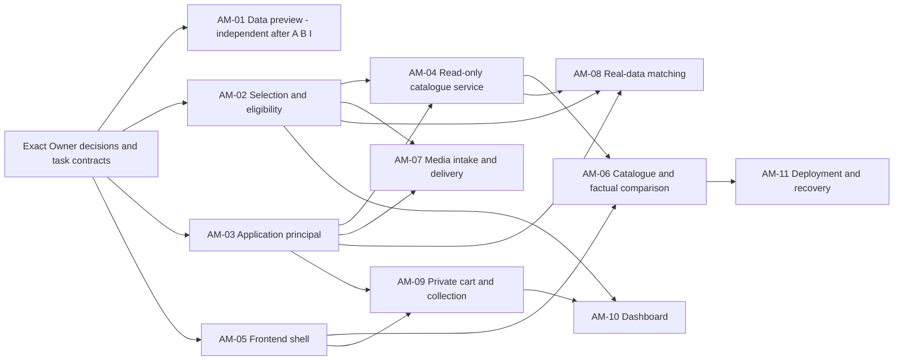

# Dependency-based implementation roadmap

All AM identifiers are **proposed architecture work units**, not allocated/approved implementation tasks. Reuse existing task scope where it exists; formal new task IDs are assigned only after the exact scope/gates are accepted. No unit starts from a Planning PR merge alone. Existing proposed IMP-ENR-01 remains the independently gated five-record preview, not current work.

See [[System_Architecture_Refinement]], [[Architecture_Alternatives_and_ADR]] and [[Architecture_Owner_Review_Packet]]. The graph below is a task prerequisite DAG, separate from the component dependency DAG and review lifecycle loops.

AM-02 is split into field-selection/rights projection and a separately gated matching-eligibility transition; the AM-04 dependency needs only the former. A factual catalogue slice does not wait for complete pyramids, matching eligibility or real methods. Under the clean new application-private pilot option, AM-03 establishes the principal/scope before any intake into that new scope; independent review of old licensed data does not reassign old operator ownership. AM-07 has separate intake/delivery sub-PRs; source/media permission and exact intake approval are extra prerequisites not satisfied by AM-02/03. AM-08 real methods need exact separate contracts, not merely AM-04. AM-11 depends on whichever actual slice is selected and separate operations approval; it does not require every roadmap feature or real matching. The graph's P6 edge represents the recommended first web slice only.

## Future units and acceptance

| Unit | Boundary / proposed code surfaces | Dependencies and exact Owner gate | Security, tests and acceptance — all future NOT RUN | Rollback / expected PR type |
|---|---|---|---|---|
| AM-01 Data Preview | Existing IMP-ENR-01 proposal: exactly five pinned local source records/46 review slots, unselected candidate bundle; new preview module/tests only after approval | Original POST27 exact A/B/I and preview note/hash plus merged planning authority; no stack/session/real-matching dependency | Exact pins/keys/ordinals/field allowlist/version, explicit unknowns/provenance/attribution, deterministic replay and bounded output; reject sixth record/unlisted field/tamper/implicit normalization/DB/network writes | Preserve immutable inputs and prior bundle; withdraw failed preview, retain failure evidence. One focused Draft Implementation PR; no code now |
| AM-02 Source Selection / Eligibility | Separate canonical field-review, closure/normalization/selection/materialization and eligibility transitions; not one all-powerful promotion command | Exact C/D/source-use/audience policy, reviewed identities/vocabulary, per-item evidence and separate mutation task; all 43 proposals/44 holds stay until explicit decisions | Cross-row/FK/scope/source/rights/conflict/closure/hold/expiry tests, positive/negative/replay/concurrency/rollback; review approval is not automatic hold release or match eligibility | Append corrective/revocation history; preserve raw claims and old selections; any schema amendment is new reviewed migration, never rewriting eight. Separate data/security Implementation PRs |
| AM-03 Application Principal | Trusted auth/session-to-genuine-LOGIN lease, exact privilege/scope model and cleanup; optionally a clean application-private pilot before approved intake | H/design choice plus exact provider/binding/roles/credential/transaction contract, permitted new-scope data use and separate implementation gate; alternative binding amendment requires its own plan | Initial admin/BYPASSRLS/SET ROLE/GUC/SET SESSION AUTH bypass, forged user, immutable owner rewrite, role/pool reuse, revoked membership, transaction/cancel/error cleanup tests; no admin fetch/filter | Disable new binding/credentials/leases, invalidate sessions; preserve old operator-private data/subjects. Focused security Implementation PR; any alternative schema change separate |
| AM-04 Read-only Catalogue Service | Future transport/controller, strict DTOs, scoped query/profile/vocabulary/capability projection; no private writes or real scorer | Actual stack/driver/transport/resource/state ADR, AM-03 and accepted usable fields/rights from AM-02; no source permission by inference | Auth before lookup/count/filter/page, object/field rights, current revisions, uniform hidden/missing response, strict malformed/bounded input, pool isolation and no-store/error tests; no arbitrary executor/db/user callback | Disable service and invalidate session/view state, no data rewrite. One bounded Draft Implementation PR |
| AM-05 Frontend Shell | Future accessible navigation, sign-in placeholder/boundary, local state/DTO client and static UI assets; no data cache/SW | Exact frontend/transport/auth presentation ADR and accepted route/state/cache choices; can use owned non-real fixtures independently of data acquisition/real matching | Keyboard/name/focus/status/error/async-generation tests, no source/domain imports or credentials/private payload in bundle, no unauthorized prefetch/cache | Disable new UI; no source/DB mutation. Separate UI Implementation PR; no framework install now |
| AM-06 Catalogue Pages / Comparison | Future catalogue/detail/pyramid/chips and two-column factual compare, permitted buying-link actions where separately available; real fit remains disabled | AM-04/05, approved field display/provenance/route/accessibility contracts; media may remain semantic placeholders | Missing/incomplete/general/held/unknown states, scoped filters/cursors, two distinct authorized columns, no false absence/0%/unlicensed imagery; direct URL and stale-response negatives | Disable affected route/view, reauthorize any subsequent access; no stale private cache fallback. Separate page/vertical-slice PRs |
| AM-07 Media Intake / Delivery | Separate original-only permitted PNG intake and private delivery adapters; immutable hash/source/license/attribution linkage | Exact E/F and per-file rights-holder/use/method/version/byte/task approval; intake may remain operator-only. Delivery additionally needs AM-03/approved service boundary; no codec/conversion expansion | Current PNG byte/chunk/CRC/dimension/stream limits, asset/source/rights/ancestor/FK/scope, same validated byte snapshot, stale rights/hash/scope, attribution and unauthorized URL/path/stream/cache tests | Quarantine/withdraw access or replace through preserved lineage; never strip/convert to pass, reactivate through restore or erase history. Distinct intake and delivery Draft PRs |
| AM-08 Real-data Matching | Separately named/versioned real-domain entrypoint plus capability/query/partition/scoring use cases; not a synthetic wrapper | Exact real method/config/query/normalization/vocabulary/domain/closure/selection/eligibility/rights contract, AM-02/03/04 and current usable evidence; each real method is its own scope | New goldens/properties and existing math regression, unknown/complete-empty/held/conflict/rights/strict negatives, exact rational sort/ties/wire precision, cross-partition rejection and revocation tests | Disable capability and invalidate result context; retain evidence and existing synthetic code. Separate method Implementation PRs; Full Mode A/B2 require additional exact plans/data, not inclusion here |
| AM-09 Private Cart / Collection | Separate own personal-state, buying-source, manual Ordered, purchase-record and physical-bottle commands; no commerce | Exact private command/field/unit/date/money/enum/idempotency/concurrency/retention policy, genuine scoped writer identity, AM-03/05 and accepted object projections | Cross-user/FK/hidden existence, stale/lost update/replay, manual status versus purchase versus bottle separation, unknown prices, URL/no-fetch/no-order behavior, retained EverPurchased after inventory lifecycle | Stop writes/withdraw affected own command with audited correction; never cascade erase purchases/source claims. Separate service/UI command PRs rather than one large feature |
| AM-10 Dashboard | Own CurrentOwned/EverPurchased and permitted brand/family/note aggregates with coverage and accessible drilldowns; R31 optional spending stays deferred | AM-09 plus allowed selected classification facts and explicit denominator/date/privacy policy; no global cross-user analytics | Authorize before counts, private aggregate/drilldown equality, unknown classification/price and partial denominators, keyboard/table alternatives; no inferred chemical preference or source completeness | Disable aggregates, retain own raw records and approved history. Separate read-only/dashboard PR |
| AM-11 Deployment / Recovery | Selected private runtime packaging, secret/persistence/backup/restore operation and availability checks; not Production authorization | Separate exact host/image/port/provider/TLS/secrets/retention/RPO/RTO/backup policy, accepted implemented slice and explicit bounded operator/deployment approval | Persistence/volume/secret/session isolation, fresh recovery/inventory/provenance/rights/revocation verification, restore must not revive withdrawn access; public/cloud/Production require their own gate | Approved rollback to prior runtime with data/rights lineage intact; no global prune/destructive reset. Operations or deployment PR/approval, independently reviewed |

## Smallest safe vertical slice and independent lanes

The smallest recommended web slice is **AM-03 + AM-04 + a minimal AM-05/06 catalogue/detail view** after their prerequisites. It reads only a separately approved app-accessible scope, returns safe field-state DTOs, uses placeholders for unapproved media and does not enable real matching or private writes. It cannot serve the old operator-private pilot through admin credentials and post-filtering.

Independent work can continue under its own exact approvals: the five-record preview does not need a UI or service stack; rights/attribution/metadata review does not need scoring; source-quality/normalization dossiers do not release holds; static UI shell work can use owned mock data only after its implementation scope is accepted. None begins in this architecture task.

Keep R12/R19 research-assistance/AI-intake intent in a separate future P5 planning lane. It requires explicit source/privacy/provider/budget decisions and must remain outside deterministic matching and ordinary privileged operator execution. No new AI interface/provider is invented as an implemented dependency. R31 spending analytics remains an explicit deferred extension.

## Approval and change rules

Every future PR must identify approved plan/contract/version/hash, actor/scope/rights, source surfaces, expected tests, rollback and limitations. A materially changed exact input/policy/rights/method contract requires a new version and Owner acceptance. A recommendation, available library, diagram, source presence, old passing test or Planning PR merge does not supply an unanswered choice, licensor grant or Production authorization.

See [[Architecture_Owner_Review_Packet]]. No implementation, acquisition, database change, framework/configuration install, private cache or PR merge occurs in this amendment.
