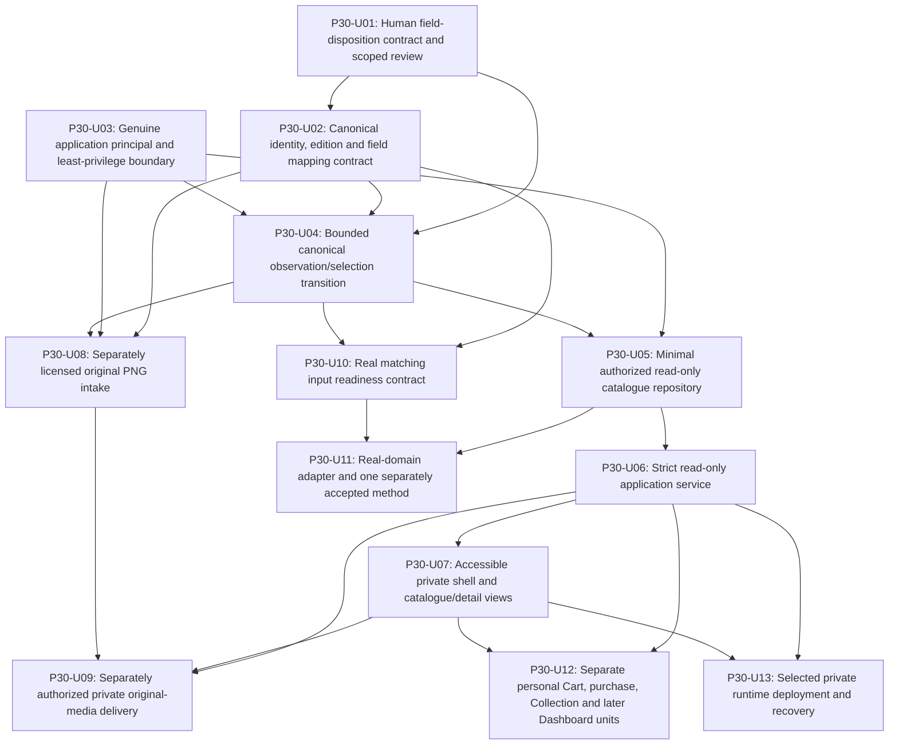

# Post-PR30 dependency and gate map

Version **post30-dependency-gates-1**. All units are PROPOSED / IMPLEMENTATION BLOCKED. `P30-Uxx` are packet-local aliases, not allocated global implementation IDs. Merged task notes, Backlog/Project_Index and GitHub PR search were checked for DPT-PLAN-011 collisions before creating this task; a dedicated Task_Register/Task_Index file was NOT FOUND. Before any future allocation, recheck the then-current registry/PRs and use an existing task where its scope is already allocated. Do not create implementation branches now.

Completed AM-01/IMP-ENR-01 is Owner-merged PR30; do not repeat its planning/runtime or reinterpret the 46 technical matches as human acceptance. This map refines AM-02..AM-11 in [[Dependency_Based_Implementation_Roadmap]] without modifying that historical note. Normative machine-readable unit/edge inventory: [[Post_PR30_Dependency_Model.json]]. Exact new decisions are in [[Post_PR30_Owner_Decision_Packet]].

## One integrated prerequisite DAG

Edges mean prerequisites, not implementation approval. Every node additionally requires its exact accepted contract, relevant source/asset rights, separate Owner task authorization, isolated branch, TDD/appropriate tests, regression, independent review, Draft PR and Human Merge. There is no generic approve-all gate.

## Exact proposed units and residual gates

| Alias / prior unit | Bounded future contract | Prerequisites / Owner rows | Rights / unresolved implementation authority | Required future tests | Recovery |
|---|---|---|---|---|---|
| P30-U01 / AM-02 — Human field-disposition contract and scoped review | Per-slot reviewer identity/evidence, accept/reject/defer/request-evidence process; retain 43 DEFER/3 UNKNOWN until actual new review. | ; DATA-01, DATA-04 | No DB operation; signed review evidence is distinct from technical parity. | All46slot/version/provenance/disposition controls; missing never zero/empty; no invented human ACCEPT. SPECIFIED / NOT RUN. | Append correction/revocation evidence; never rewrite source or old review. |
| P30-U02 / AM-02 — Canonical identity, edition and field mapping contract | Resolve exact five-record identities/editions, allowed target paths and note/alias semantics; unsupported mappings require their own versioned amendment. | P30-U01; DATA-02, DATA-03, DATA-05 | No final UUID, taxonomy, equivalence, closure or capture time inferred from source ID/ordinal. | Ambiguous edition/concentration/year, material origin, family taxonomy, General/layer, alias and unknown evidence negatives. SPECIFIED / NOT RUN. | Retain alternatives and prior decisions; do not silently merge identities. |
| P30-U03 / AM-03 — Genuine application principal and least-privilege boundary | Exact trusted auth proof/subject/initialLOGIN binding, dedicated new private scope, credential custody and minimal repository/grants contract. | ; APP-01, APP-02, APP-04, APP-07 | No existing role grants or operator-owned data are changed by this plan. Any role/schema amendment needs a new separately approved migration/task. | Forged/admin/BYPASSRLS/SETROLE/GUC/impersonation/wrongscope, direct+PUBLIC+indirectgrant, revocation/cancel/poolidentity/read-only tests. SPECIFIED / NOT RUN. | Disable new leases/credentials, invalidate sessions, preserve old immutable owners and scoped data. |
| P30-U04 / AM-02 — Bounded canonical observation/selection transition | Only separately approved reviewed claims in the explicitly authorized new application scope; per-field selected observation/materialization and current action rights. | P30-U01, P30-U02, P30-U03; DATA-01, DATA-02, DATA-03, DATA-04, DATA-05 | Needs accepted writer/curator authority and capture/reviewer evidence; no generic map, hold release, eligibility or operator-owner reassignment. | Cross-row/FK/scope/provenance/immutable observation/whole-list/conflict membership/rights-time/deferred-constraint/replay/rollback/concurrency tests. SPECIFIED / NOT RUN. | Preserve raw claims and audit; revoke/replace selections through reviewed correction; no backdated timestamps or overwritten evidence. |
| P30-U05 / AM-04 — Minimal authorized read-only catalogue repository | Catalogue/detail projection from accessible reviewed selected fields and rights; no arbitrary db/user/callback and no exposure of internal matching DTO. | P30-U03, P30-U04; DATA-03, APP-04, APP-05 | Requires a separately accepted minimal grant/repository contract; existing dpt_runtime/read_profile is not minimal application authority. | Authorize before lookup/count/filter/page; hidden/nonexistent uniformity, selected-field/rights/provenance/held-policy and minimalgrant tests. SPECIFIED / NOT RUN. | Disable repository capability; retain source/selection history and no stale privileged fallback. |
| P30-U06 / AM-04 — Strict read-only application service | Versioned request/response schemas, exact proposed resource budgets after Owner acceptance, safe errors, final recheck and bounded cancellation. | P30-U05; APP-01, APP-02, APP-04, APP-05, APP-06, APP-07 | Exact framework/provider/version/driver/session/transport contracts remain prerequisites, not chosen by research-only APP02 approval. | Malformed/coercion/unknownkey/body/cursor/nesting/response caps, identity-pool isolation, rights-change/finaldelivery, timeout/cancel and no-store tests. SPECIFIED / NOT RUN. | Disable private service; invalidate sessions/inflight responses, no browser cache revival or DB rewrite. |
| P30-U07 / AM-05/AM-06 — Accessible private shell and catalogue/detail views | Minimal signin/catalogue/detail/session-settings interactions, provenance-aware safe fields and media placeholders; future private/matching routes retained. | P30-U06; APP-01, APP-03, APP-04, APP-05, APP-06, APP-07 | Owned-mock presentation subtask can run in parallel after its separate exact UI approval; live data activation still requires U06. | Element/handler/IF/state consistency, keyboard/focus/status, staleasync/late-response/logout, no private payload/credentials in bundles or persisted cache. SPECIFIED / NOT RUN. | Disable UI/data binding, clear managed view state; no offline private-data fallback. |
| P30-U08 / AM-07 — Separately licensed original PNG intake | Exact original approved asset/version/method/use, rights-holder proof, authorized scope and subject binding; quarantine unsupported bytes. | P30-U02, P30-U03, P30-U04; MEDIA-01, MEDIA-02 | External per-asset acquisition/store/backup/retention rights AND exact operational approval remain mandatory; metadata review is independent and already allowed. | Existing original-only PNG limits, same-byte hash/source/permission lineage/scope, attribution, malformed/unsupported chunks and revocation controls. SPECIFIED / NOT RUN. | Quarantine/withdraw project use without deleting permitted provenance; no conversion/strip/resize workaround or rights invention. |
| P30-U09 / AM-07 — Separately authorized private original-media delivery | Current object/field/source/asset display rights, exact validated original snapshot, minimal attribution and private no-store delivery. | P30-U06, P30-U07, P30-U08; APP-04, APP-06, APP-07, MEDIA-02 | Private display permission and delivery contract are additional to acquisition; no public hotlink/CDN/derivative/redistribution authority. | Unauthorizedasset uniformity, expired/revoked ancestor, changedbinding, boundedstream, cancel/latepublish/cache/restore-denial tests. SPECIFIED / NOT RUN. | Stop project delivery and descendants, clear managed buffers; cannot retract already delivered lawful bytes. |
| P30-U10 / AM-08 — Real matching input readiness contract | Exact canonical vocabulary/domain/normalization, selected fields/use rights, completeness where absence is used, no unresolved held/conflicting input, explicit eligibility. | P30-U02, P30-U04; DATA-02, DATA-03, DATA-04, DATA-05 | Separate REAL-EXACT-CONTRACT and REAL-ELIGIBILITY approvals; factual catalogue display does not wait for this unit. | Unknown vs complete-empty/exclusion, repeatednotes, Khamrah alternatives, selected-field/source-rights/version/eligibility and real/synthetic partition negatives. SPECIFIED / NOT RUN. | Disable eligibility/capability through approved audited transition; preserve all original claims and fixed synthetic code. |
| P30-U11 / AM-08 — Real-domain adapter and one separately accepted method | One exact real method/config/schema/partition/explanation contract, not a wrapper that relabels real data as synthetic. | P30-U05, P30-U10; APP-04, APP-06, DATA-03, DATA-04, DATA-05 | Independent real method/formula approval needed; Full Mode A/B2 and real accord-strength scoring not unlocked here. | New real goldens/properties plus unchanged math regression, rational sort/ties, permissions/revocation and no hidden defaults/fallback. SPECIFIED / NOT RUN. | Disable method/capability and invalidate result contexts; preserve accepted M1/B1 source and evidence. |
| P30-U12 / AM-09/AM-10 — Separate personal Cart, purchase, Collection and later Dashboard units | Future individual tasks for own interest/cart, buying sources, manual Ordered stamp, purchase history, physical bottles, then private dashboard. | P30-U06, P30-U07; APP-04, APP-07 | Separate exact PRIVATE-WRITE-CONTRACTS/units/money/date/idempotency/retention decisions; no commerce or Shopee sync. | Cross-user/FK/privateexistence, replay/lostupdate, unknownprice, historyretention and authorizedaggregate/denominator tests per separate task. SPECIFIED / NOT RUN. | Stop affected writes/aggregates, preserve immutable source and purchase history; inventory lifecycle never erases EverPurchased. |
| P30-U13 / AM-11 — Selected private runtime deployment and recovery | Separate exact local/private host/provider/secrets/backup/restore scope after accepted implemented slice; no requirement to wait for real matching or media. | P30-U06, P30-U07; APP-02, APP-04, APP-07, SEQ-01 | External OPS-EXACT-CONTRACT and explicit operations authority required; Production/cloud remain separately gated. PR8 remains blocked without new causal evidence. | Fresh accepted persistence/restore/inventory/provenance/currentrights/session isolation tests; historical successful replay is not fresh proof. SPECIFIED / NOT RUN. | Follow separately approved recoverable rollback; no destructive reset, oldguard weakening or restoration of revoked access. |

## Independent lanes and the smallest useful slice

Human field disposition and identity evidence preparation can run alongside principal/stack/security contract preparation. They do not authorize a data transition. Under the recommended clean application-private pilot, actual principal/scope provisioning precedes authorized intake: do not relabel/move immutable operator-owned observations into a browser-visible scope. U04 has that dependency explicitly. Existing `dpt_runtime` broad grants/internal `read_profile` are not accepted least-privilege application credentials; U03/U05 require separately reviewed grants/repository design without rewriting migrations 001–008.

The smallest live slice is U03–U07 with only accepted selected fields and their active use rights, catalogue/detail views, honest unknown states and image placeholders. U01/U02 review contracts are its data prerequisites. Real closure/eligibility/U10–U11 and media/U08–U09 are separate branches, **not** artificial prerequisites of factual display. A synthetic owned-mock UI subtask can proceed independently after its own exact UI implementation approval; live data binding still waits for U06. No UI implementation is authorized in this planning wave.

Data path: unselected preview, explicit human field/identity review, separately authorized reviewed claims and selected canonical fields, current scope/field/use checks, read repository/service, safe private UI. Missing selected data yields an honest unavailable/incomplete projection, never raw evidence substitution. Real matching branches only after its additional completeness/normalization/vocabulary/hold/rights/eligibility and exact real-method gates. Synthetic M1/B1 remain untouched.

Media path: metadata/rights review can continue now without images. Future original PNG intake needs exact per-asset authority, approved new scope/canonical association and separate operational approval; later private delivery needs its own display rights, genuine principal and final same-byte/current-rights checks. The first web slice remains placeholders. Media privacy cannot be inherited from a public catalogue entity or storage URI.

U12 is a roadmap grouping that must be split into individual reviewable command/read tasks before implementation. Keep Cart, buying sources, manual Ordered, purchase records, Collection and Dashboard distinct; R31 spending remains deferred. U13 operations never supplies Production authority or permits a PR8 timestamp experiment. No future source download, role, schema, writer, auth, API/UI, deployment or image task is started by this DAG.

## Gate readiness

All 15 new decisions remain PROPOSED / UNANSWERED. All application/media/mutation/real-method tests are SPECIFIED / NOT RUN; current DB NOT REVALIDATED. Exact framework/provider/version/driver/auth protocol remain UNSELECTED. Licensor rights, source closure, canonical identity and per-field acceptance remain evidence gaps rather than defaults. Current planning readiness can pass static/independent review while every runtime node stays blocked.
