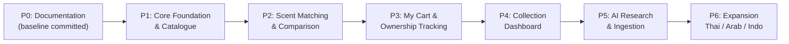

# Delivery Roadmap — DoomParfum By TK

## Current foundation checkpoint

Gate P completed by owner merge of PR #1 at `bffb2fab1918dc5221a6c5da7920168bcae263ca`. IMP-P1-01 implements
local migrations/constraints/RLS tests only, pending its separate Draft PR review/merge. P1 catalogue
and ETL are not complete. IMP-P1-02..04 remain NOT STARTED; IMP-P1-05 provisioning still needs separate
approval. Current task/evidence: [[IMP-P1-01_Local_PostgreSQL_Schema]], [[IMP-P1-01_Implementation_Evidence]].

> **Document Type:** Multi-Phase Delivery Plan & Milestones
> **Source Baseline:** `../README.md` (Section 8)
> **Status:** Draft / Active Roadmap

---

## 1. Overview & Roadmap Timeline

โครงการ DoomParfum By TK ถูกวางโครงสร้างการส่งมอบออกเป็น 7 ระยะ (Phase P0 ถึง P6) ตามแนวทาง **Documentation-First** เพื่อให้มั่นใจว่าระบบมีแบบจำลองข้อมูลและข้อกำหนดที่ชัดเจนก่อนการลงมือเขียนโค้ด

---

## 2. Phase-by-Phase Deliverables

### Phase P0: Documentation & Governance (Baseline)
- **สถานะ:** Baseline committed at `03481f7066487c44631cb9065899894ee8db71fb`; subsequent changes require Planning PR.
- **วัตถุประสงค์:** สร้างฐานข้อมูลความรู้ Obsidian Vault จัดโครงสร้างเชื่อมโยง R01–R31
- **ผลงานส่งมอบหลัก (Key Deliverables):**
  - ข้อกำหนดความต้องการ ([[Requirements_Register]])
  - ผัง Bounded Contexts และ Taxonomy ([[Domain_Model]], [[Brand_Taxonomy]], [[Perfume_and_Note_Taxonomy]])
  - ผัง ERD และพจนานุกรมข้อมูลร่าง ([[ERD_Draft]], [[Data_Dictionary_Draft]])
  - ร่างสูตรคำนวณการจับคู่กลิ่น ([[Scent_Matching_Spec]])
  - แบบจำลอง No-Checkout Cart & Ownership ([[My_Cart_and_Ownership]])
  - สเปก 6 หน้าจอหลัก ([[Site_Map_and_Screens]] ถึง [[Collection_Dashboard]])
  - บันทึกการตัดสินใจตั้งต้น DEC-001 ถึง DEC-009 ([[Decision_Log]])

---

### Phase P1: Core Foundation & Catalogue MVP
- **สถานะ:** Planning research active; implementation NOT STARTED. See [[P1_Data_Foundation_Plan]].
- **วัตถุประสงค์:** สร้างฐานข้อมูล PostgreSQL และแอปพลิเคชัน Next.js สำหรับค้นหาและดูรายละเอียดน้ำหอม
- **ผลงานส่งมอบหลัก:**
  - Database Migrations & Drizzle Schema จาก Data Dictionary
  - แคตตาล็อกน้ำหอมสากลและแบรนด์ไทยโฟกัส (La Palette, SCENTERY, BE CHERIE, SÚNDALO)
  - หน้า Search / Explore พร้อมตัวกรองราคา (<= ฿2,000), เพศ, ฤดูกาล (Screen 1)
  - หน้า Perfume Detail พร้อมการ์ดพีระมิดโน้ต Top/Heart/Base และภาพประกอบ (Screen 2)
  - ฟังก์ชันคลิกที่ Note เพื่อค้นหาความเชื่อมโยง

---

### Phase P2: Scent DNA Matching & Side-by-Side Compare
- **สถานะ:** `PLANNED`
- **วัตถุประสงค์:** พัฒนาเครื่องมือค้นหาน้ำหอมทางเลือกและการเปรียบเทียบเชิงโครงสร้าง
- **ผลงานส่งมอบหลัก:**
  - ฟังก์ชันเลือกรุ่น Designer/Niche อ้างอิงเพื่อหากลิ่นใกล้เคียงในงบประหยัด
  - Rule-Based Scent Matching Engine (Pyramid + Accords + Evidence)
  - หน้าเปรียบเทียบ Side-by-Side พร้อมไฮไลต์โน้ตที่เหมือนและต่าง (Screen 3)
  - ระบบแยกคะแนนความคล้าย (Similarity) ออกจากคะแนนความเชื่อมั่น (Confidence)

---

### Phase P3: My Cart & Personal Shopping Tracker
- **สถานะ:** `PLANNED`
- **วัตถุประสงค์:** ระบบจัดการตะกร้าในแอป บันทึกแหล่งซื้อ Shopee หลายร้าน และการเปลี่ยนสถานะด้วยมือ
- **ผลงานส่งมอบหลัก:**
  - หน้าจอ Shopping Tracker (`My Cart`) แยกแท็บ In-Cart, Ordered, History (Screen 4)
  - ระบบผูกหลายลิงก์ร้านค้า Shopee ต่อหนึ่งน้ำหอม พร้อมบันทึกราคาและหมายเหตุ
  - ปุ่มเปลี่ยนสถานะด้วยตนเอง `Mark as Ordered` และ `Mark as Received / Owned`
  - ตาราง `purchase_records` ถาวร แยกจาก `inventory_items`

---

### Phase P4: Collection Dashboard & Personal Analytics
- **สถานะ:** `PLANNED`
- **วัตถุประสงค์:** ระบบแดชบอร์ดสรุปประวัติศาสตร์การซื้อและการครอบครอง
- **ผลงานส่งมอบหลัก:**
  - หน้าคอลเลกชันส่วนตัว (`My Collection`) จัดการระดับน้ำหอมในขวด (Screen 5)
  - แดชบอร์ดสรุปยอดแยกชัดเจนระหว่าง "เคยซื้อทั้งหมด" กับ "มีอยู่ในครอบครองปัจจุบัน" (Screen 6)
  - แผนภูมิแจกแจงสัดส่วนแบรนด์ ตระกูลกลิ่น และโน้ตกลิ่นที่สะสมมากที่สุด

---

### Phase P5: AI Research Assistant & Responsible Ingestion Pipeline
- **สถานะ:** `PLANNED`
- **วัตถุประสงค์:** ผู้ช่วย AI ค้นคว้าข้อมูล และไปป์ไลน์ดึงข้อมูลจากแหล่งที่ได้รับอนุญาต
- **ผลงานส่งมอบหลัก:**
  - ไปป์ไลน์ ETL นำเข้าข้อมูล พร้อมระบบทำความสะอาดและตรวจสอบคุณภาพ
  - หน้าจอ Admin Review สำหรับผู้ใช้ตรวจอนุมัติข้อมูลก่อนเข้าฐานข้อมูลจริง
  - ผู้ช่วย AI ช่วยสรุปข้อคิดเห็นจากรีวิว พร้อมอ้างอิงแหล่งที่มา

---

### Phase P6: Expansion & Ecosystem Refinement
- **สถานะ:** `PLANNED`
- **วัตถุประสงค์:** ขยายความครอบคลุมของแบรนด์ไทย อาหรับ อินโดนีเซีย และปรับปรุงระบบ
- **ผลงานส่งมอบหลัก:**
  - ขยาย Thai Brand Registry ให้ครอบคลุมแบรนด์อิสระในไทยเพิ่มเติม
  - ปรับจูนค่าน้ำหนักการจับคู่กลิ่นตามความพึงพอใจจริงของผู้ใช้

---

## 3. Requirements Covered

- ครอบคลุมภาพรวม [[Requirements_Register#R01|R01]] ถึง [[Requirements_Register#R31|R31]]

---

## 4. Dependencies & Links

- รายการงานละเอียด: [[Backlog]]
- เกณฑ์การตรวจรับงาน: [[Acceptance_Criteria]]
- สถานะโครงการ: [[Project_Status]]

---

## 5. Change Notes

- `2026-11-10`: กำหนด Roadmap P0 ถึง P6 สอดคล้องกับข้อกำหนดใน README

## P1 gate sequence — PROPOSED, 2026-11-10

DPT-PLAN-001 discovery/schema/hosting plan → human merge and accepted decisions → IMP-P1-01 local
schema → IMP-P1-02 bounded ETL → IMP-P1-03 image metadata → IMP-P1-04 benchmark and independent
DB/object restore → IMP-P1-05 optional separately authorized host migration. Catalogue UI follows.
The initial ETL pilot is brought forward from broad P5 ingestion to test P1 feasibility; P5 AI research
and bulk integrations remain deferred. No phases are declared implemented by this plan.
R22 priority Thai coverage remains an acceptance target pending permissioned real samples.
Details and test criteria: [[P1_Pilot_Implementation_Plan]].

## Local schema review readiness — 2026-11-11

IMP-P1-01 source d25083c67ea73384ab13068bf41fb70755c0a0d0 has69 passing tests and independent review,
ready for owner review as a Draft PR. P1 catalogue/ETL and IMP-P1-02..05 remain incomplete/not started;
Human Owner merge of01 is required before02. No production/cloud/provider activation.
