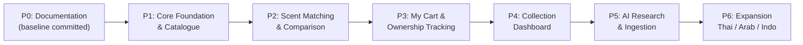

# Delivery Roadmap — DoomParfum By TK

## Post-PR13–17 verified integration — 2026-11-13

Current origin/main1f2f53f97dff39bc4f3094e4ad82653e8b03f52c includes Owner-merged13–17, including
PR15. The prior dated pending statements remain historical. Merge does not answer DM/OP or grant
new source/auth/publication rights. [[Next_Wave_Owner_Decision_Form]] is the current answer form;
actual Git/test/data/tool/merge evidence is in [[DPT-DOC-002_Post_PR13_17_Preflight]].

Next order: exact Owner decisions; review proposed method/normalization/private operation contracts;
merge any applicable Planning Amendment; only then separate synthetic ModeA/B1 implementation tasks
with TDD. Real catalogue eligibility is a later separate gate; B2strengths unavailable. Source/media
tasks additionally need exact usable licensor permissions. Auth/private pilot and API/UI remain
separate approved tasks; no framework or provider chosen. Continue safe research/evidence now.

## Post-merge Waves 0–2 — 2026-11-13

Order: review separate Owner answer packet; establish exact remaining scorer milestones; decide
closure/normalization/selected-rights/nonadmin session; review separate private architecture and
source/media Planning PRs; only then open approved bounded implementation tasks. Merged primitives
and local adapter do not complete full matching or the application. B2 real strengths remain unavailable.
PR8diagnosis has no new condition: preserve blocked status, no equivalent replay or main integration.
Current source/merge/test boundaries: [[Project_Status]] and [[Post_Merge_Owner_Review_Matrix]].

## Verified review boundary and dependency order — 2026-11-13

PR11reference adapter now independently reviewed after actual fixes,28/157tests pass; real-data
application binding/closure/selected-rights/eligibility remain separate. PR10bounded research ready;
PR9pure primitives reviewed but full ModeA scope/milestone acceptance pending. PR8historicaltimestamp
cause unresolved despite preserved successful replay/recovery evidence. No new Owner merge or scope
acceptance is inferred. Original migrations, receipts and44holds remain untouched.

Next: Human review PR11/10, explicitly decide PR9milestone and DM01–07, choose nonadmin application
binding and domain closure/absence. Then separately reviewed full synthetic A/B1scorers and controlled
permissioned app-private pilot; API follows approved authorization/stack, UI follows API, performance/
relevance follows accepted implementation/eligible fixtures. Actual B2stays disabled without accord
inputs. See [[Matching_Owner_Decision_Register]], [[Matching_Nonadmin_Session_and_Publication_Proposal]]
and [[Matching_Data_Readiness_and_Closure_Gates]]. No agent merge or Production change.

## Current dependency graph — 2026-11-13

Verified origin/main aa55f8b59acb0872b3b40273a8cdd25198f3ba27. Human Owner merged PRs1–7;
PR4 GateP is merged, but DM01–07 remain PROPOSED. Historical OPEN/DRAFT/pending statements below
are dated snapshots. No source/asset/publication right, numeric default or application stack is
accepted by inference. All8migrations and every pre-existing immutable receipt remain exact.

Stage1: local IMP-MATCH-01 implementation/testing and DPT-DATA-002offline research; PR8reconciled
but reliabilityblocked; PR9generic mathematical primitives reviewed. Stage2: final adapter review
and accepted DM/data policies precede full IMP-MATCH-02ModeA and03B1. IMP-MATCH-04realB2 needs actual
reviewed compatible accord values/presence, currently unavailable; synthetic math is not realdata.
Stage3: IMP-MATCH-05scoped API needs accepted session/architecture and scorer gates;06UI needs
explicit stack/auth and API approval;07performance/relevance needs accepted implementation and
permissioned eligible fixtures. No bypass through a database eligibility boolean or admin read.

See [[Post_PR4_Application_Readiness]] and [[IMP-MATCH-01_Read_Only_Input_Adapter]]. Human Owner
reviews Draft PRs separately. PR10offline audit ready; PR9fullfeature acceptance pending; PR8rootcause
blocked; adapter final independent review pending. No automatic merge or Production work.

## DPT-PLAN-003 independent P2 planning lane — 2026-11-11

[[P2_Dual_Mode_Scent_Matching_Plan]] proposes A perfume-to-perfume plus B1 note/B2 accord search,
independent from PR #3 acquisition. PR #2 merge verified9636ee740cdcd3d60633ac11745366814d1af05c;
pre-merge checkpoint language below is historical. Matching waits for its own Gate P and licensed
IMP-P1-02 readiness. S2: PR #3/#5 now merged at comparator55d39cd; bounded ETL is complete while
matching eligibility0/44holds/accord/completeness gates persist. The current
[[P2_Post_PR5_Matching_Reconciliation]] supersedes older pending ETL/foundation checkpoints below.
Broader sources/images/hosting remain separately gated; no matching feature starts here.

## Current foundation checkpoint

Gate P completed by owner merge of PR #1 at `bffb2fab1918dc5221a6c5da7920168bcae263ca`. IMP-P1-01 implements
local migrations/constraints/RLS tests only, pending its separate Draft PR review/merge. P1 catalogue
and ETL are not complete. IMP-P1-02..04 remain NOT STARTED; IMP-P1-05 provisioning still needs separate
approval. Current task/evidence: [[IMP-P1-01_Local_PostgreSQL_Schema]], [[IMP-P1-01_Implementation_Evidence]].

> **Document Type:** Multi-Phase Delivery Plan & Milestones
> **Source Baseline:** `../README.md` (Section 8)
> **Status:** Draft / Active Roadmap

---

## 1. Overview & Roadmap Timeline

โครงการ DoomParfum By TK ถูกวางโครงสร้างการส่งมอบออกเป็น 7 ระยะ (Phase P0 ถึง P6) ตามแนวทาง **Documentation-First** เพื่อให้มั่นใจว่าระบบมีแบบจำลองข้อมูลและข้อกำหนดที่ชัดเจนก่อนการลงมือเขียนโค้ด

---

## 2. Phase-by-Phase Deliverables

### Phase P0: Documentation & Governance (Baseline)
- **สถานะ:** Baseline committed at `03481f7066487c44631cb9065899894ee8db71fb`; subsequent changes require Planning PR.
- **วัตถุประสงค์:** สร้างฐานข้อมูลความรู้ Obsidian Vault จัดโครงสร้างเชื่อมโยง R01–R31
- **ผลงานส่งมอบหลัก (Key Deliverables):**
  - ข้อกำหนดความต้องการ ([[Requirements_Register]])
  - ผัง Bounded Contexts และ Taxonomy ([[Domain_Model]], [[Brand_Taxonomy]], [[Perfume_and_Note_Taxonomy]])
  - ผัง ERD และพจนานุกรมข้อมูลร่าง ([[ERD_Draft]], [[Data_Dictionary_Draft]])
  - ร่างสูตรคำนวณการจับคู่กลิ่น ([[Scent_Matching_Spec]])
  - แบบจำลอง No-Checkout Cart & Ownership ([[My_Cart_and_Ownership]])
  - สเปก 6 หน้าจอหลัก ([[Site_Map_and_Screens]] ถึง [[Collection_Dashboard]])
  - บันทึกการตัดสินใจตั้งต้น DEC-001 ถึง DEC-009 ([[Decision_Log]])

---

### Phase P1: Core Foundation & Catalogue MVP
- **สถานะ:** Planning research active; implementation NOT STARTED. See [[P1_Data_Foundation_Plan]].
- **วัตถุประสงค์:** สร้างฐานข้อมูล PostgreSQL และแอปพลิเคชัน Next.js สำหรับค้นหาและดูรายละเอียดน้ำหอม
- **ผลงานส่งมอบหลัก:**
  - Database Migrations & Drizzle Schema จาก Data Dictionary
  - แคตตาล็อกน้ำหอมสากลและแบรนด์ไทยโฟกัส (La Palette, SCENTERY, BE CHERIE, SÚNDALO)
  - หน้า Search / Explore พร้อมตัวกรองราคา (<= ฿2,000), เพศ, ฤดูกาล (Screen 1)
  - หน้า Perfume Detail พร้อมการ์ดพีระมิดโน้ต Top/Heart/Base และภาพประกอบ (Screen 2)
  - ฟังก์ชันคลิกที่ Note เพื่อค้นหาความเชื่อมโยง

---

### Phase P2: Scent DNA Matching & Side-by-Side Compare
- **สถานะ:** `PLANNED`
- **วัตถุประสงค์:** พัฒนาเครื่องมือค้นหาน้ำหอมทางเลือกและการเปรียบเทียบเชิงโครงสร้าง
- **ผลงานส่งมอบหลัก:**
  - ฟังก์ชันเลือกรุ่น Designer/Niche อ้างอิงเพื่อหากลิ่นใกล้เคียงในงบประหยัด
  - Rule-Based Scent Matching Engine (Pyramid + Accords + Evidence)
  - หน้าเปรียบเทียบ Side-by-Side พร้อมไฮไลต์โน้ตที่เหมือนและต่าง (Screen 3)
  - ระบบแยกคะแนนความคล้าย (Similarity) ออกจากคะแนนความเชื่อมั่น (Confidence)

---

### Phase P3: My Cart & Personal Shopping Tracker
- **สถานะ:** `PLANNED`
- **วัตถุประสงค์:** ระบบจัดการตะกร้าในแอป บันทึกแหล่งซื้อ Shopee หลายร้าน และการเปลี่ยนสถานะด้วยมือ
- **ผลงานส่งมอบหลัก:**
  - หน้าจอ Shopping Tracker (`My Cart`) แยกแท็บ In-Cart, Ordered, History (Screen 4)
  - ระบบผูกหลายลิงก์ร้านค้า Shopee ต่อหนึ่งน้ำหอม พร้อมบันทึกราคาและหมายเหตุ
  - ปุ่มเปลี่ยนสถานะด้วยตนเอง `Mark as Ordered` และ `Mark as Received / Owned`
  - ตาราง `purchase_records` ถาวร แยกจาก `inventory_items`

---

### Phase P4: Collection Dashboard & Personal Analytics
- **สถานะ:** `PLANNED`
- **วัตถุประสงค์:** ระบบแดชบอร์ดสรุปประวัติศาสตร์การซื้อและการครอบครอง
- **ผลงานส่งมอบหลัก:**
  - หน้าคอลเลกชันส่วนตัว (`My Collection`) จัดการระดับน้ำหอมในขวด (Screen 5)
  - แดชบอร์ดสรุปยอดแยกชัดเจนระหว่าง "เคยซื้อทั้งหมด" กับ "มีอยู่ในครอบครองปัจจุบัน" (Screen 6)
  - แผนภูมิแจกแจงสัดส่วนแบรนด์ ตระกูลกลิ่น และโน้ตกลิ่นที่สะสมมากที่สุด

---

### Phase P5: AI Research Assistant & Responsible Ingestion Pipeline
- **สถานะ:** `PLANNED`
- **วัตถุประสงค์:** ผู้ช่วย AI ค้นคว้าข้อมูล และไปป์ไลน์ดึงข้อมูลจากแหล่งที่ได้รับอนุญาต
- **ผลงานส่งมอบหลัก:**
  - ไปป์ไลน์ ETL นำเข้าข้อมูล พร้อมระบบทำความสะอาดและตรวจสอบคุณภาพ
  - หน้าจอ Admin Review สำหรับผู้ใช้ตรวจอนุมัติข้อมูลก่อนเข้าฐานข้อมูลจริง
  - ผู้ช่วย AI ช่วยสรุปข้อคิดเห็นจากรีวิว พร้อมอ้างอิงแหล่งที่มา

---

### Phase P6: Expansion & Ecosystem Refinement
- **สถานะ:** `PLANNED`
- **วัตถุประสงค์:** ขยายความครอบคลุมของแบรนด์ไทย อาหรับ อินโดนีเซีย และปรับปรุงระบบ
- **ผลงานส่งมอบหลัก:**
  - ขยาย Thai Brand Registry ให้ครอบคลุมแบรนด์อิสระในไทยเพิ่มเติม
  - ปรับจูนค่าน้ำหนักการจับคู่กลิ่นตามความพึงพอใจจริงของผู้ใช้

---

## 3. Requirements Covered

- ครอบคลุมภาพรวม [[Requirements_Register#R01|R01]] ถึง [[Requirements_Register#R31|R31]]

---

## 4. Dependencies & Links

- รายการงานละเอียด: [[Backlog]]
- เกณฑ์การตรวจรับงาน: [[Acceptance_Criteria]]
- สถานะโครงการ: [[Project_Status]]

---

## 5. Change Notes

- `2026-11-10`: กำหนด Roadmap P0 ถึง P6 สอดคล้องกับข้อกำหนดใน README

## P1 gate sequence — PROPOSED, 2026-11-10

DPT-PLAN-001 discovery/schema/hosting plan → human merge and accepted decisions → IMP-P1-01 local
schema → IMP-P1-02 bounded ETL → IMP-P1-03 image metadata → IMP-P1-04 benchmark and independent
DB/object restore → IMP-P1-05 optional separately authorized host migration. Catalogue UI follows.
The initial ETL pilot is brought forward from broad P5 ingestion to test P1 feasibility; P5 AI research
and bulk integrations remain deferred. No phases are declared implemented by this plan.
R22 priority Thai coverage remains an acceptance target pending permissioned real samples.
Details and test criteria: [[P1_Pilot_Implementation_Plan]].

## Historical S1 schema review readiness — 2026-11-11

IMP-P1-01 source d25083c67ea73384ab13068bf41fb70755c0a0d0 has69 passing tests and independent review,
ready for owner review as a Draft PR. P1 catalogue/ETL and IMP-P1-02..05 remain incomplete/not started;
Human Owner merge of01 is required before02. No production/cloud/provider activation.

## Current S2 performance correction

PR #2 remains OPEN/DRAFT; additive008 and79/79 tests are recorded in [[IMP-P1-01_Performance_Correction]].
Exact-source independent review passed; Owner merge still gates IMP-P1-02. The bounded synthetic
validation measurement does not complete IMP-P1-04 capacity/restore or authorize cloud resources.

## Parallel planning lane — 2026-11-11 / DPT-PLAN-002
PR #1 is now MERGED on GitHub; PR #2 database foundation is now MERGED at 2026-11-11 03:53 Bangkok (SHA 9636ee740cdcd3d60633ac11745366814d1af05c); licensed ETL and new-source adapter work remain separate. Independently begin WP-00 brand/source read-only research and WP-01/02 evidence/permission research; DPT-PLAN-002 docs-only Draft Planning PR follows. After Human Gate P and required PR #2/IMP-P1-02 Scento baseline, schedule separate rights-authorized source adapters -> popularity metric observations -> one-click admin/queue -> approved media pipeline -> measurements/recovery/host decisions. These proposals do not alter PR #2 or authorize larger imports. Details [[DPT-PLAN-002_Focused_Catalogue_Acquisition_and_Automation]].

## Proposed catalogue coverage expansion — 2026-11-11

Following the owner's product-model coverage and Dupe matching request, refine early P1/P2 dependencies: Brand Registry -> **approved-source comprehensive Product Index** -> approved Scento profile/notes pilot -> licensed image pipeline -> browse/search MVP -> pairwise reported-Dupe evidence graph -> versioned structural matching/side-by-side -> safe admin batch updates. This does not abandon current P0–P6 categories or imply Implementation complete. Source rights and Human Gate P remain mandatory. See [[DPT-PLAN-002_Catalogue_Coverage_Images_Matching_Addendum]], and NEW-07..11 awaiting owner review.

## Post-PR18–21 observed next wave — 2026-11-14

Merged plans/research18–21 are integrated at8c6a8376680c7a10cc3eb4b5cf80afe4376a9282; do not reopen
duplicate plans. Current scoped tasks: DPT-DATA-005 actual catalogue/brand/note audit,
DPT-DATA-006 actual11-operation source/media audit,DPT-QA-001 policy-free primitive invariants,
DPT-DOC-003 coordination/Owner direction/gates/handoff. Exact independent evidence precedes closeout.
Full synthetic A/B1 depends on accepted method versions; real data additionally needs rights,
selected completeness/normalization/eligibility,genuine nonadmin and relevance/security gates.
Initial local-private direction is confirmed; exact stack/auth remains unselected. PR8stays blocked.

## Post-PR22–25 continuation checkpoint — 2026-11-14

Actual main8c6a8376680c7a10cc3eb4b5cf80afe4376a9282 unchanged;22–25OPEN/DRAFT/clean,notmerged.
No formalreviews/comments/checkrollups;noCI PASS or exactOwneranswers. Fresh62offlinecandidate
methodsPASS(55baseline+7invariantsincluded),runtime mainbyte-exact;future/full/live testsNOTRUN.
CurrentDBrevalidationBLOCKED Dockerpipeabsent,no restart/query;03:04BangkokcountsHISTORICALONLY.
[[Post_PR22_25_Owner_Review_and_Unlock]] coordinates exact review/gate/sample/normalization/app
preparation onexistingPR25. AllindividualchoicesPROPOSED,strategicdirectionCONFIRMED. Preserve
receipts/migrations/44holds/matching0/PR8;no secondreceipt/newduplicatePR or implementationunlock.
