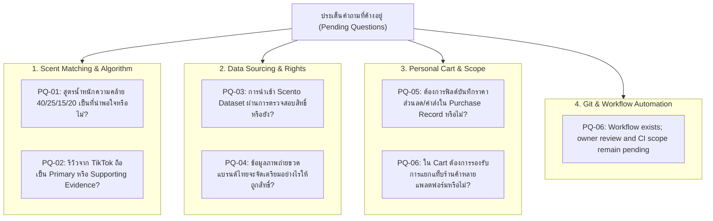

# Pending Questions & Uncertainties — DoomParfum By TK

> **Document Type:** Active Tracking of Unresolved Design & Technical Questions
> **Source Baseline:** `../README.md` (Section 11)
> **Status:** Active Tracking

---

## 1. Overview

เอกสารนี้ทำหน้าที่เป็นสมุดจดประเด็นคำถาม ความคลุมเครือ (Uncertainties) และข้อตัดสินใจที่ยังคงค้างอยู่ เพื่อให้ทีมงานและผู้ใช้สามารถติดตามและตอบข้อซักถามก่อนที่จะเริ่มการพัฒนาจริงใน Phase P1

---

## 2. Summary of Open Questions by Category

---

## 3. Detailed Tracking Table

| ID | ประเด็นคำถาม | ระดับผลกระทบ | เอกสารที่เกี่ยวข้อง | สถานะปัจจุบัน | ทางเลือกที่เสนอ |
|---|---|---|---|---|---|
| **PQ-01** | สัดส่วนการถ่วงน้ำหนัก Notes (40%), Accords (25%), Family (15%), Evidence (20%) เหมาะสมหรือไม่? | High | [[Scent_Matching_Spec]] | รอยืนยัน | ใช้เป็น Proposed baseline และทดสอบในระยะ P2 |
| **PQ-02** | สถานะทางกฎหมายและการจัดเก็บรีวิว TikTok/YouTube | Medium | [[Review_Evidence_and_Confidence]], [[Rights_and_Attribution]] | รอรีวิวสิทธิ์ | บันทึกเฉพาะลิงก์ต้นทางและข้อความสรุปสั้นๆ ห้ามเก็บไฟล์วิดีโอ |
| **PQ-03** | การใช้งาน Scento Dataset เพื่อเป็น Initial Seed ใน Phase P1 | High | [[Source_Registry]], [[Ingestion_and_ETL]] | CC BY 4.0 verified; pilot adoption pending | See OD-01 and [[Source_Registry]]; no runtime import yet |
| **PQ-04** | สิทธิ์ของรูปภาพขวดน้ำหอมและโลโก้แบรนด์ | Medium | [[Rights_and_Attribution]], [[Perfume_Detail_Pyramid]] | รอแนวทาง | ใช้ภาพถ่ายจริงของผู้ใช้เอง หรือบันทึกเฉพาะ URL อ้างอิง |
| **PQ-05** | ความละเอียดของแบบฟอร์มการซื้อจริง (R29) | Low | [[My_Cart_and_Ownership]], [[Shopping_Tracker]] | รอยืนยัน | ให้ฟิลด์ส่วนใหญ่เป็น Optional เพื่อไม่ให้ผู้ใช้เสียเวลากรอก |
| **PQ-06** | Existing public repository/workflow; governance acceptance and future CI scope | High | [[GitHub_and_Workflow_PENDING]], [[Backlog]] | OWNER REVIEW PENDING | PR #1 exists and stays Draft/Open; no missing-workflow blocker, no CI creation |

---

## 4. How to Resolve Questions

เมื่อผู้ใช้ให้คำตอบสำหรับประเด็นใด:
1. ปรับปรุงสถานะในเอกสารนี้เป็น `RESOLVED`
2. บันทึกผลการตัดสินใจลงใน [[Decision_Log]]
3. ปรับปรุงข้อกำหนดและสเปกในโฟลเดอร์ที่เกี่ยวข้อง (`01_Product`, `02_Domain`, `04_Matching`, `06_Engineering`)

Post-review note: OD-01..06 LOCAL/test/rights/CLOUD recommendations are in [[P1_Data_Foundation_Plan]]. No PROPOSED decision is accepted by this update.
