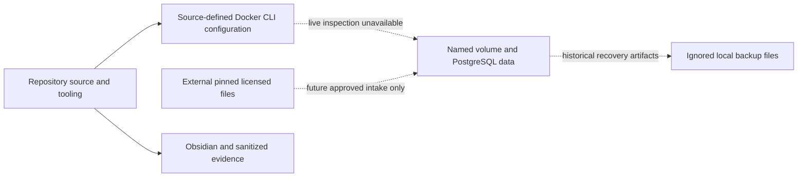

# Post-PR27 local environment and storage diagnostics

Evidence base: `8eef8f13265adc14db0cae82ff77cfc4863853ce`. These diagnostics are read-only and do not establish current catalogue, role or permission state.

## Current observations

Docker client `28.3.2` is present. The version command exits 1 because the `dockerDesktopLinuxEngine` named pipe does not exist. The selected context is `desktop-linux`, whose recorded endpoint is `npipe:////./pipe/dockerDesktopLinuxEngine`. Result: **DOCKER_NOT_AVAILABLE / DB_NOT_REVALIDATED**. No service start, restart, container recreation, volume operation or database query followed this failure.

| Item | Verified scope | Current conclusion |
|---|---|---|
| Repository source folder | Git root and isolated planning checkout | Source is separate from database persistence |
| Container `doomparfum-p1-01` | Name in unchanged `database/local.py` | Existence and running/stopped state UNKNOWN |
| Named volume `doomparfum-p1-01-data` | Source-defined mount at `/var/lib/postgresql/data`, task label `com.doomparfum.task=IMP-P1-01` | Live existence, mount identity, host storage and persistence health UNKNOWN |
| Bind mounts / Compose project | No root Compose file; current helper uses Docker CLI and a named volume | No current live bind-mount or Compose-project claim; inspect blocked by unavailable engine |
| External licensed datasets | Existing `DoomParfum Local Data/Master Handoff/.../09_LOCAL_LICENSED_SOURCE/scento_pinned` | Local CSV bytes and rights evidence are separate from Docker volume and canonical database |
| Private backups | Four existing `.local/p1-04/recovery_00[2-5]/pilot.dump` files, each 4,295,993 bytes | Metadata and SHA-256 observed; contents, completeness and recoverability NOT REVALIDATED |
| Backup policy | Existing historical recovery reports and OD-05 local-test authority | No new restore; retention/RPO/RTO/external provisioning remain deferred |
| Application asset storage | Existing architecture proposal and image-validation tooling | No application media service or new asset intake; live registered asset counts UNKNOWN |

The four backup files total **17,183,972 bytes**. Exact local paths and new hashes remain in ignored `.local/post27-planning/PRIVATE_BACKUP_INVENTORY.json`; dump bytes are excluded from Git and the handoff. Hashing a dump does not test restoring it. No credentials, private rows or Docker environment variables were printed or published.

This diagram describes separation and proposed/historical relationships, not active services. Current canonical populations, ownership bindings, rights validity and matching eligibility remain UNKNOWN. Historical T0 counts from 2026-11-14 03:04 Bangkok cannot become fresh query results through a Git merge or a successful synthetic test.

## Verification boundaries and next action

Exact structured evidence: [Post_PR27_Local_Diagnostics.json](Post_PR27_Local_Diagnostics.json). Existing eight migrations, immutable receipts and PR8 remain untouched. No temporal experiment, import/replay, backup restore, credential reset or role change ran. A later explicitly bounded operator diagnostic may inspect existing services only once the Owner makes the environment available; this plan does not authorize starting them.

See [[Post_PR27_Consolidated_Next_Wave_Plan]] and [[Post_PR27_Owner_Decision_Packet]].
